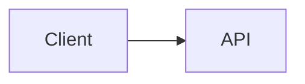

# Расширение синтаксиса Markdown — Дизайн

## Контекст

Этот документ содержит ссылки на реализацию для интегрированного PR расширения синтаксиса Markdown. Основан на исследовании оптимизации TUI из `origin/docs/tui-optimization-design`, особенно:

- `docs/design/tui-optimization/00-overview.md`
- `docs/design/tui-optimization/03-rendering-extensibility.md`
- `docs/design/tui-optimization/04-gemini-cli-research.md`
- `docs/design/tui-optimization/05-claude-code-research.md`
- `docs/design/tui-optimization/06-implementation-rollout-checklist.md`
- `docs/design/tui-optimization/08-execution-plan-and-test-matrix.md`

Исследование рекомендует долгосрочную архитектуру Markdown, построенную вокруг AST парсера, кэширования блоков/токенов, стабильного префиксного стриминга, ограниченных панелей деталей и обнаружения возможностей терминала. Эта первая реализация сохраняет небольшую footprint runtime и делает новое поведение видимым немедленно.

## Область интегрированного MR

Этот MR рассматривает расширение синтаксиса Markdown как одно согласованное улучшение рендерера, не отдельные MR функций.

Включено в первую реализацию:

- Блоки кода Mermaid визуализируются в TUI.
- Диаграммы Mermaid рендерятся через PNG изображения терминала, когда рендеринг изображений явно включён, `mmdc` доступен, и терминал поддерживает image protocol.
- Диаграммы Mermaid `flowchart` / `graph` используют fallback на текстовые превью с блоками и стрелками.
- Диаграммы Mermaid `sequenceDiagram` используют fallback на превью с участниками и стрелками.
- Базовые `classDiagram`, `stateDiagram`, `erDiagram`, `gantt`, `pie`, `journey`, `mindmap`, `gitGraph`, и `requirementDiagram` блоки используют fallback на ограниченные текстовые превью.
- Типы Mermaid без текстового превью fallback на исходный fenced код, чтобы пользователь мог всё ещё читать и копировать определение диаграммы.
- Элементы списка задач рендерятся с маркерами отмечено/не отмечено.
- Блоки цитат рендерятся с видимой полосой цитаты.
- Инлайн `$...$` математика и блочная `$$...$$` математика рендерятся с общими Unicode подстановками.
- Существующие таблицы Markdown продолжают использовать `TableRenderer`.
- Существующие не-Mermaid fenced блоки кода продолжают использовать `CodeColorizer`.
- Визуализированные визуальные блоки сохраняют источник доступным через `/copy mermaid N`, `/copy latex N`, `/copy latex inline N`, и raw mode.
- `ui.renderMode` контролирует, начинают ли сессии в rendered или raw/source режиме, в то время как `Alt/Option+M` переключает активный вид сессии.

## Стратегия рендеринга Mermaid

### Первая версия: рендеринг изображений с проверкой возможностей плюс текстовый fallback

Реализация теперь рассматривает собственный layout Mermaid как предпочтительный путь. Когда локальное окружение поддерживает, TUI рендерит блоки Mermaid через этот пайплайн:

```text
Mermaid source
  -> mmdc / Mermaid CLI
  -> PNG
  -> Kitty или iTerm2 terminal image protocol
```

Если терминал не поддерживает inline изображения, но `chafa` установлен, тот же PNG рендерится как ANSI block graphics. Если ни image protocol, ни `chafa` не доступны, рендерер fallback на синхронный текстовый превью терминала, описанный ниже.

Рендеринг изображения не выполняется, пока ответ всё ещё стримится. Во время стриминга блоки Mermaid показывают ограниченное pending превью. Как только ответ финализирован, путь изображения выполняется только когда явно включён. Это держит медленный запуск `mmdc`, особенно opt-in `npx` путь, вне стандартного интерактивного пути рендеринга.

Генерация PNG кэшируется независимо от размещения в терминале. Повторные рендеры одного и того же источника Mermaid, включая обновления изменения размера терминала, переиспользуют сгенерированный PNG и только пересчитывают размеры размещения Kitty/iTerm2.

Путь изображения намеренно opt-in и capability-gated вместо всегда bundling или вызова Puppeteer/Chromium из hot CLI пути. Пользователь может включить путь изображения с `NESSY_CLI_MERMAID_IMAGE_RENDERING=1`, затем предоставить `@mermaid-js/mermaid-cli` установкой `mmdc` в `PATH` или установкой `NESSY_CLI_MERMAID_MMD_CLI` в путь бинарника. Для ad-hoc локальной верификации, `NESSY_CLI_MERMAID_ALLOW_NPX=1` позволяет рендереру вызывать `npx -y @mermaid-js/mermaid-cli@11.12.0`; это намеренно opt-in, потому что первый запуск может установить Puppeteer/Chromium и заблокировать рендеринг. Repo-local `node_modules/.bin` рендереры не auto-discovered, если только `NESSY_CLI_MERMAID_ALLOW_LOCAL_RENDERERS=1` не установлен. Выбор терминального протокола может быть форсирован с `NESSY_CLI_MERMAID_IMAGE_PROTOCOL=kitty|iterm2|off`.

Для совместимых с Kitty терминалов таких как Ghostty, рендерер использует Kitty Unicode placeholders вместо записи payload изображения как Ink text. PNG передаётся через raw stdout в quiet mode (`q=2`) с виртуальным размещением (`U=1`), и React дерево рендерит нормальную placeholder character grid (`U+10EEEE`) с явными row и column diacritics для каждой ячейки. Это держит Ink ответственным за layout и resize, предотвращая APC payload bytes от обёртывания в видимый base64 text.

### Fallback: изменяемый wireframe превью

Fallback избегает async работы, потому что `<Static>` путь Ink append-only: финализированное сообщение не может надёжно ждать background render job и затем обновиться на месте без форсирования полного static refresh. Fallback должен поэтому производить терминальный вывод во время нормального React render pass.

Для диаграмм `flowchart` / `graph`, fallback строит lightweight graph model вместо печати одного ребра за раз:

- Узлы нормализуются по Mermaid id, label, и базовой форме.
- Node labels поддерживают Mermaid-style `\n` / `<br/>` line breaks.
- Top-down диаграммы ранжируются в горизонтальные слои.
- Left-to-right диаграммы ранжируются в вертикальные колонки, когда помещаются.
- Множественные исходящие рёбра из одного узла рисуются как одна fork с bracketed edge labels такими как `[Yes]`, `[No]`, `[Да]`, и `[Нет]`.
- Back edges и cycles суммируются в секции `Cycles:` с явными `↩ to <node>` маркерами. Это избегает нестабильных длинных cross-diagram routes в терминальных шрифтах, сохраняя семантику loop видимой.
- Graph пересчитывается из `contentWidth`, поэтому изменения resize меняют ширину узла, spacing, и пути коннекторов.
- Большие превью ограничиваются перед graph layout, поэтому очень большие блоки Mermaid не аллоцируют неограниченный терминальный canvas во время рендера.

Пример:



рендерится как терминальный визуальный превью вместо источника Mermaid.

Другие распространённые семейства диаграмм Mermaid используют ограниченные текстовые сводки вместо полного layout engine: class relationships/members, state transitions, ER entities/relationships, Gantt tasks, pie slices, journey steps, mindmap trees, git graph entries, и requirement trees. Если тип диаграммы неизвестен или не previewable, рендерер показывает оригинальный fenced Mermaid source вместо placeholder, чтобы контент оставался читаемым и selectable/copyable в терминале. Rendered Mermaid заголовки также показывают Mermaid-specific copy команду, например `/copy mermaid 2`, чтобы пользователи могли восстановить оригинальный источник диаграммы без переключения всего вида в raw mode.

Fallback всё ещё не полный Mermaid engine. Это быстрый, dependency-light preview layer для распространённых LLM-generated диаграмм, когда high-fidelity рендеринг не доступен.

### Будущие провайдеры

Граница провайдера намеренно открыта для дополнительных native image провайдеров:

- `mmdc` / `@mermaid-js/mermaid-cli` для SVG/PNG вывода.
- `terminal-image` для Kitty/iTerm2 плюс ANSI fallback.
- `chafa` когда присутствует для Sixel/Kitty/iTerm2/Unicode mosaics.

Этот путь должен оставаться optional, cached, и capability-gated, с cache keys на основе source hash, terminal width, renderer provider, и terminal protocol. Не должен блокировать запуск или добавлять bundled Mermaid/Puppeteer работу в hot TUI путь по умолчанию.

## Совместимость AST Renderer

Первая версия расширяет существующий парсер для минимизации blast radius. Границы функции всё ещё совместимы с будущим `marked` token pipeline:

- `code(lang=mermaid)` -> `MermaidDiagram`
- `code(lang=*)` -> существующий `CodeColorizer`
- `table` -> существующий `TableRenderer`
- `blockquote` -> quote block renderer
- `list(task=true)` -> task list renderer
- `paragraph/text` -> inline renderer с math/link/style поддержкой

Реализация не кэширует React nodes. Будущий AST renderer должен кэшировать tokens/blocks, затем рендерить из current width/theme/settings props.

## Безопасность и производительность

- Исход Mermaid рассматривается как untrusted input.
- Первый рендерер не выполняет Mermaid JavaScript.
- Native image рендеринг должен быть opt-in или capability-gated.
- Будущий browser-based рендеринг должен использовать timeouts и size limits.
- Рендеринг должен degrade до терминального текста вместо бросания исключений.
- Большие блоки должны уважать available height и width.

## Валидация

Целевая unit верификация:

```bash
cd packages/cli
npx vitest run \
  src/config/settingsSchema.test.ts \
  src/ui/AppContainer.test.tsx \
  src/ui/utils/MarkdownDisplay.test.tsx \
  src/ui/utils/mermaidImageRenderer.test.ts \
  src/ui/commands/copyCommand.test.ts \
  src/ui/components/BaseTextInput.test.tsx \
  src/ui/keyMatchers.test.ts \
  src/ui/contexts/KeypressContext.test.tsx
```

Более широкая верификация перед submission MR:

```bash
npm run build --workspace=packages/cli
npm run typecheck --workspace=packages/cli
npm run lint --workspace=packages/cli
git diff --check
```

Terminal-capture integration scenario:

```bash
npm run build && npm run bundle
cd integration-tests/terminal-capture
npm run capture:markdown-rendering
```

Этот scenario захватывает Markdown-heavy ответ модели, переключает raw/source mode с `Alt/Option+M`, и верифицирует видимые source copy flows с `/copy mermaid 1` и `/copy latex 1`.

Ручные сценарии:

- Ответ ассистента с блоком Mermaid `flowchart LR`.
- Ответ ассистента с блоком Mermaid `sequenceDiagram`.
- Markdown таблица плюс Mermaid в том же ответе.
- Fenced JavaScript блок кода всё ещё показывает code formatting.
- Узкая ширина терминала.
- Ограниченная tool/detail поверхность.
- `ui.renderMode: "raw"` начинает сессию в source-oriented mode.
- `Alt/Option+M` переключает тот же ответ между rendered и raw/source mode.
- Mermaid и LaTeX визуальные блоки раскрывают copy hints, которые маппятся на фактический `/copy mermaid N` и `/copy latex N` source order.
