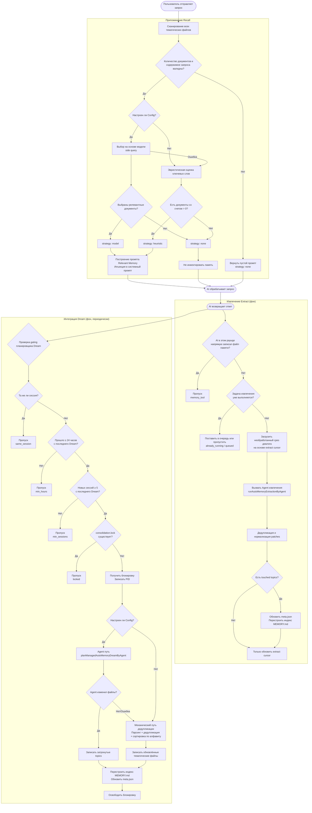
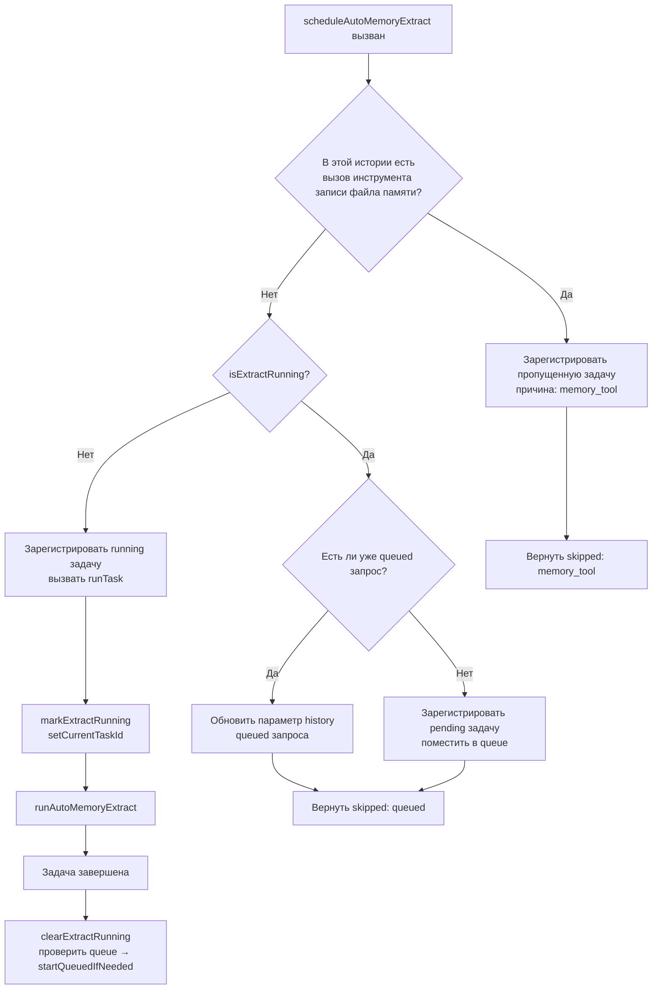
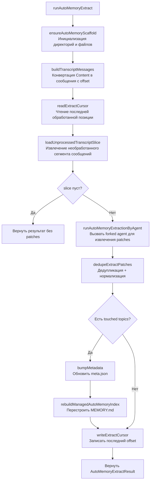
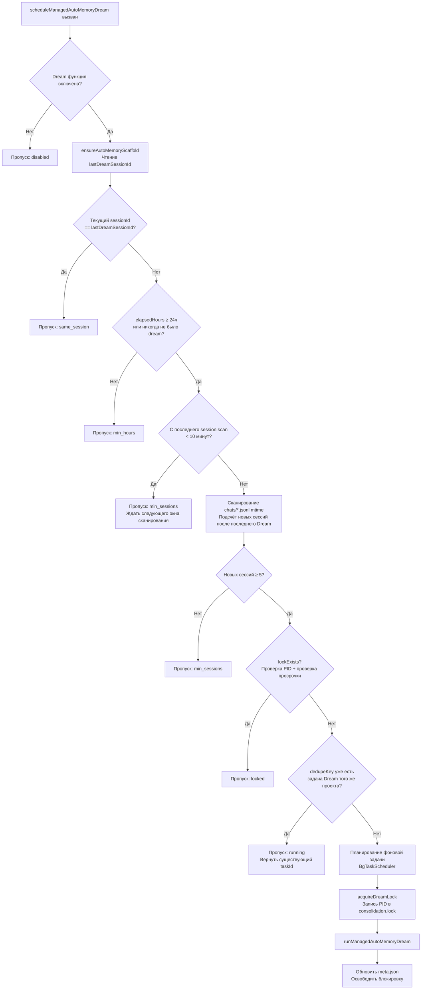
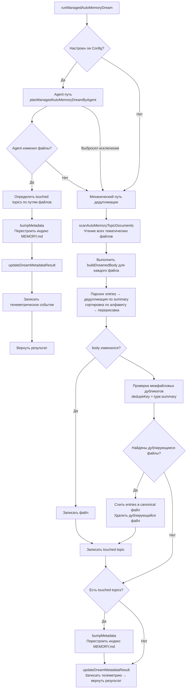
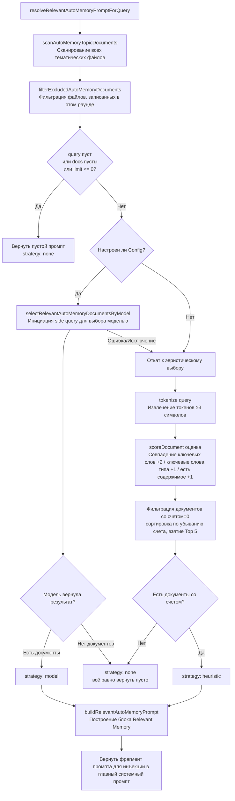
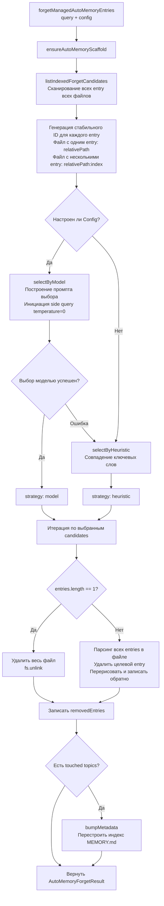

# Memory (Память) — Система управления

:::tip
Эта статья описывает механизм управления, триггеры и детали реализации **Managed Auto-Memory** (Управляемой автоматической памяти) в Nessy CLI.
:::

---

## Содержание

1. [Обзор](#обзор)
2. [Структура хранения](#структура-хранения)
3. [Типы памяти](#типы-памяти)
4. [Формат записи памяти](#формат-записи-памяти)
5. [Основной жизненный цикл](#основной-жизненный-цикл)
6. [Extract — Извлечение](#extract--извлечение)
7. [Dream — Интеграция](#dream--интеграция)
8. [Recall — Припоминание](#recall--припоминание)
9. [Forget — Забывание](#forget--забывание)
10. [Перестройка индекса](#перестройка-индекса)
11. [Телеметрия](#телеметрия)

---

## Обзор

Managed Auto-Memory — это система персистентной памяти, которая **автоматически** накапливает, интегрирует и извлекает знания, связанные с пользователем, в процессе AI-сессии. Она поддерживает четыре основные операции для управления жизненным циклом памяти:

| Операция     | Английский | Триггер                                        | Действие                                                             |
| ------------ | ---------- | ---------------------------------------------- | -------------------------------------------------------------------- |
| Извлечение   | Extract    | Автоматически (после каждого раунда разговора) | Извлечение новых знаний из истории разговора и запись в файлы памяти |
| Интеграция   | Dream      | Автоматически (периодическая фоновая задача)   | Дедупликация и слияние файлов памяти, поддержание чистоты            |
| Припоминание | Recall     | Автоматически (перед каждым раундом разговора) | Извлечение релевантной памяти и инъекция в системный промпт          |
| Забывание    | Forget     | Вручную (команда пользователя `/forget`)       | Точное удаление указанных записей памяти                             |

---

## Структура хранения

### Макет директории

```
~/.nessy/                                      ← Глобальная базовая директория (по умолчанию)
└── projects/
    └── <sanitized-git-root>/                 ← Идентификатор проекта (на основе корневого пути Git)
        ├── meta.json                         ← Метаданные (временные метки extract/integration, статус)
        ├── extract-cursor.json               ← Курсор извлечения (обработанный сдвиг разговора)
        ├── consolidation.lock                ← Блокировка взаимного исключения процесса Dream
        └── memory/                           ← Основная директория памяти
            ├── MEMORY.md                     ← Индексный файл (автоматически генерируется, суммирует все записи)
            ├── user.md                       ← Память пользовательских предпочтений (пример)
            ├── feedback.md                   ← Память обратной связи (пример)
            ├── project/
            │   └── milestone.md              ← Проектная память (поддерживает поддиректории)
            └── reference/
                └── grafana.md                ← Память внешних ресурсов
```

> **Перекрытие переменными окружения**:
>
> - `NESSY_CLI_MEMORY_BASE_DIR`: Замена глобальной базовой директории
> - `NESSY_CLI_MEMORY_LOCAL=1`: Использование пути проекта `.nessy/memory/`

### Описание ключевых файлов

| Файл                  | Описание                                                                                                         |
| --------------------- | ---------------------------------------------------------------------------------------------------------------- |
| `meta.json`           | Записывает время последнего Extract/Dream, ID сессии, задействованные типы памяти, статус выполнения             |
| `extract-cursor.json` | Записывает, до какого сдвига в истории разговора текущая сессия обработала, чтобы избежать повторного извлечения |
| `consolidation.lock`  | Блокировка файла во время выполнения Dream, содержимое — PID владельца, автоматически истекает через 1 час       |
| `MEMORY.md`           | Индекс всех тематических файлов, перестраивается после каждого Extract/Dream, формат — список Markdown           |

---

## Типы памяти

Система поддерживает четыре встроенных типа памяти, каждый соответствует разным измерениям информации:

| Тип         | Содержимое                                                                          | Когда записывается                                                      | Когда читается                                                        |
| ----------- | ----------------------------------------------------------------------------------- | ----------------------------------------------------------------------- | --------------------------------------------------------------------- |
| `user`      | Роль пользователя, навыки, бэкграунд, рабочие привычки                              | При узнавании роли/предпочтений/фона пользователя                       | При ответе, требующем настройки под фон пользователя                  |
| `feedback`  | Руководство по поведению AI: чего избегать, что продолжать                          | При исправлении AI пользователем или подтверждении неочевидного подхода | При влиянии на способ поведения AI                                    |
| `project`   | Прогресс проекта, цели, решения, дедлайны, отслеживание багов                       | При узнавании, кто что делает, почему, к какому сроку                   | При помощи AI понять контекст и мотивацию работы                      |
| `reference` | Указатели на ресурсы внешних систем (Dashboard, тикет-системы, Slack-каналы и т.д.) | При узнавании внешнего ресурса и его назначения                         | При упоминании пользователем внешней системы или связанной информации |

**Не следует сохранять в память**: шаблоны кода/соглашения, история Git, решения отладки, временное состояние задач, содержимое, уже записанное в NESSY.md/AGENTS.md.

---

## Формат записи памяти

Каждый тематический файл использует формат **YAML frontmatter + Markdown body**:

```markdown
---
name: Имя памяти
description: Описание в одну строку (используется для определения релевантности припоминания, должно быть конкретным)
type: user|feedback|project|reference
---

Содержимое памяти (строка summary)

Why: Причина (позволяет AI понять граничные случаи, а не слепо следовать правилам)
How to apply: Сценарии применения и способ использования
```

Для типов `feedback` и `project` настоятельно рекомендуется заполнять `Why` и `How to apply`, чтобы память могла правильно применяться в граничных случаях.

---

## Основной жизненный цикл



---

## Extract — Извлечение

### Время срабатывания

Автоматически запускается `scheduleAutoMemoryExtract` после завершения каждого ответа AI (фоновый, неблокирующий).

### Логика планирования (`extractScheduler.ts`)



**Объяснение причин пропуска**:

| Причина           | Значение                                                                                        |
| ----------------- | ----------------------------------------------------------------------------------------------- |
| `memory_tool`     | Главный Agent уже напрямую записал файл памяти в этом раунде, пропускаем во избежание конфликта |
| `already_running` | Извлечение выполняется и не может быть поставлено в очередь                                     |
| `queued`          | Извлечение уже выполняется, этот запрос поставлен в очередь                                     |

### Основной процесс извлечения (`extract.ts`)



**Курсор извлечения (Cursor)**:

- Поля: `{ sessionId, processedOffset, updatedAt }`
- Обновляет `processedOffset` до текущей длины истории после каждого извлечения
- При следующем извлечении обрабатываются только сообщения с `offset >= processedOffset`
- При смене сессии (`sessionId` изменяется) начинается с нулевой отметки

**Правила фильтрации Patch**:

- Длина summary < 12 символов → отбрасывается
- summary заканчивается на `?` → отбрасывается (вопросительное предложение)
- Содержит временные ключевые слова (today/now/currently/temporary и т.д.) → отбрасывается
- Одинаковая комбинация `topic:summary` → дедупликация

---

## Dream — Интеграция

### Время срабатывания

Автоматически запускается `scheduleManagedAutoMemoryDream` после завершения каждого ответа AI (фоновый, неблокирующий). Но защищён несколькими условиями gating, в большинстве случаев пропускается.

### Gating планирования (`dreamScheduler.ts`)



**Параметры gating**:

| Параметр                   | Значение по умолчанию | Описание                                              |
| -------------------------- | --------------------- | ----------------------------------------------------- |
| `minHoursBetweenDreams`    | 24 часа               | Минимальный интервал между двумя Dream                |
| `minSessionsBetweenDreams` | 5 сессий              | Минимальное количество новых сессий для запуска Dream |
| `SESSION_SCAN_INTERVAL_MS` | 10 минут              | Интервал дросселирования сканирования файлов сессий   |
| `DREAM_LOCK_STALE_MS`      | 1 час                 | Порог времени, когда lock-файл считается просроченным |

**Механизм блокировки**:

- Lock-файл находится в `<project-state-dir>/consolidation.lock`
- Содержимое — PID процесса-владельца
- При проверке: если процесс PID больше не существует (`kill(pid, 0)` не удаётся) или lock старше 1 часа → считается просроченным, автоматически очищается

### Процесс выполнения интеграции (`dream.ts`)



**Логика механической дедупликации**:

1. Внутри каждого тематического файла: дедупликация по `summary.toLowerCase()`, слияние полей `why`/`howToApply`
2. Пересортировка по алфавиту summary
3. Между файлами: записи с одинаковым `type:summary` сливаются в первый найденный файл, дублирующиеся файлы удаляются

---

## Recall — Припоминание

### Время срабатывания

Автоматически запускается `resolveRelevantAutoMemoryPromptForQuery` перед обработкой запроса пользователя AI, инъекция релевантной памяти в системный промпт.

### Процесс припоминания (`recall.ts`)



**Правила оценки (эвристика)**:

| Условие                                       | Баллы                |
| --------------------------------------------- | -------------------- |
| query token появляется в содержимом документа | +2 (за каждый token) |
| query token является ключевым словом типа     | +1 (за каждый token) |
| body документа не пустой                      | +1                   |

**Ключевые слова для каждого типа**:

- `user`: user, preference, background, role, terse
- `feedback`: feedback, rule, avoid, style, summary
- `project`: project, goal, incident, deadline, release
- `reference`: reference, dashboard, ticket, docs, link

**Правила построения Prompt**:

- Максимум 5 документов для инъекции (`MAX_RELEVANT_DOCS`)
- Body каждого документа обрезается до 1200 символов (`MAX_DOC_BODY_CHARS`)
- При превышении добавляется подсказка: "NOTE: Relevant memory truncated for prompt budget."
- Включает информацию о свежести документа (на основе mtime файла)

---

## Forget — Забывание

### Время срабатывания

Запускается вручную пользователем выполнением команды `/forget <query>`.

### Процесс забывания (`forget.ts`)



**Дизайн ID записи**:

- Файл с одной записью (распространённый случай): `relativePath` (например `feedback/no-summary.md`)
- Файл с несколькими записями: `relativePath:index` (например `feedback/style.md:2`)
- Использование стабильного ID позволяет модели точно локализовать запись, не затрагивая другие записи в том же файле

---

## Перестройка индекса

`MEMORY.md` — это навигационный индекс всех тематических файлов, вызывается `rebuildManagedAutoMemoryIndex` после каждого Extract или Dream для перестройки:

```
- [Пользовательские предпочтения](user/preferences.md) — Пользователь — опытный Go-инженер, впервые работает с React
- [Руководство по обратной связи](feedback/style.md) — Сохранять ответы краткими, без итогового резюме
- [Веха проекта](project/milestone.md) — Окно заморозки слияния перед выделением ветки мобильного релиза
```

**Ограничения индекса**:

- Максимум 150 символов на строку (превышение обрезается с `…`)
- Максимум 200 строк
- Общий размер не более 25 000 байт

---

## Телеметрия

Система имеет три типа событий телеметрии для мониторинга производительности и эффективности операций памяти:

### Телеметрия Extract

| Поле             | Тип                         | Описание                               |
| ---------------- | --------------------------- | -------------------------------------- |
| `trigger`        | `'auto'`                    | Способ запуска (только автоматический) |
| `status`         | `'completed'` \| `'failed'` | Результат выполнения                   |
| `patches_count`  | number                      | Количество извлечённых валидных patch  |
| `touched_topics` | string[]                    | Список затронутых типов памяти         |
| `duration_ms`    | number                      | Общее время (миллисекунды)             |

### Телеметрия Dream

| Поле              | Тип                                   | Описание                                                 |
| ----------------- | ------------------------------------- | -------------------------------------------------------- |
| `trigger`         | `'auto'`                              | Способ запуска                                           |
| `status`          | `'updated'` \| `'noop'` \| `'failed'` | Результат выполнения                                     |
| `deduped_entries` | number                                | Количество записей, дедуплицированных механическим путём |
| `touched_topics`  | string[]                              | Список изменённых типов памяти                           |
| `duration_ms`     | number                                | Общее время (миллисекунды)                               |

### Телеметрия Recall

| Поле            | Тип                                    | Описание                                     |
| --------------- | -------------------------------------- | -------------------------------------------- |
| `query_length`  | number                                 | Длина строки запроса                         |
| `docs_scanned`  | number                                 | Общее количество просканированных документов |
| `docs_selected` | number                                 | Количество окончательно введённых документов |
| `strategy`      | `'none'` \| `'heuristic'` \| `'model'` | Стратегия выбора                             |
| `duration_ms`   | number                                 | Общее время (миллисекунды)                   |

---

## Индекс связанных исходных файлов

| Файл                                                 | Обязанности                                                                                       |
| ---------------------------------------------------- | ------------------------------------------------------------------------------------------------- |
| `packages/core/src/memory/types.ts`                  | Определения типов: `AutoMemoryType`, `AutoMemoryMetadata`, `AutoMemoryExtractCursor`              |
| `packages/core/src/memory/paths.ts`                  | Вычисление путей: `getAutoMemoryRoot`, `isAutoMemPath`, helpers путей различных файлов            |
| `packages/core/src/memory/store.ts`                  | Инициализация лесов: `ensureAutoMemoryScaffold`, чтение/запись индекса/метаданных                 |
| `packages/core/src/memory/scan.ts`                   | Сканирование тематических файлов: `scanAutoMemoryTopicDocuments`, парсинг frontmatter             |
| `packages/core/src/memory/entries.ts`                | Парсинг и рендеринг записей: `parseAutoMemoryEntries`, `renderAutoMemoryBody`                     |
| `packages/core/src/memory/extract.ts`                | Основная логика извлечения: `runAutoMemoryExtract`, управление курсором, дедупликация patch       |
| `packages/core/src/memory/extractScheduler.ts`       | Планировщик извлечения: `ManagedAutoMemoryExtractRuntime`, очередь/машина состояния выполнения    |
| `packages/core/src/memory/extractionAgentPlanner.ts` | Agent извлечения: `runAutoMemoryExtractionByAgent`                                                |
| `packages/core/src/memory/dream.ts`                  | Основная логика интеграции: `runManagedAutoMemoryDream`, Agent-путь + механическая дедупликация   |
| `packages/core/src/memory/dreamScheduler.ts`         | Планировщик интеграции: `ManagedAutoMemoryDreamRuntime`, проверка gating, управление блокировками |
| `packages/core/src/memory/dreamAgentPlanner.ts`      | Agent интеграции: `planManagedAutoMemoryDreamByAgent`                                             |
| `packages/core/src/memory/recall.ts`                 | Логика припоминания: `resolveRelevantAutoMemoryPromptForQuery`, эвристика + модель с двумя путями |
| `packages/core/src/memory/forget.ts`                 | Логика забывания: `forgetManagedAutoMemoryEntries`, генерация кандидатов + точное удаление        |
| `packages/core/src/memory/indexer.ts`                | Перестройка индекса: `rebuildManagedAutoMemoryIndex`, `buildManagedAutoMemoryIndex`               |
| `packages/core/src/memory/prompt.ts`                 | Шаблон системного промпта: описание типов памяти, примеры формата, спецификации использования     |
| `packages/core/src/memory/governance.ts`             | Типы предложений управления: `AutoMemoryGovernanceSuggestionType`                                 |
| `packages/core/src/memory/state.ts`                  | Состояние выполнения извлечения: `isExtractRunning`, `markExtractRunning`, `clearExtractRunning`  |
| `packages/core/src/memory/memoryAge.ts`              | Описание свежести: `memoryAge`, `memoryFreshnessText`                                             |
