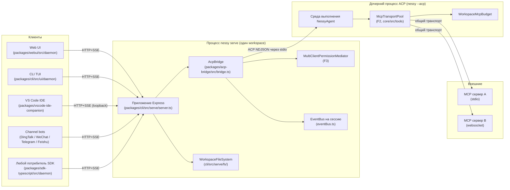
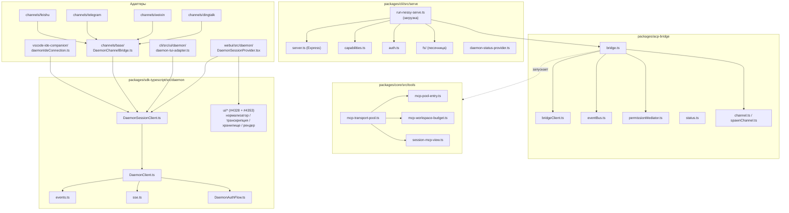
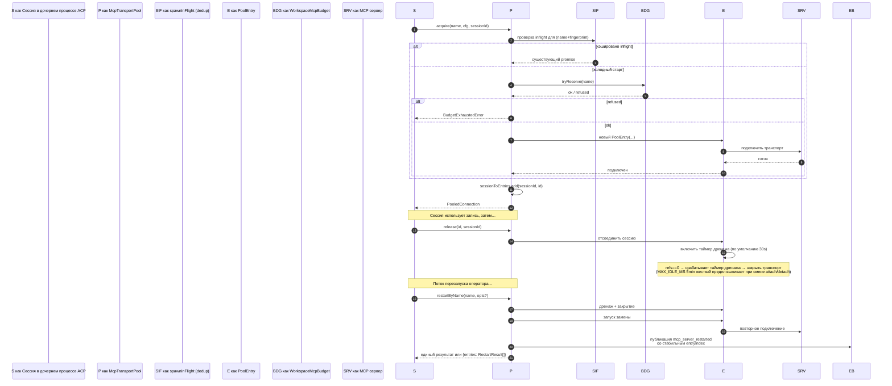
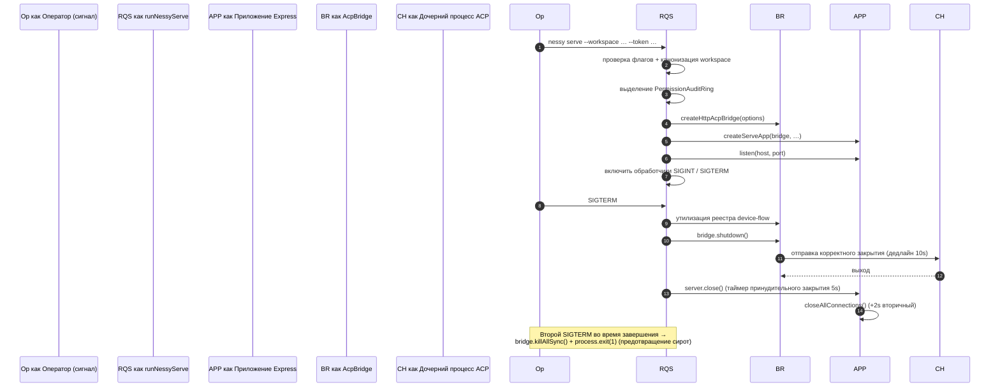

# Архитектура Daemon

## Обзор

Процесс `nessy serve` — это **один демон = один workspace**. Он размещает один HTTP-сервер Express, владеет экземпляром `@nestor/nessy-cli-acp-bridge` и запускает один дочерний процесс ACP (`nessy --acp`), который запускает фактическую среду выполнения агента. Несколько клиентов (CLI TUI, IDE companion, IM channel bots, web BFF, пользовательские скрипты) подключаются через HTTP + SSE и либо используют одну сессию ACP (`sessionScope: 'single'`, по умолчанию), либо разделяют сессии по потокам разговора (`sessionScope: 'thread'`).

Внутри дочернего процесса ACP MCP серверы используются совместно на уровне workspace через `McpTransportPool` (F2): один кортеж (имя сервера + отпечаток конфигурации) сопоставляется с одним MCP транспортом, независимо от того, сколько сессий его обнаружит. `MultiClientPermissionMediator` моста (F3) координирует голоса разрешений для всех подключенных клиентов в рамках одной из четырех политик.

Этот документ дает **системную картину**, на которой строится остальная часть этого набора документации. Каждый критический поток показан как диаграмма последовательности Mermaid; детали реализации по компонентам находятся в других 18 документах.

## Топология процессов



Процесс daemon и дочерний процесс ACP соединены через `AcpChannel` (по умолчанию: реальная пара труб stdio подпроцесса; `inMemoryChannel` для тестов). Все, что делает демон, определяется этим разделением: HTTP и SSE трафик завершаются в демоне, решения агента и вызовы инструментов происходят в дочернем процессе, а мост соединяет их.

## Карта пакетов



Три границы доверия имеют значение: HTTP край (цепочка middleware `serve/auth.ts`), граница между мостом и дочерним процессом ACP (NDJSON через stdio, без аутентификации; дочерний процесс неявно доверяет мосту) и граница между агентом и MCP сервером (агент может вызывать инструменты, которые касаются хоста).

## Поток 1: Жизненный цикл HTTP-запроса

```mermaid
sequenceDiagram
    autonumber
    participant C как Клиент (SDK)
    participant MW как Middleware<br/>(CORS→host→log→bearer→rate-limit→JSON→telemetry→mutationGate)
    participant R как Обработчик маршрута
    participant BR как AcpBridge
    participant BC как BridgeClient
    participant CH как Дочерний процесс ACP

    C->>MW: POST /session/:id/prompt<br/>Authorization: Bearer …<br/>X-Nessy-Client-Id: …
    MW->>MW: denyBrowserOriginCors
    MW->>MW: hostAllowlist (защита от DNS rebinding)
    MW->>MW: хук access-log
    MW->>MW: bearerAuth (сравнение с постоянным временем)
    MW->>MW: rateLimit (когда включено)
    MW->>MW: парсер тела express.json
    MW->>MW: daemonTelemetryMiddleware
    MW->>MW: mutationGate (строгий для изменяющих маршрутов)
    MW->>R: req проверен
    R->>BR: bridge.sendPrompt(sessionId, body, clientId)
    BR->>BC: client.sendPrompt(sessionId, …)
    BC->>CH: ACP JSON-RPC через stdin
    CH-->>BC: ACP ответ / уведомления
    BC-->>BR: результат
    BR-->>R: результат
    R-->>C: 200 JSON
```

Не потоковые маршруты (подсказка, отмена, переключение модели, метаданные, workspace CRUD) завершаются одним JSON ответом. Потоковый вывод доставляется вне полосы на канале SSE, **а не** как фрагментированное HTTP тело в этом соединении. См. поток 2.

## Поток 2: Доставка и воспроизведение событий SSE

```mermaid
sequenceDiagram
    autonumber
    participant C как Клиент
    participant SR как GET /session/:id/events
    participant EB как EventBus<br/>(на сессию)
    participant BC как BridgeClient
    participant CH как Дочерний процесс ACP

    C->>SR: GET …/events<br/>Last-Event-ID: 42 (опционально)
    SR->>EB: subscribe(lastSeenId=42, maxQueued=N)
    EB-->>SR: воспроизведение фреймов 43..currentTail<br/>(из кольцевого буфера)
    SR-->>C: NDJSON: id=43, type=session_update, …
    CH-->>BC: уведомление ACP (например, agent_message_chunk)
    BC->>EB: publish({type, data})
    EB-->>SR: enqueue id=N
    SR-->>C: id=N, type=…, data=…
    Note over EB,SR: Если очередь подписчика >= maxQueued,<br/>EventBus выдает терминальный фрейм client_evicted<br/>и закрывает подписчика.
```

Кольцевой буфер ограничен (`eventRingSize`, по умолчанию 8000). Переподключающийся клиент, чей `Last-Event-ID` старше головы кольца, получает синтетический сигнал догонки и должен вызвать `loadSession` / `resumeSession` для восстановления более глубокого состояния. Медленные клиенты вызывают `slow_client_warning` при 75% заполнении очереди и `client_evicted` на пределе.

## Поток 3: Медиация разрешений для нескольких клиентов

```mermaid
sequenceDiagram
    autonumber
    participant CH как Дочерний процесс ACP (агент)
    participant BC как BridgeClient.requestPermission
    participant MED как Медиатор (политика)
    participant EB как EventBus
    participant C1 как Клиент A<br/>(инициатор)
    participant C2 как Клиент B

    CH->>BC: ACP requestPermission(requestId, options)
    BC->>MED: request({requestId, sessionId, originatorClientId, allowedOptionIds}, timeoutMs)
    MED->>EB: publish permission_request<br/>(широковещательная рассылка подписчикам)
    EB-->>C1: SSE permission_request
    EB-->>C2: SSE permission_request

    alt first-responder
        C2->>MED: POST /permission/:requestId optionId=allow
        MED-->>BC: resolved
        BC-->>CH: ACP ответ
        MED->>EB: permission_resolved
        C1->>MED: POST /permission/:requestId (поздний голос)
        MED-->>C1: 409 permission_already_resolved
    else designated
        C2->>MED: голос (clientId != originatorClientId)
        MED-->>C2: 403 permission_forbidden
        C1->>MED: голос (совпадает с originator)
        MED-->>BC: resolved
    else consensus (N-of-M)
        C1->>MED: голос
        MED->>EB: permission_partial_vote (1/N)
        C2->>MED: голос
        MED->>EB: permission_partial_vote (2/N)
        Note over MED: когда счетчик достигает кворума по одному варианту, разрешить
    else local-only
        C2->>MED: голос (удаленный)
        MED-->>C2: 403 permission_forbidden (remote_not_allowed)
        Note over MED,CH: блокирует, пока loopback избиратель не разрешит
    end
```

Обходной путь для всех политик: любой клиент может проголосовать `CANCEL_VOTE_SENTINEL` для краткого замыкания запроса как `cancelled / agent_cancelled`. Мост защищает от звонящих по проводу, вводящих sentinel через обычный поле `optionId` (`InvalidPermissionOptionError`).

## Поток 4: Получение / освобождение / перезапуск транспорта MCP



`releaseSession(sessionId)` использует обратный индекс `sessionToEntries` для освобождения каждой записи, которую удерживает сессия, за O(refs). При завершении работы daemon `drainAll()` устанавливает флаг `draining` (отказывая новым получениям) и ждет, пока каждая запись закроется в пределах настраиваемого тайм-аута.

## Поток 5: Жизненный цикл — запуск и корректное завершение



Двухфазное завершение важно, потому что HTTP-запросы в процессе выполнения, SSE подписчики в процессе выполнения и вызовы инструментов дочернего процесса ACP в процессе выполнения все нуждаются в ограниченных окнах демонтажа. Если что-то блокируется после этих дедлайнов, путь принудительного закрытия вступает в силу, чтобы застрявший дочерний процесс не мог удерживать процесс daemon активным.

## Критические файлы

| Проблема                  | Файл                                                        |
| ------------------------- | ----------------------------------------------------------- |
| Загрузка                  | `packages/cli/src/serve/run-nessy-serve.ts`                 |
| Приложение Express        | `packages/cli/src/serve/server.ts`                          |
| Реестр возможностей       | `packages/cli/src/serve/capabilities.ts`                    |
| Middleware аутентификации | `packages/cli/src/serve/auth.ts`                            |
| Мост                      | `packages/acp-bridge/src/bridge.ts`                         |
| BridgeClient              | `packages/acp-bridge/src/bridgeClient.ts`                   |
| Медиатор разрешений       | `packages/acp-bridge/src/permissionMediator.ts`             |
| EventBus                  | `packages/acp-bridge/src/eventBus.ts`                       |
| Пул транспортов MCP       | `packages/core/src/tools/mcp-transport-pool.ts`             |
| Бюджет MCP workspace      | `packages/core/src/tools/mcp-workspace-budget.ts`           |
| FS workspace              | `packages/cli/src/serve/fs/`                                |
| SDK DaemonClient          | `packages/sdk-typescript/src/daemon/DaemonClient.ts`        |
| SDK SessionClient         | `packages/sdk-typescript/src/daemon/DaemonSessionClient.ts` |
| Схема событий             | `packages/sdk-typescript/src/daemon/events.ts`              |

## Ссылки

- Проблемы дизайна: [#3803](https://github.com/NessyLM/nessy-cli/issues/3803) (дизайн daemon), [#4175](https://github.com/NessyLM/nessy-cli/issues/4175) (этапы F-серии).
- Руководство пользователя: [`../../../users/work/features/nessy-serve.md`](../../../users/work/features/nessy-serve.md).
- Справочник по wire-протоколу: [`../../nessy-serve-protocol.md`](../../nessy-serve-protocol.md).
- Документ дизайна F2: [`../../../design/f2-mcp-transport-pool.md`](../../../design/f2-mcp-transport-pool.md).
- Заметки по дизайну F2: коммиты 4-6 проблемы [#4175](https://github.com/NessyLM/nessy-cli/issues/4175).
