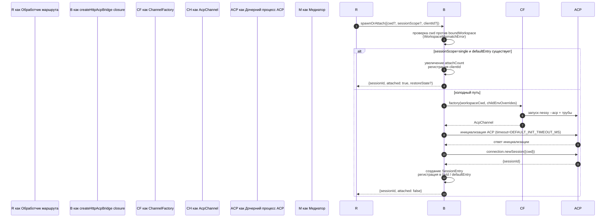
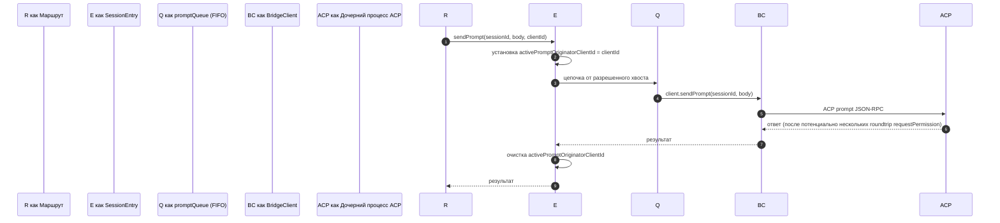
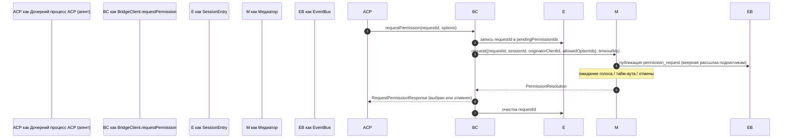
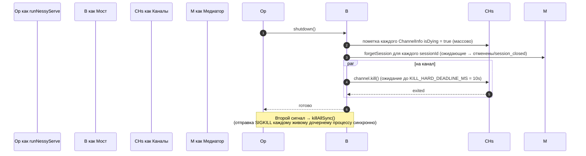

# ACP Bridge

## Обзор

`packages/acp-bridge/` владеет границей между HTTP-слоем daemon и дочерним процессом ACP. Он потребляется `packages/cli/src/serve/` (демон `nessy serve`) и был выделен в #4175 F1 шаг 3, чтобы будущие потребители (`channels/base/AcpBridge.ts`, IDE companion VS Code) могли использовать то же ядро моста без доступа к пакету CLI.

Мост предоставляет один экземпляр `HttpAcpBridge`, один `AcpChannel` к дочернему процессу ACP, мультиплексированные сессии через этот канал, `EventBus` на сессию, `MultiClientPermissionMediator`, адаптер `BridgeFileSystem` и вспомогательные методы ACP (`spawnOrAttach`, `loadSession`, `resumeSession`, `sendPrompt`, `cancelSession`, `respondToPermission`, плюс extMethod RPC для статуса workspace и перезапуска MCP).

## Обязанности

- Запуск или прикрепление к дочернему процессу ACP через подключаемую `ChannelFactory`. Фабрика по умолчанию: `defaultSpawnChannelFactory` (подпроцесс `nessy --acp`). Тесты внедряют `inMemoryChannel`.
- Поддержание `aliveChannels` (реестр каналов) и `byId` (реестр сессий).
- Мультиплексирование N сессий на стороне HTTP на один дочерний процесс ACP через `connection.newSession()`.
- Сериализация подсказок на сессию через `promptQueue` (ACP обеспечивает одну активную подсказку на сессию).
- FIFO на сессию для вызовов `setSessionModel`, чтобы одновременные подключения с разными моделями не создавали гонку агента.
- `EventBus` на сессию, который управляет `GET /session/:id/events` (см. [`10-event-bus.md`](./10-event-bus.md)).
- Поток разрешений: `BridgeClient.requestPermission` → `MultiClientPermissionMediator.request` → веерная рассылка → сбор голосов → ответ ACP (см. [`04-permission-mediation.md`](./04-permission-mediation.md)).
- Файловый ввод-вывод: адаптер `BridgeFileSystem` для вызовов ACP `readTextFile` / `writeTextFile` (см. [`07-workspace-filesystem.md`](./07-workspace-filesystem.md)).
- extMethod RPC для статуса на уровне workspace (`/workspace/mcp`, `/workspace/skills`, `/workspace/providers`) и перезапуска MCP.
- Жизненный цикл: корректное `shutdown()` с `KILL_HARD_DEADLINE_MS` (10s) на канал; синхронный `killAllSync()` для принудительного выхода при втором сигнале.

## Архитектура

**Публичный вход**: `createHttpAcpBridge(opts: BridgeOptions): HttpAcpBridge` в `packages/acp-bridge/src/bridge.ts`.

**Ключевые типы**:

| Тип                             | Файл                    | Роль                                                                                                                                                                                                                     |
| ------------------------------- | ----------------------- | ------------------------------------------------------------------------------------------------------------------------------------------------------------------------------------------------------------------------ |
| `HttpAcpBridge`                 | `bridgeTypes.ts`        | Публичный интерфейс: `spawnOrAttach`, `loadSession`, `resumeSession`, `sendPrompt`, `cancelSession`, `subscribeEvents`, `respondToPermission`, `getWorkspaceMcpStatus`, `restartMcpServer`, `shutdown`, `killAllSync`, … |
| `BridgeSession`                 | `bridgeTypes.ts`        | `{ sessionId, workspaceCwd, attached, clientId?, createdAt? }` возвращается HTTP обработчикам.                                                                                                                           |
| `BridgeOptions`                 | `bridgeOptions.ts`      | Конфигурация времени создания (см. [Конфигурация](#конфигурация)).                                                                                                                                                       |
| `AcpChannel`                    | `channel.ts`            | `{ stream, kill(), killSync(), exited }` — один канал ACP NDJSON.                                                                                                                                                        |
| `ChannelFactory`                | `channel.ts`            | `(workspaceCwd, childEnvOverrides?) => Promise<AcpChannel>`.                                                                                                                                                             |
| `BridgeClient`                  | `bridgeClient.ts`       | Обертывает одно соединение ACP `ClientSideConnection`; реализует ACP `Client` (`requestPermission`, `readTextFile`, `writeTextFile`, `sessionUpdate`, `extNotification`).                                                |
| `EventBus`                      | `eventBus.ts`           | Внутренний pub/sub на сессию. См. [`10-event-bus.md`](./10-event-bus.md).                                                                                                                                                |
| `MultiClientPermissionMediator` | `permissionMediator.ts` | Медиатор с четырьмя политиками. См. [`04-permission-mediation.md`](./04-permission-mediation.md).                                                                                                                        |

**Внутреннее состояние (замкнуто `createHttpAcpBridge`)**:

| Состояние       | Форма                           | Назначение                                                                                                                                                                                                                                                                                                                                                                                                 |
| --------------- | ------------------------------- | ---------------------------------------------------------------------------------------------------------------------------------------------------------------------------------------------------------------------------------------------------------------------------------------------------------------------------------------------------------------------------------------------------------- |
| `aliveChannels` | `Map<string, ChannelInfo>`      | Реестр каналов по ключу channel id. Каждый `ChannelInfo` содержит `channel`, `connection`, `client` (один `BridgeClient` на канал), `sessionIds: Set<string>`, `pendingRestoreIds`, `statusClosedReject?`, `isDying: boolean`.                                                                                                                                                                             |
| `byId`          | `Map<string, SessionEntry>`     | Реестр сессий по ключу sessionId. Каждый `SessionEntry` содержит `channel`, `connection`, `events: EventBus`, `promptQueue: Promise<void>`, `modelChangeQueue: Promise<void>`, `pendingPermissionIds: Set<string>`, `clientIds: Map<string, count>`, `activePromptOriginatorClientId?`, `attachCount`, `spawnOwnerWantedKill`, `restoreState?`, `sessionLastSeenAt?`, `clientLastSeenAt: Map<string, ms>`. |
| `defaultEntry`  | `SessionEntry \| null`          | Сессия "single", используемая при `sessionScope: 'single'`.                                                                                                                                                                                                                                                                                                                                                |
| `defaultPolicy` | `PermissionPolicy`              | Настраивается через `BridgeOptions.permissionPolicy`.                                                                                                                                                                                                                                                                                                                                                      |
| `mediator`      | `MultiClientPermissionMediator` | Один на экземпляр моста.                                                                                                                                                                                                                                                                                                                                                                                   |
| Константы       | —                               | `DEFAULT_INIT_TIMEOUT_MS = 10_000`, `MCP_RESTART_TIMEOUT_MS = 300_000`, `DEFAULT_MAX_SESSIONS = 20`, `MAX_EVENT_RING_SIZE = 1_000_000`, `DEFAULT_PERMISSION_TIMEOUT_MS = 5min`, `DEFAULT_MAX_PENDING_PER_SESSION = 64`.                                                                                                                                                                                    |

**Инвариант `isDying`**: любой путь демонтажа должен устанавливать `ChannelInfo.isDying = true` синхронно **до** ожидания `channel.kill()`. `ensureChannel` рассматривает умирающий канал как отсутствующий и создает новый. Без этого флага одновременный `spawnOrAttach`, прибывающий во время окна грации SIGTERM (до 10s), прикрепится к транспорту, который вот-вот закроется, и sessionId вызывающего получит 404 на каждом последующем вызове. **Места установки** (должны быть синхронизированы): `ensureChannel` (ошибка инициализации + повторная проверка позднего завершения), `doSpawn` (ошибка newSession на пустом канале), `killSession` (последняя сессия уходит), `shutdown` (массово).

**Инвариант сохранения `channelInfo`**: **не** очищайте `channelInfo` при установке `isDying = true`. `killAllSync` все еще должен найти канал во время окна грации SIGTERM, чтобы отправить SIGKILL при `process.exit(1)`. `aliveChannels` удерживает умирающую запись до срабатывания `channel.exited`.

**Ограниченная буферизация BridgeClient**: Кадры уведомлений ACP `extNotification`, поступающие в `BridgeClient` для sessionId, которого еще нет в `byId` (потому что ответ `connection.newSession` еще не вернулся, но обнаружение MCP внутри `newSession` уже запустило события бюджета), буферизуются в очередь ранних событий, ограниченную `MAX_EARLY_EVENT_SESSIONS = 64` × `MAX_EARLY_EVENTS_PER_SESSION = 32` × `EARLY_EVENT_TTL_MS = 60_000`. Худший случай — около 400 КБ кучи. Без буферизации первый слот кольца воспроизведения SSE для новой сессии не содержал бы событий, запущенных во время ее создания.

## Поток

### `spawnOrAttach` (основная точка входа)

Ключевые моменты:

- `sessionScope='single'` с существующим `defaultEntry` только увеличивает
  `attachCount`, регистрирует `clientId` и возвращает `attached: true`.
- Холодный путь запускает ChannelFactory, выполняет инициализацию ACP
  (`DEFAULT_INIT_TIMEOUT_MS=10s`), вызывает `connection.newSession({cwd})`, затем
  регистрирует новый `SessionEntry`.
- `SessionLimitExceededError` выбрасывается, когда `byId.size >= maxSessions`.
- `InvalidClientIdError` выбрасывается, если `X-Nessy-Client-Id` вне
  `[A-Za-z0-9._:-]{1,128}`.
- Отключающий сборщик в `server.ts` отслеживает владельца запуска через
  `attachCount`/`spawnOwnerWantedKill`, чтобы избежать демонтажа сессии, чей
  владелец запуска отключился, но другие клиенты уже прикрепились (review #3889
  BQ9tV).

### Сериализация подсказок

Сбои в конце очереди **поглощаются**, чтобы отклонение предыдущей подсказки не отравляло последующие подсказки; оригинальный вызывающий все еще получает отклонение на своем собственном возвращенном promise. `transportClosedReject`, кэшированный на сессии, гоняется с promise подсказки против `channel.exited`, чтобы сбой дочернего процесса проявлялся немедленно, а не зависал.

### Поток разрешений (высокоуровневый)

`InvalidPermissionOptionError` выбрасывается перед медиатором, когда проводной голос пытается ввести `CANCEL_VOTE_SENTINEL` через обычное поле `optionId` — sentinel является единственным выходным путем моста для краткого замыкания запроса как `cancelled / agent_cancelled` и не должен быть случайно достижим из провода. См. [`04-permission-mediation.md`](./04-permission-mediation.md).

### Завершение работы

## Фабрика каналов

`AcpChannel` (`channel.ts`) — это абстракция транспорта моста. Продакшн использует `defaultSpawnChannelFactory` в `spawnChannel.ts`, который запускает `nessy --acp` как подпроцесс с парой труб stdio. Тесты внедряют `inMemoryChannel` для запуска агента внутри процесса. Мост ничего не знает о базовом механизме — ему нужны только `{ stream, kill, killSync, exited }`.

`ChannelFactory` принимает `childEnvOverrides`, чтобы каждый handle daemon мог передавать свои переменные окружения бюджета MCP (`NESSY_SERVE_MCP_CLIENT_BUDGET`, `NESSY_SERVE_MCP_BUDGET_MODE`) без мутации `process.env` (что создавало бы гонку, когда два встроенных daemon работают в одном процессе Node).

## Состояние и жизненный цикл

- Создание моста синхронное; первый `spawnOrAttach` холодно запускает дочерний процесс ACP.
- `defaultEntry` живет в течение времени жизни моста при `sessionScope: 'single'`; канал очищается, когда `sessionIds.size === 0` (после `killSession`) И `isDying` становится true.
- `MAX_EVENT_RING_SIZE = 1_000_000` — это мягкий верхний предел для `BridgeOptions.eventRingSize`, чтобы поймать опечатки оператора до ~500 МБ на сессию OOM.
- `DEFAULT_PERMISSION_TIMEOUT_MS = 5 * 60 * 1000` не позволяет застрявшему запросу разрешения блокировать `promptQueue` на сессию навсегда.
- `DEFAULT_MAX_PENDING_PER_SESSION = 64` зеркально отражает `DEFAULT_MAX_SUBSCRIBERS`; избыточные вызовы `requestPermission` разрешаются как отмененные с предупреждением stderr.

## Зависимости

| Upstream                                                                                  | Downstream                                           |
| ----------------------------------------------------------------------------------------- | ---------------------------------------------------- |
| `@agentclientprotocol/sdk` — `ClientSideConnection`, `PROTOCOL_VERSION`, типы ACP         | `packages/cli/src/serve/` (демон)                    |
| `@nestor/nessy-cli-core` — `ApprovalMode`, `TrustGateError`, `getCurrentGeminiMdFilename` | `packages/channels/base/` (запланировано, F4)        |
| `node:crypto`, `node:fs`, `node:path`                                                     | `packages/vscode-ide-companion/` (запланировано, F4) |

## Конфигурация

`BridgeOptions` (`bridgeOptions.ts`):

| Ключ                                          | По умолчанию                                     | Назначение                                                                                                            |
| --------------------------------------------- | ------------------------------------------------ | --------------------------------------------------------------------------------------------------------------------- |
| `boundWorkspace`                              | (требуется)                                      | Канонический путь workspace, который обеспечивает мост.                                                               |
| `sessionScope`                                | `'single'`                                       | `'single'` делит одну сессию между всеми клиентами; `'thread'` создает отдельную сессию для каждого потока разговора. |
| `channelFactory`                              | `defaultSpawnChannelFactory`                     | Подключаемая фабрика дочернего процесса ACP.                                                                          |
| `initializeTimeoutMs`                         | `DEFAULT_INIT_TIMEOUT_MS = 10_000`               | Тайм-аут рукопожатия инициализации ACP.                                                                               |
| `maxSessions`                                 | `DEFAULT_MAX_SESSIONS = 20`                      | Лимит на `byId.size`. `0` / `Infinity` = без лимита; NaN/отрицательный выбрасывает.                                   |
| `eventRingSize`                               | `DEFAULT_RING_SIZE` (из `eventBus.ts`)           | Кольцо событий на сессию; мягкий предел на `MAX_EVENT_RING_SIZE`.                                                     |
| `permissionResponseTimeoutMs`                 | `DEFAULT_PERMISSION_TIMEOUT_MS = 5 min`          | Стенные часы на запрос для медиатора.                                                                                 |
| `maxPendingPermissionsPerSession`             | `DEFAULT_MAX_PENDING_PER_SESSION = 64`           | Противодавление для агентов с высоким объемом.                                                                        |
| `childEnvOverrides`                           | `{}`                                             | Добавления / очистки окружения на handle для дочернего процесса ACP.                                                  |
| `persistApprovalMode`, `persistDisabledTools` | —                                                | Хуки записи настроек для маршрутов мутации Wave 4.                                                                    |
| `contextFilename`                             | из `context.fileName` в `settings.json`          | Переопределяет `getCurrentGeminiMdFilename`.                                                                          |
| `statusProvider`                              | (нет)                                            | Ячейки префлайта хоста daemon (`DaemonStatusProvider`).                                                               |
| `fileSystem`                                  | (нет)                                            | Адаптер `BridgeFileSystem` для ACP `readTextFile` / `writeTextFile`.                                                  |
| `permissionPolicy`                            | из `policy.permissionStrategy` в `settings.json` | Одна из `first-responder` / `designated` / `consensus` / `local-only`.                                                |
| `permissionConsensusQuorum`                   | из `settings.json`                               | N для политики consensus.                                                                                             |
| `permissionAudit`                             | `createNoOpPermissionAuditPublisher()`           | Подключение к `PermissionAuditRing` для аудиторского следа.                                                           |
| `channelIdleTimeoutMs`                        | `0`                                              | Поддержание дочернего процесса ACP активным в течение этого количества миллисекунд после закрытия последней сессии.   |

## Дополнительные методы моста

В дополнение к основным вызовам `spawnOrAttach`, `sendPrompt`, `cancelSession`,
`respondToPermission`, `loadSession` и `resumeSession`, интерфейс
`HttpAcpBridge` теперь включает эти вспомогательные методы для daemon:

| Метод                                                        | Назначение                                                        |
| ------------------------------------------------------------ | ----------------------------------------------------------------- |
| `generateSessionRecap(sessionId, context?)`                  | Создание одной строки резюме сессии.                              |
| `generateSessionBtw(sessionId, question, signal?, context?)` | Ответ на побочный вопрос / btw подсказку.                         |
| `executeShellCommand(sessionId, command, signal?, context?)` | Запуск команды оболочки на хосте daemon.                          |
| `getSessionContextUsageStatus(sessionId, opts?)`             | Возврат использования контекстного окна.                          |
| `getSessionSupportedCommandsStatus(sessionId)`               | Возврат доступных slash команд.                                   |
| `getSessionTasksStatus(sessionId)`                           | Возврат снимка фоновой задачи.                                    |
| `getSessionStatsStatus(sessionId)`                           | Возврат статистики использования сессии.                          |
| `setSessionApprovalMode(sessionId, mode, opts, context?)`    | Обновление режима одобрения для сессии.                           |
| `detachClient(sessionId, clientId?)`                         | Явное отсоединение клиента.                                       |
| `addRuntimeMcpServer(name, config, originatorClientId)`      | Добавление MCP сервера во время выполнения.                       |
| `removeRuntimeMcpServer(name, originatorClientId)`           | Удаление MCP сервера во время выполнения.                         |
| `manageMcpServer(serverName, action, originatorClientId)`    | Включение / отключение / аутентификация / очистка аутентификации. |
| `generateWorkspaceAgent(description, originatorClientId)`    | Создание определения субагента с AI.                              |
| `preheat()`                                                  | Прогрев дочернего процесса ACP перед первой сессией.              |
| `getSessionLastEventId(sessionId)`                           | Чтение монотонного id события сессии.                             |
| `getWorkspaceToolsStatus()`                                  | Возврат снимка реестра встроенных инструментов.                   |
| `getWorkspaceMcpToolsStatus(serverName)`                     | Возврат инструментов для конкретного MCP сервера.                 |

`BridgeSpawnRequest.sessionScope` был переименован из `'per-client'` в
`'thread'`. `BridgeRestoredSession` теперь несет `compactedReplay`,
`liveJournal` и `lastEventId`. `BridgeClientRequestContext` — это контекст запроса,
продетый через вызовы моста; он несет `clientId`,
`fromLoopback: boolean` и `promptId`.

## Предостережения и известные ограничения

- `MCP_RESTART_TIMEOUT_MS = 300_000` (5 мин) — тайм-аут моста для `/workspace/mcp/:server/restart` намеренно велик, потому что `McpClientManager.MAX_DISCOVERY_TIMEOUT_MS` может быть до 5 мин для stdio серверов. Более короткий дедлайн создавал бы ложные тайм-ауты, пока дочерний процесс ACP продолжал переподключение в фоне.
- `BridgeOptions.eventRingSize > 1_000_000` выбрасывает при создании.
- `connection.unstable_resumeSession` предоставляется через стабильную возможность daemon `session_resume`; `unstable_session_resume` остается рекламируемым как устаревший псевдоним совместимости для старых SDK. Клиенты должны определять возможность `session_resume`.
- Пакет моста — `@nestor/nessy-cli-acp-bridge`, и потребляется через шимы повторного экспорта в `serve/event-bus.ts`, `serve/status.ts`, `serve/httpAcpBridge.ts` для обратной совместимости с путями импорта до F1. Новый код должен импортировать напрямую.

## Ссылки

- `packages/acp-bridge/src/bridge.ts` (особенно `createHttpAcpBridge` на строке 350+)
- `packages/acp-bridge/src/bridgeClient.ts`
- `packages/acp-bridge/src/bridgeTypes.ts`
- `packages/acp-bridge/src/bridgeOptions.ts`
- `packages/acp-bridge/src/channel.ts`
- `packages/acp-bridge/src/spawnChannel.ts`
- `packages/acp-bridge/src/bridgeErrors.ts`
- Issues: [#3803](https://github.com/NessyLM/nessy-cli/issues/3803), [#4175](https://github.com/NessyLM/nessy-cli/issues/4175).
