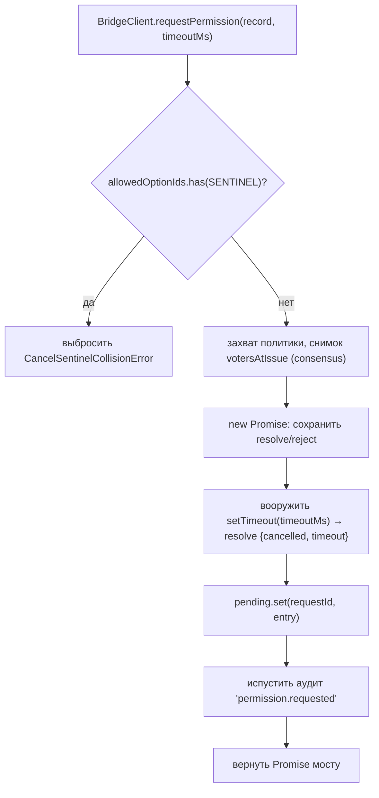
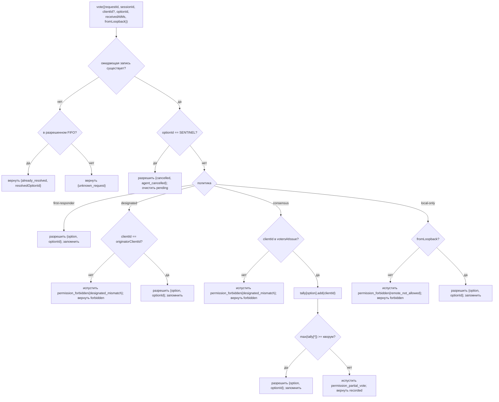

# Медиация разрешений для нескольких клиентов

## Обзор

Когда агент дочернего процесса ACP вызывает `requestPermission`, демон не просто пересылает его одному клиенту. При `sessionScope: 'single'` каждый подключенный клиент видит запрос, и любой из них может ответить. Без медиации поздние голоса не имеют адреса, два клиента могут гоняться за один запрос, и один rogue-клиент может переопределить инициатора.

`MultiClientPermissionMediator` (`packages/acp-bridge/src/permissionMediator.ts`) реализует контракт `PermissionMediator` (`packages/acp-bridge/src/permission.ts`) и владеет всем ожидающим и разрешенным состоянием разрешений для моста. Он распределяет голоса через одну из четырех политик, объявленных в `PermissionPolicy`:

| Политика          | Правило разрешения                                                                                                      | Случай использования                                                                            |
| ----------------- | ----------------------------------------------------------------------------------------------------------------------- | ----------------------------------------------------------------------------------------------- |
| `first-responder` | Первый действительный голос побеждает; поздние голосующие получают `permission_already_resolved`.                       | Live cross-client collaboration UX (по умолчанию).                                              |
| `designated`      | Только `originatorClientId` подсказки может разрешить; другие видят `permission_forbidden{designated_mismatch}`.        | Per-tenant SaaS, где поверхность UI должна владеть своими собственными одобрениями.             |
| `consensus`       | Кворум N-из-M по снимку client-id v1; промежуточные события `permission_partial_vote` позволяют UI отображать прогресс. | Предприятие change review, где два оператора должны согласиться.                                |
| `local-only`      | Отказывается от любого не-loopback голосующего; блокирует, пока loopback клиент не разрешит.                            | Рабочие станции, где удаленное управление никогда не должно предоставлять повышение привилегий. |

> **Предел безопасности v1**: `X-Nessy-Client-Id` сообщается самостоятельно. `designated` и
> `consensus` еще не имеют proof-of-possession. Клиент, который наблюдает
> `originatorClientId`, может повторно использовать этот id. `{outcome:'cancelled'}` также маршрутизируется
> через cancel sentinel перед диспетчеризацией политики, поэтому даже `local-only`
> не может рассматривать отмену как защищенную политикой резолюцию. Для сильной изоляции привяжите
> демон к loopback или поместите его за аутентифицированный обратный прокси. См.
> [Примечание по безопасности: идентичность клиента v1 сообщается самостоятельно](#примечание-по-безопасности-идентичность-клиента-v1-сообщается-самостоятельно).

## Обязанности

- Отслеживание каждого ожидающего запроса (жизненный цикл `request → vote → resolved`).
- Вооружение и разоружение стенных часов тайм-аута на запрос (**инвариант N1**: тайм-аут должен быть вооружен синхронно внутри `request()`, чтобы немедленно отмененная сессия не могла утечь постоянно ожидающим закрытием).
- Диспетчеризация голосов через политику, захваченную во время `request()` (изменение политики daemon во время полета не влияет на запросы в полете).
- Поддержание ограниченного FIFO (`MAX_RESOLVED_PERMISSION_RECORDS = 512`) недавно разрешенных запросов, чтобы дублирующиеся голоса получали структурированный `already_resolved`, а не `unknown_request`.
- Испускание `permission_partial_vote` (consensus) и `permission_forbidden` (designated / consensus / local-only) на EventBus сессии.
- Разрешение ожидающих запросов как `{kind: 'cancelled', reason: 'session_closed'}` через `forgetSession(sessionId)` при демонтаже сессии.
- Отклонение злонамеренного или случайного введения `CANCEL_VOTE_SENTINEL` через провод (`InvalidPermissionOptionError`) и через опубликованные агентом метки опций (`CancelSentinelCollisionError`).

## Архитектура

### Публичная поверхность

```ts
interface PermissionMediator {
  readonly policy: PermissionPolicy;
  request(
    record: PermissionRequestRecord,
    timeoutMs: number,
  ): Promise<PermissionResolution>;
  vote(vote: PermissionVote): PermissionVoteOutcome;
  forgetSession(sessionId: string): void;
}
```

`MultiClientPermissionMediator` добавляет: `peekSessionFor(requestId)`, `pendingCount(sessionId)`, внутренний издатель аудита и т.д. `BridgeClient` зависит только от половины `request()` (структурная подтипизация — см. `bridgeClient.ts`).

### `PermissionPolicy` и `PermissionVoteOutcome`

```ts
type PermissionPolicy =
  | 'first-responder'
  | 'designated'
  | 'consensus'
  | 'local-only';

type PermissionVoteOutcome =
  | { kind: 'resolved'; resolvedOptionId: string }
  | { kind: 'recorded'; votesNeeded: number } // consensus partial
  | { kind: 'already_resolved'; resolvedOptionId: string }
  | { kind: 'forbidden'; reason: 'designated_mismatch' | 'remote_not_allowed' }
  | { kind: 'unknown_request' };

type PermissionResolution =
  | { kind: 'option'; optionId: string }
  | {
      kind: 'cancelled';
      reason: 'timeout' | 'session_closed' | 'agent_cancelled';
    };
```

### Cancel sentinel

`CANCEL_VOTE_SENTINEL = '__cancelled__'`. Мост отображает голосующего `{outcome:'cancelled'}` на этот sentinel **до** вызова `mediator.vote`. Медиатор маршрутизирует sentinel **до** диспетчеризации политики — отмена голосующего работает при любой политике независимо от `clientId` / loopback / членства. Две защиты:

1. **`bridge.ts`** отклоняет проводные голоса, у которых `optionId === CANCEL_VOTE_SENTINEL` с `InvalidPermissionOptionError` (злонамеренный проводной клиент не должен иметь возможности ввести отмену, солгав об `optionId`).
2. **`mediator.request`** отклоняет записи, у которых `allowedOptionIds` содержит sentinel с `CancelSentinelCollisionError` (агент, законно публикующий `'__cancelled__'` как метку опции, не должен иметь возможности маскироваться).

Это преднамеренное межполитическое спасение задокументировано в `permissionMediator.ts`, чтобы будущий сопровождающий случайно не удалил обход.

### Ожидающее состояние

Каждый ожидающий запрос ключируется по `requestId` и несет:

- `policy` — захвачено во время `request()`.
- `record: PermissionRequestRecord` (requestId, sessionId, originatorClientId, allowedOptionIds, issuedAtMs).
- Замыкания `resolve` / `reject`.
- `votesAtIssue` (только consensus) — снимок зарегистрированных `clientIds` для сессии во время выпуска; поздние голоса отклоняются, если их нет в этом наборе.
- `tally` (только consensus) — `Map<optionId, Set<clientId>>` подсчета голосов за опцию.
- `timeoutHandle` — тайм-аут Node, вооруженный внутри `request()` (инвариант N1).
- `auditTrail[]` — записи аудита на голос.

### Разрешенный FIFO

`MAX_RESOLVED_PERMISSION_RECORDS = 512`. Вытеснение — FIFO через `resolvedOrder.shift()` (DeepSeek review #4335 / 3271627446 — зеркально отражает `PermissionAuditRing`). Хранит только `{requestId, sessionId, outcome}`, поэтому 512 записей остаются ниже 100 КБ в нормальных окнах переподключения/гонки UI.

## Поток

### `request()` (инвариант N1)



Таймер вооружается **до** того, как запись станет видимой где-либо еще. Без этого `forgetSession`, прибывающий между `pending.set` и `setTimeout`, оставил бы запись ожидающей без тайм-аута — `promptQueue` на сессию моста зависла бы навсегда.

### Диспетчеризация `vote()`



### `forgetSession()`

Вызывается при закрытии сессии, вытеснении и завершении моста. Для каждой ожидающей записи, у которой `record.sessionId === sessionId`:

1. Отменить тайм-аут.
2. Разрешить ожидающий Promise с `{kind: 'cancelled', reason: 'session_closed'}`.
3. Добавить запись аудита.
4. Удалить из `pending`.

Путь демонтажа сессии моста всегда вызывает `forgetSession` **до** окна kill-канала, чтобы ожидающие разрешения не пережили свою сессию.

## Состояние и жизненный цикл

- `policy` захватывается на запрос. Изменение политики daemon (будущая поверхность) не влияет на запросы в полете.
- `votesAtIssue` (consensus) захватывается во время `request()`; клиенты, которые прибывают после запроса, могут голосовать, но если их `clientId` еще не был зарегистрирован в сессии во время выпуска, их голос отклоняется как `designated_mismatch`. Это намеренно повторно использует причину mismatch политики `designated`, чтобы сохранить контракт закрытым; будущие версии могут разделить союз, если потребителям SDK потребуется различать.
- Разрешенные записи живут в FIFO не более `MAX_RESOLVED_PERMISSION_RECORDS` (512). После вытеснения дублирующийся голос на тот же `requestId` возвращает `{unknown_request}`.
- `permission_partial_vote` срабатывает только для `consensus`. Не полагайтесь на него при любой другой политике.
- `permission_forbidden` срабатывает для `designated`, `consensus` и `local-only` — не `first-responder`.

## Зависимости

- [`03-acp-bridge.md`](./03-acp-bridge.md) — как мост подключает `BridgeClient.requestPermission` к `mediator.request`.
- [`10-event-bus.md`](./10-event-bus.md) — как кадры частичного голоса и forbidden достигают клиентов.
- [`09-event-schema.md`](./09-event-schema.md) — контракты полезной нагрузки для событий `permission_*`.
- [`08-session-lifecycle.md`](./08-session-lifecycle.md) — `forgetSession()` вызывается при каждом завершении сессии.
- [`02-serve-runtime.md`](./02-serve-runtime.md) — `PermissionAuditRing` (FIFO на 512 записей аудита).

## Конфигурация

| Источник             | Ручка                                                                                                  | Эффект                                              |
| -------------------- | ------------------------------------------------------------------------------------------------------ | --------------------------------------------------- |
| `settings.json`      | `policy.permissionStrategy`                                                                            | Активная политика медиатора.                        |
| `settings.json`      | `policy.consensusQuorum`                                                                               | N для consensus.                                    |
| `BridgeOptions`      | `permissionPolicy`, `permissionConsensusQuorum`, `permissionAudit`                                     | Программное переопределение.                        |
| Тег возможности      | `permission_mediation` (всегда; `modes: ['first-responder', 'designated', 'consensus', 'local-only']`) | Набор, поддерживаемый сборкой.                      |
| Оболочка возможности | `policy.permission`                                                                                    | Активная политика, под которой работает этот демон. |

Если `policy.permissionStrategy` явно не настроен, демон использует
`first-responder`. `designated`, `consensus` и `local-only` вступают в силу
только при установке в `settings.json`.

## Кворум consensus: формула по умолчанию и край M=2

Когда активна политика `consensus` и `policy.consensusQuorum` не установлен,
медиатор вычисляет **N = floor(M/2) + 1** через `consensusQuorumFor` в
`permissionMediator.ts`:

```ts
Math.max(1, Math.floor(m / 2) + 1);
```

| M (`votersAtIssue.size`) | N по умолчанию | Поведение                             |
| ------------------------ | -------------- | ------------------------------------- |
| 1                        | 1              | Один голосующий разрешает немедленно. |
| 2                        | 2              | Требует единогласного согласия.       |
| 3                        | 2              | Большинство.                          |
| 4                        | 3              | Больше половины.                      |
| 5                        | 3              | Большинство.                          |
| 6                        | 4              | Больше половины.                      |

Для **M = 2** раздельные голоса (A выбирает X, B выбирает Y) могут быть разрешены только
по тайм-ауту на разрешение: ни одна опция не достигает единогласия, поэтому запрос ждет
до `permissionResponseTimeoutMs` (по умолчанию 5 мин) и разрешается как
`{cancelled, timeout}`. Путь продвижения голоса логирует это поведение "единогласие означает раздельные голоса тайм-аут" в stderr для операторов.

Операторы, которые хотят поведения first-vote-wins для M = 2, могут явно установить
`policy.consensusQuorum: 1`. Более строгие конфигурации, такие как требование
единогласия для M = 4, используют то же поле.

## Проверка политики при загрузке

`runNessyServe.validatePolicyConfig(policyConfig)`
(`packages/cli/src/serve/run-nessy-serve.ts`) проверяет объединенный `settings.json`
`policy.*` при загрузке и выбрасывает `InvalidPolicyConfigError` за ошибки оператора:

- `policy.permissionStrategy` установлен, но не в четырех поддерживаемых режимах.
  Допустимый набор выводится во время выполнения из
  `SERVE_CAPABILITY_REGISTRY.permission_mediation.modes`, единого источника
  истины для рекламы возможностей.
- `policy.consensusQuorum` установлен, но не является положительным целым числом.

Также есть мягкое предупреждение stderr, когда `consensusQuorum` установлен, пока
`permissionStrategy !== 'consensus'`; переопределение иначе было бы молча
проигнорировано при политиках не-consensus.

`InvalidPolicyConfigError` экспортируется для тестов `instanceof`. `runNessyServe`
использует его, чтобы отличить неправильную конфигурацию оператора, которая повторно выбрасывается как
явный сбой загрузки, от сбоев чтения настроек ввода-вывода, которые откатываются к
значениям по умолчанию.

## Примечание по безопасности: идентичность клиента v1 сообщается самостоятельно

`X-Nessy-Client-Id` предоставляется HTTP клиентом. В v1 демон проверяет
формат (`[A-Za-z0-9._:-]{1,128}`) и отслеживает прикрепленные client id в
`clientIds`, но не выполняет proof-of-possession. Любой клиент, который может
наблюдать `originatorClientId` в SSE, может зарегистрироваться с тем же id и
выдать себя за этого инициатора в последующих запросах.

Влияние политики:

- **`first-responder`** не затронут, потому что не зависит от идентичности.
- **`designated`** может быть подделан удаленным клиентом, повторно использующим
  `originatorClientId`.
- **`consensus`** блокируется по снимку `votersAtIssue` времени выпуска; если поддельный
  id уже прикреплен, когда запрос выпущен, он может голосовать.
- **`local-only`** невосприимчив к подделке id, потому что `fromLoopback: boolean`
  проставляется демоном из удаленного адреса соединения, а не предоставляется
  клиентом.

Будущий механизм pair-token выдаст секрет на сессию из
`POST /session` и потребует его для голосов `designated` / `consensus`. Этот
механизм не существует в v1.

## Предостережения и известные ограничения

- **Cancel sentinel маршрутизируется ДО диспетчеризации политики** по замыслу — демон `local-only` и демон `consensus` могут быть отменены любым голосующим, который публикует `{outcome: 'cancelled'}`. Это задокументировано в `permissionMediator.ts` и является путем прерывания на стороне агента.
- **`designated` и `consensus` перегружают `designated_mismatch`** в `PermissionVoteOutcome`. Медиатор выдает отдельные записи аудита, но форма провода — единая. Будущие версии протокола могут разделить союз.
- **Анонимные голосующие (без `X-Nessy-Client-Id`)** принимаются при `first-responder` и `local-only` (loopback) только; `designated` и `consensus` отклоняют их.
- **Межполитический выходной путь** означает, что отмена не может быть заблокирована политикой. Если развертыванию нужна отмена, блокированная политикой, это было бы будущим изменением контракта — не закрывайте проверками на уровне маршрута.
- **Семантика снимка `votesAtIssue`** означает, что развертывание consensus с изменяющимся набором клиентов может иметь законных клиентов, отклоненных потому, что они подключились после выпуска запроса. Операторы должны предварительно зарегистрировать client id сотрудников перед выпуском подсказок change-review.

## Ссылки

- `packages/acp-bridge/src/permission.ts` (замороженный контракт)
- `packages/acp-bridge/src/permissionMediator.ts` (реализация медиатора F3)
- `packages/acp-bridge/src/bridgeClient.ts` (использует структурную подтипизацию на `PermissionMediator`)
- `packages/acp-bridge/src/bridgeErrors.ts` (`CancelSentinelCollisionError`, `InvalidPermissionOptionError`, `PermissionForbiddenError`)
- `packages/cli/src/serve/permission-audit.ts` (кольцо аудита + издатель)
- Проблема: [#4175](https://github.com/NessyLM/nessy-cli/issues/4175) F3 серия.
