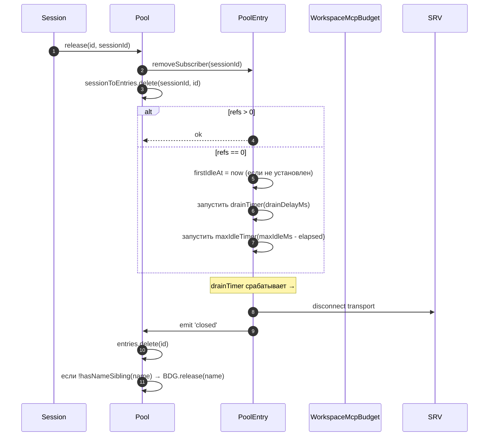
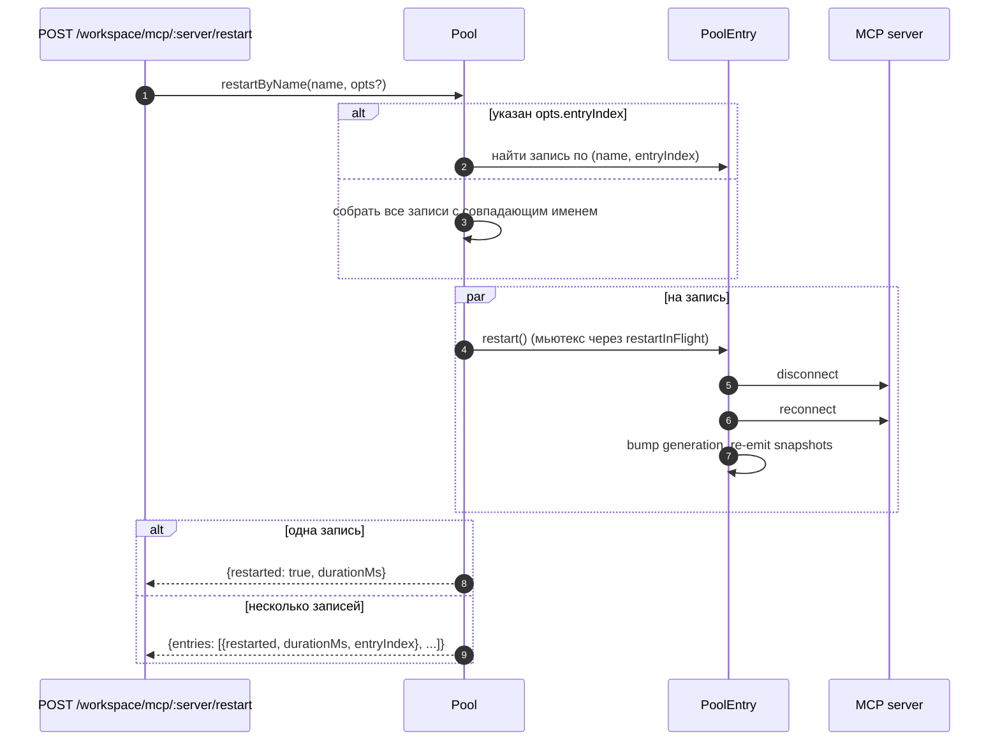
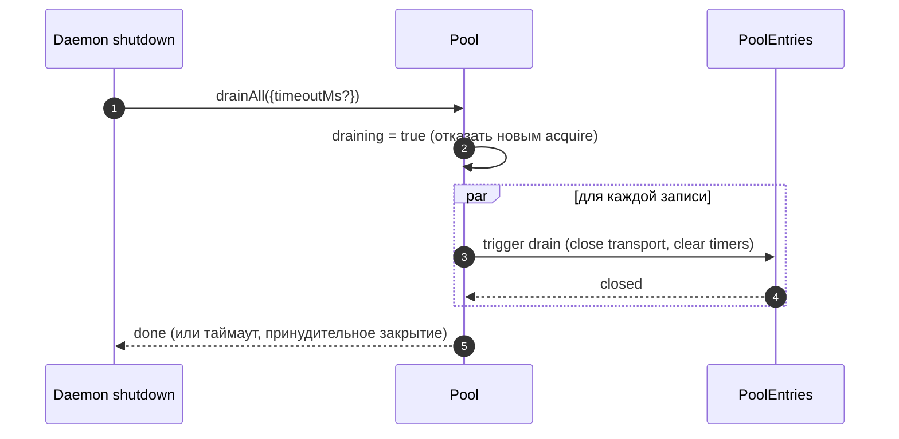

# Пул транспортов MCP рабочей области

## Обзор

`McpTransportPool` (`packages/core/src/tools/mcp-transport-pool.ts`) — это пул уровня рабочей области F2 (#4175 commit 5): несколько сессий ACP на одном демоне используют один транспорт на каждый уникальный кортеж `(serverName + configFingerprint)`, вместо того чтобы каждая сессия создавала свой дочерний процесс MCP. Пул живёт **внутри дочернего процесса ACP** (`NessyAgent.mcpPool`), конструируется один раз при запуске агента с бутстрап `Config` демона и переживает жизненные циклы сессий. Записи ведут учёт сессий через подсчёт ссылок и закрываются после настраиваемого льготного периода, когда счётчик ссылок достигает нуля.

Это основной механизм, предотвращающий форк одного экземпляра каждого MCP-сервера на сессию в демоне с несколькими сессиями.

## Обязанности

- Получение или создание одного MCP-транспорта на каждый `(name + fingerprint)`, дедупликация конкурентных получений через `spawnInFlight`.
- Освобождение ссылок на сессию; запуск таймера слива записи, когда последняя ссылка отсоединяется.
- Переживание колебаний счётчика ссылок с жёстким ограничением `MAX_IDLE_MS`, чтобы нестабильный клиент не мог бесконечно удерживать простаивающий транспорт.
- Учёт сессий в обратном индексе (`sessionToEntries`), чтобы `releaseSession(sessionId)` работал за O(refs), а не O(entries).
- Перезапуск записей по требованию (`restartByName`) — для одной записи возвращается `{restarted, durationMs}`, для нескольких записей — `{entries: RestartResult[]}` (контракт F2 для нескольких записей).
- Слив всего пула при завершении работы демона с настраиваемым таймаутом; отказ в новых получениях во время слива.
- Консультация с `WorkspaceMcpBudget` (см. [`06-mcp-budget-guardrails.md`](./06-mcp-budget-guardrails.md)) при `acquire` для применения ограничений на резервирование по имени; освобождение слота при закрытии записи, когда никакая родственная запись не удерживает то же имя.
- Создание отфильтрованных снимков инструментов/подсказок на сессию через `SessionMcpView`, чтобы обнаружение в одной сессии не регистрировало инструменты в других сессиях.

## Архитектура

### Публичный интерфейс

```ts
class McpTransportPool {
  constructor(cliConfig: Config, options: McpTransportPoolOptions);
  acquire(
    serverName,
    cfg,
    sessionId,
    sessionToolRegistry,
    sessionPromptRegistry,
  ): Promise<PooledConnection>;
  release(id, sessionId): void;
  releaseSession(sessionId): void;
  restartByName(
    name,
    opts?,
  ): Promise<RestartResult | { entries: RestartResult[] }>;
  drainAll(opts?): Promise<void>;
  getBudget(): WorkspaceMcpBudget | undefined;
  getSnapshot(): McpPoolSnapshot;
}
```

`McpTransportPoolOptions`:

- `workspaceContext: WorkspaceContext` (обязательно).
- `debugMode: boolean`.
- `sendSdkMcpMessage?` — колбэк на сессию (пул обходит SDK MCP).
- `pooledTransports?: ReadonlySet<McpTransportKind>` — по умолчанию `{stdio, websocket}`. Транспорты HTTP/SSE по умолчанию не объединяются в пул, потому что их заголовки могут содержать специфичные для сессии OAuth-состояния, но операторы могут явно включить их в пул через `NESSY_SERVE_MCP_POOL_TRANSPORTS`.
- `drainDelayMs?` — по умолчанию `30_000`.
- `entryOptions?: (transport) => PoolEntryOptions`.
- `budget?: WorkspaceMcpBudget`.

### Внутреннее состояние

| Состояние          | Тип                                     | Назначение                                                                                              |
| ------------------ | --------------------------------------- | ------------------------------------------------------------------------------------------------------- |
| `entries`          | `Map<ConnectionId, PoolEntry>`          | Активные записи пула, ключи — `connectionIdOf(name, fingerprint)`.                                      |
| `unpooledIds`      | `Set<ConnectionId>`                     | Записи для транспортов вне настроенного списка `pooledTransports`.                                      |
| `spawnInFlight`    | `Map<ConnectionId, Promise<PoolEntry>>` | Дедупликация конкурентных холодных получений для одного ключа.                                          |
| `sessionToEntries` | `Map<string, Set<ConnectionId>>`        | Обратный индекс V21-2 для `releaseSession` за O(refs).                                                  |
| `draining`         | `boolean`                               | Мьютекс слива — после установки все вызовы `acquire` отклоняются.                                       |
| `nextIndexByName`  | `Map<string, number>`                   | Монотонный `entryIndex` V21-7 на имя сервера (дашборды не перетасовываются при появлении новой записи). |

### `PoolEntry` (структура на запись, `mcp-pool-entry.ts`)

Автомат состояний: `spawning → active ⇄ (active ↔ reconnect) → (active → draining на последнем отсоединении, draining → active при присоединении ИЛИ draining → closed по таймеру)`.

| Поле                                                   | Назначение                                                                                                  |
| ------------------------------------------------------ | ----------------------------------------------------------------------------------------------------------- |
| `localStatus: MCPServerStatus`                         | Управляется жизненным циклом `MCPServerStatus`.                                                             |
| `state: PoolEntryState`                                | `spawning`/`active`/`draining`/`closed`/`failed`.                                                           |
| `generation: number`                                   | Увеличивается при каждом перезапуске; подписчики сравнивают для обнаружения циклов переподключения.         |
| `refs: Set<string>`                                    | Идентификаторы сессий, currently attached.                                                                  |
| `subscribers: Map<string, SessionMcpView>`             | Отфильтрованные представления на сессию.                                                                    |
| `subscriberHandles: Map<string, PooledConnectionImpl>` | Дескрипторы, возвращённые из `acquire`.                                                                     |
| `toolsSnapshot[], promptsSnapshot[]`                   | Канонические снимки уровня пула; перевыпускаются при `toolsChanged` / `promptsChanged`.                     |
| `drainTimer?`                                          | Запускается при `refs.size === 0`; по умолчанию 30 с. Сбрасывается при присоединении.                       |
| `maxIdleTimer?`                                        | Запускается при первом простое; никогда не сбрасывается при колебаниях acquire/release. По умолчанию 5 мин. |
| `firstIdleAt?`                                         | Водяной знак для жёсткого ограничения max-idle.                                                             |
| `restartInFlight?`                                     | Мьютекс для `restart()`.                                                                                    |

### `PoolEntryOptions`

```ts
interface PoolEntryOptions {
  drainDelayMs: number; // default 30_000
  maxIdleMs: number; // default 5 * 60_000
  maxReconnectAttempts: number; // default 3 (stdio/ws) or 5 (http/sse)
  reconnectStrategy:
    | { kind: 'fixed'; delayMs: number }
    | { kind: 'exponential'; baseMs: number; capMs: number };
}
```

`defaultPoolEntryOptions(transport)` (`mcp-pool-entry.ts`) возвращает значения по умолчанию для stdio/ws `{fixed 5s, 3 attempts}` и для http/sse `{exponential 1s → 16s, 5 attempts}`. Удалённые транспорты получают более длительные бюджеты повторных попыток, потому что их сбои чаще временные.

## Рабочий процесс

### `acquire`

```mermaid
sequenceDiagram
    autonumber
    participant S as Session
    participant P as Pool
    participant SIF as spawnInFlight
    participant E as PoolEntry
    participant BDG as WorkspaceMcpBudget
    participant SRV as MCP server

    S->>P: acquire(name, cfg, sessionId, sessionToolRegistry, sessionPromptRegistry)
    P->>P: отказать, если draining
    P->>P: connectionId = connectionIdOf(name, fingerprint)
    P->>P: если !isPoolable(cfg) → пометить как unpooled
    alt entry в entries (тёплый)
        E-->>P: существующий PoolEntry
    else холодный спавн в полёте
        SIF-->>P: существующий Promise<PoolEntry>
    else холодный старт
        P->>BDG: tryReserve(name) (если budget установлен + poolable)
        BDG-->>P: 'reserved' | 'already_held' | 'refused'
        alt refused
            P->>BDG: recordRefusal(name, transport)
            P-->>S: BudgetExhaustedError
        else ok
            P->>E: spawnEntry(name, cfg)
            E->>SRV: connect transport
            SRV-->>E: ready
            P->>P: entries.set(id, E); nextIndexByName++
            E-->>P: connected
        end
    end
    P->>E: addSubscriber(sessionId, sessionToolRegistry, sessionPromptRegistry)
    P->>P: sessionToEntries.add(sessionId, id)
    P->>P: отменить таймер слива (refs>0)
    P-->>S: PooledConnection { id, serverName, entryIndex, client, toolsSnapshot, promptsSnapshot, on, off, release }
```

### `release` + слив



`hasNameSibling(name)` (`mcp-transport-pool.ts`) итерирует оба `entries.values()` и `spawnInFlight.keys()`, разбирая последние через `parseConnectionId` (имена серверов могут законно содержать `::`, поэтому `startsWith` дал бы ложные срабатывания на родственном имени, начинающемся с `${name}::`).

`releaseSession(sessionId)` читает из `sessionToEntries`, освобождает все указанные записи за O(refs), затем очищает запись индекса. Используется в пути закрытия сессии моста, чтобы не итерировать полную карту записей.

### `restartByName`



Предварительная проверка бюджета на уровне HTTP демона возвращает `{restarted:false, skipped:true, reason:'budget_would_exceed'}` (управление мутациями Wave 4), когда слот цели ещё не зарезервирован и перезапуск pushed бы live count сверх бюджета `enforce`.

### `drainAll`



## Состояние и жизненный цикл

- Конструкция пула синхронна; первый `acquire` холодно запускает транспорт.
- `drainDelayMs` (по умолчанию 30 с) сбрасывается до отмены при присоединении.
- `maxIdleMs` (по умолчанию 5 мин) **никогда** не сбрасывается при присоединении/отсоединении — он начинает тикать при ПЕРВОМ простое и останавливается только когда запись фактически закрывается или присоединяется до дедлайна. Защита от нестабильных клиентов.
- `nextIndexByName` монотонен. Старые записи сохраняют свой назначенный индекс даже после появления новых, поэтому дашборды, читающие `entryIndex`, не перетасовываются.
- Сбой спавна освобождает зарезервированный слот бюджета (V21-4 — без этого холодный спавн, упавший в середине подключения, утекал бы резервирование навсегда).

## Зависимости

- `packages/core/src/tools/mcp-client.ts` — `McpClient`, enum статуса, `SendSdkMcpMessage`.
- `packages/core/src/tools/mcp-pool-entry.ts` — `PoolEntry`, `PoolEntryOptions`, `defaultPoolEntryOptions`.
- `packages/core/src/tools/mcp-pool-key.ts` — `connectionIdOf`, `parseConnectionId`, `isPoolable`, `mcpTransportOf`, `POOLED_TRANSPORTS_DEFAULT`.
- `packages/core/src/tools/mcp-pool-events.ts` — `ConnectionId`, `PoolEntryState`, `PoolEvent`.
- `packages/core/src/tools/session-mcp-view.ts` — представление на сессию, которое фильтрует снимки пула.
- `packages/core/src/tools/mcp-workspace-budget.ts` — `WorkspaceMcpBudget` (см. [`06-mcp-budget-guardrails.md`](./06-mcp-budget-guardrails.md)).
- `packages/core/src/tools/mcp-discovery-timeout.ts` — `discoveryTimeoutFor`, `runWithTimeout`.

## Конфигурация

| Источник                    | Ручка                                                           | Эффект                                                                                                                   |
| --------------------------- | --------------------------------------------------------------- | ------------------------------------------------------------------------------------------------------------------------ |
| Env                         | `NESSY_SERVE_NO_MCP_POOL=1`                                     | Kill switch — `NessyAgent.mcpPool` остаётся undefined; `McpClientManager` на сессию применяет (путь до-F2).              |
| Флаг                        | `--mcp-client-budget=N`, `--mcp-budget-mode={off,warn,enforce}` | Передаётся дочернему процессу ACP через `childEnvOverrides`; ребёнок конструирует `WorkspaceMcpBudget` и передаёт в пул. |
| Теги возможностей (условно) | `mcp_workspace_pool`, `mcp_pool_restart`                        | Объявляются вместе, когда пул включён. SDK делает pre-flight обоих для ветвления на формы ответов, учитывающие пул.      |

### Непулированные записи (HTTP / SSE / SDK-MCP)

Транспорты вне настроенного списка `pooledTransports` (HTTP, SSE и SDK-MCP по умолчанию) идут отдельным путём: `createUnpooledConnection(name, cfg, sessionId, ...)` (`mcp-transport-pool.ts`) создаёт запись на сессию с id `${name}::unpooled-${entryIndex}`. Отличия от пулированных записей:

- Хранятся в `entries` И отслеживаются в `unpooledIds: Set<ConnectionId>`, чтобы `release` / `releaseSession` могли быстро закрывать при отсоединении (refs всегда максимум 1).
- `McpClient.discover()` используется напрямую вместо повтора пула; `applyTools` / `applyPrompts` — no-ops, потому что реестры сессии уже содержат то, что было зарегистрировано (W77 / `skipReplay: true` в `attach()`).
- Бюджет рабочей области всё ещё применяется — последующее действие F2 закрыло лазейку, где непуплированные соединения обходили `tryReserve`; тот же слот `WorkspaceMcpBudget` резервируется и освобождается при закрытии записи (пулированной или нет).

Гонка W77 (`cb206da36`): `createUnpooledConnection` сохраняет запись в `this.entries` ДО ожидания `client.connect()` / `client.discover()`, но индексирует `sessionToEntries[sessionId]` ТОЛЬКО ПОСЛЕ успеха `attach()`. Конкурентный `closeStoredSession()` / `releaseSession(sessionId)` во время окна connect/discover видел пустой индекс, позволял завершиться непуплированному спавну, и `attach()` затем регистрировал инструменты/подсказки в уже закрытой сессии. Исправление:

- `mcp-pool-entry.ts`: публичный зонд `isTerminated(): boolean` (`state === 'closed' || state === 'failed'`).
- `mcp-pool-entry.ts`: `markActive()` коротко замыкает, если `isTerminated()`, чтобы разобранная запись не могла воскреснуть в `'active'`.
- Вызывающие (непулированный путь пула) зондируют `isTerminated()` между ожиданиями и прерывают attach, если родительская сессия ушла.

Эта гонка была скрыта на момент написания (хуки `releaseSession` W61/W71 на сессию приземляются в F4), но стала бы живой в момент появления этого хука. Исправление было применено рано в серии F2.

## Поля снимка `GET /workspace/mcp`, учитывающие пул

Когда пул активен, каждая ячейка сервера `ServeWorkspaceMcpStatus`
(`packages/acp-bridge/src/status.ts`) включает три дополнительных поля:

| Поле             | Тип                                         | Назначение                                                                                                                                                                                                                                                                                                                                                   |
| ---------------- | ------------------------------------------- | ------------------------------------------------------------------------------------------------------------------------------------------------------------------------------------------------------------------------------------------------------------------------------------------------------------------------------------------------------------ |
| `disabledReason` | `'config' \| 'budget'`                      | Различает отключённые оператором серверы (`disabled: true` из `disabledMcpServers`) от отказа бюджета (`status: 'error', errorKind: 'budget_exhausted'`). Дашборды могут отображать одну строку сервера без перекрёстного чтения `errors[]` или `budgets[]`.                                                                                                 |
| `entryCount`     | `number` (`>=1`)                            | В режиме пула рабочая область может иметь несколько экземпляров `PoolEntry` с одним именем, когда сессии вставляют разные fingerprint, такие как заголовки OAuth на сессию. Это поле отсутствует, когда `NESSY_SERVE_NO_MCP_POOL=1` отключает пул. Новые клиенты отображают бейдж "N записей" при `entryCount > 1`.                                          |
| `entrySummary`   | `ReadonlyArray<{entryIndex, refs, status}>` | Разбивка на записи. `entryIndex` — стабильное абстрактное целое число, назначенное при создании записи; это не сырой fingerprint, поэтому снимки не утекают время вращения OAuth или env. `refs` — текущее количество присоединённых сессий. `status` позволяет дашбордам показывать работоспособность на запись, пока агрегатный `mcpStatus` уже подключён. |

`(entryCount, entrySummary)` всегда передаются парой. Тег возможности
`mcp_workspace_pool` подразумевает оба поля. Старые клиенты SDK игнорируют их
в рамках аддитивного протокольного контракта.

Снимки пула также предоставляют `subprocessCount`. Он считает только
семейство `'stdio'`. Транспорты WebSocket, HTTP и SSE подключаются к удалённым серверам и не создают локальные дочерние процессы. Ранние версии считали транспорты WebSocket как локальные дочерние процессы, что раздувало дашборды ресурсов.

## Слив идёт от обоих путей завершения

Слив пула не ограничивается обработчиком SIGTERM. Нормальный путь завершения IDE
(`await connection.closed`) также вызывает `drainAll` через
`packages/cli/src/acp-integration/acpAgent.ts`'s `drainPoolBeforeExit`. Получает
ли демон сигнал процесса или IDE чисто закрывает соединение, пул входит в
`draining`, отказывает в новых получениях и ждёт закрытия записей.

## `/mcp refresh` разделяет путь обнаружения при загрузке

`discoverAllMcpTools` (обнаружение при загрузке) и
`discoverAllMcpToolsIncremental` (`/mcp refresh` / горячая перезагрузка) оба консультируются с
пулом первым в режиме пула (`packages/core/src/tools/mcp-client-manager.ts`). Общий
шлюз предотвращает случайное создание клиента на сессию при горячей перезагрузке,
двойной счёт бюджета или оставление транспорта-сироты.

## Вызовы инструментов в полёте во время переподключения (`MCPCallInterruptedError`)

Когда базовый MCP-транспорт молча отключается (соединение перескакивает
из `'active'` / `'draining'` в `localStatus === DISCONNECTED` без явного закрытия), пул помечает запись как `'failed'`, удаляет её из
`pool.entries` и emit'ит событие `failed` перед отсоединением представлений подписчика. Порядок emit-перед-отсоединением важен: подписчики получают событие `failed` достаточно скоро, чтобы направить ожидающие промисы `callTool` в
`MCPCallInterruptedError`, поэтому застрявшее `await client.callTool(...)` чисто отклоняется вместо зависания. `forceShutdown` использует тот же порядок emit-затем-отсоединение.

## Нормализация fingerprint и `canonicalOAuth`

Ключ пула происходит из `fingerprint(cfg)` в `mcp-pool-key.ts`. Хеш покрывает
все поля, определяющие транспорт:

> `transport, command, args, cwd, env, url, httpUrl, tcp, headers, timeout, oauth`

Поля фильтрации и метаданных на сессию (`includeTools`, `excludeTools`,
`trust`, `description`, `extensionName`, `discoveryTimeoutMs`) исключены, поэтому
сессии с разными фильтрами могут разделять одну запись.

Для ячейки OAuth `canonicalOAuth(o)` хеширует каждое поле `MCPOAuthConfig`:
`clientId`, `clientSecret`, отсортированные `scopes`, отсортированные `audiences`,
`authorizationUrl`, `tokenUrl`, `redirectUri`, `tokenParamName` и
`registrationUrl`. Это контракт изоляции учётных данных: две конфигурации сессии, различающиеся только `clientSecret`, `audiences` или `redirectUri`, получают разные fingerprint и не могут разделять одну запись. Конфиденциальные клиенты и развёртывания с несколькими аудиториями зависят от этого.

Сортировка `scopes` и `audiences` делает порядок вызова неважным. Явный
`null` нормализуется, чтобы неопределённые поля хешировались так же, как явный null. Ключ не включает `discoveryTimeoutMs`; конкурентные вызовы acquire с одним ключом, но разными таймаутами — «первый побеждает», что соответствует поведению менеджера на сессию до-F2.

`PoolEntry` держит `cfg: MCPServerConfig` приватным. Внешний код должен использовать геттер `entry.transportKind`, когда ему нужно семейство транспорта. Это предотвращает случайную утечку полей env, header auth и OAuth потребителям.

## Выгрузка расширений опирается на `MAX_IDLE_MS`

Намеренно отсутствует активный путь очистки для выгрузки MCP-расширения во
время выполнения. Записи-сироты, чей `MCPServerConfig` больше не появляется в объединённых
настройках рабочей области, изымаются естественным образом жёстким ограничением `MAX_IDLE_MS` после отсоединения последнего подписчика. Синхронный путь очистки выгрузки добавил бы сложности для редкого краевого случая оператора; жёсткое ограничение ограничивает время жизни процесса-сироты после точки выгрузки до 5 минут по умолчанию.

Операторы, которым нужна более быстрая очистка, могут перезапустить демон или вызвать
`POST /workspace/mcp/:server/restart` для теперь несконфигурированного имени, что идёт через путь отключённого сервера и разбирает запись.

## Наблюдаемость самоисцеления

Пул emit'ит два структурированных диагноза на пути самоисцеления:

**`McpClient.lastTransportError: Error | undefined`** (`packages/core/src/tools/mcp-client.ts`) — `McpClient.onerror` сохраняет последнее исключение транспорта в приватном поле и очищает его при входе `connect()`. Путь молчаливого сброса `PoolEntry` читает `client.getLastTransportError()` и включает его в `emit({kind:'failed', lastError})`, поэтому подписчики и дашборды не должны grep'ить stderr для первопричины.

**`SweepResult`** (внутренний интерфейс, не экспортируется; `packages/core/src/tools/mcp-pool-entry.ts`) — `sweepAndDisconnect(reason)` возвращает `Promise<SweepResult>`:

```ts
interface SweepResult {
  pidSweepError?: Error; // listDescendantPids itself threw
  descendantsFound?: number; // descendant pid count found
  descendantsSignaled?: number; // successfully SIGTERM'd count
}
```

Единственный потребитель — блок молчаливого сброса в `statusChangeListener`. Он использует
`descendantsFound` / `descendantsSignaled` для обнаружения случаев частичного сигнала
(меньше процессов сигнализировано, чем найдено, обычно потому что процесс вышел или EPERM
произошёл между `listDescendantPids` и `sigtermPids`) и ошибок sweep, затем
логирует структурированное предупреждение. `forceShutdown` и `doRestart` игнорируют это возвращаемое значение, потому что их пути catch уже несут более богатые сигналы сбоя.

## Очистка подпроцессов: путь снимка `pid-descendants`

Когда `McpTransportPool` закрывает подпроцессы stdio, он должен перечислить их
дочерние процессы; обёртки `npx` и shell-обёртки могут создавать несколько уровней fork. `packages/core/src/tools/pid-descendants.ts` предоставляет
`listDescendantPids(rootPid) → Promise<number[]>` и `sigtermPids(pids)` для
`sweepAndDisconnect`.

### Основной путь Linux / macOS

Один снимок `ps -A -o pid=,ppid=` читает таблицу процессов, разбирает её в
`Map<ppid, pid[]>`, затем `walkDescendants(tree, root)` выполняет BFS для извлечения
поддерева. Любая глубина требует только одного fork `ps`.

`walkDescendants` поддерживает `visited: Set<number>` и включает `root` в
набор для защиты от циклов повторного использования PID. При быстром колебании процессов снимок
теоретически может содержать циклы A→B / B→A. Без `visited` walker мог бы
заполнить квоту `MAX_DESCENDANTS` фиктивными данными и вытеснить реальных потомков.

### Основной путь Windows

Один снимок `Get-CimInstance Win32_Process | ConvertTo-Csv -Delimiter ","`
emit'ит все строки `(ProcessId, ParentProcessId)`, затем запускается тот же путь `Map` и
`walkDescendants`.

Явный `-Delimiter ","` требуется. PowerShell 5.1, который поставляется с
Windows, по умолчанию использует `ConvertTo-Csv` с разделителем списка локали системы; DE, FR,
NL, IT и подобные локали используют `;`, поэтому префикс-парсер
`^"(\d+)","(\d+)"$` никогда не совпадал, и каждый завершение работы демона падал обратно на путь фильтра CIM на pid, добавляя примерно 0,5-1 с стоимости запуска PowerShell на ребёнка.

### Путь отката

BusyBox `<v1.28` не имеет `ps -o`, distroless-контейнеры могут не включать `ps`,
а некоторые W... [сокращено]

При разборе пути нуль строк или выбросе, код падает обратно на BFS на pid: Linux /
macOS используют `pgrep -P <pid>`, а Windows использует
`Get-CimInstance -Filter "ParentProcessId=$p"`, где `$p` — связывание переменной PowerShell, а не конкатенация строк. Текущий
защитник `Number.isInteger` достаточен для точки входа; связывание — защита в глубину.

### Общие ограничения

Оба пути ограничены `MAX_DESCENDANTS = 256` и `MAX_DEPTH = 8`, чтобы злонамеренное или вырожденное дерево процессов не замедляло sweep.

Путь снимка использует `maxBuffer: 8MB`, достаточно для патологических хостов с
около 250k процессов. Буфер по умолчанию Node 1MB может обрезать вывод дочернего процесса
около 30k процессов.

Прирост производительности намеренно скромен (типичные 200-500 процессов dev
машины разбираются за менее чем 10 мс, примерно в 2 раза быстрее, чем `pgrep` на pid). Основное
преимущество — гигиена fork и согласованность снимка: BFS видит полное поддерево сразу, в то время как предыдущий путь запроса на pid мог пропустить внучатый процесс, fork'нутый между двумя запросами.

## Заметка встраивающего: конструктор `McpClientManager`

`McpClientManager` конструируется как
`(config, toolRegistry, options?: McpClientManagerOptions)`. Встраивающие, которые
импортируют класс напрямую, должны передать:

```ts
new McpClientManager(config, toolRegistry, {
  eventEmitter,
  sendSdkMcpMessage,
  healthConfig,
  budgetConfig,
  pool,
});
```

Тесты должны предпочитать фабрику `mkManager(overrides?)`, чтобы случаи, заботящиеся об
одном-двух полях, оставались в одну строку.

## Заметки реализации

Эти хелперы внутренние, но читатели исходников могут их увидеть:

- `McpTransportPool.acquire()` использует `attachPooledSession` и `rollbackReservationOnSpawnFailure` для разделения быстрого пути attach, post-spawn attach и поведения catch spawn-in-flight в пуле. Поведение времени выполнения неизменно; инварианты окна гонки всё ещё живут на сайтах вызовов.
- `SessionMcpView.applyTools` / `applyPrompts` компилируют `includeTools` / `excludeTools` один раз через `compileNameFilter(cfg)` и проверяют каждый инструмент с `compiledFilterAccepts(compiled, name)`. Экспортированные `passesSessionFilter` / `passesSessionPromptFilter` используют тот же компилированный путь. `excludeTools` — точное совпадение; `includeTools` удаляет первый суффикс `(...)` так, чтобы `toolName(args)` совпадал с `toolName`.

Дизайн-документ: [`../../../design/f2-mcp-transport-pool.md`](../../../design/f2-mcp-transport-pool.md) §6 покрывает автомат состояний пула транспортов, переподключение, слив и пути sweep потомков.

## Ограничения и известные пределы

- **Транспорты HTTP / SSE не пулируются по умолчанию** — если операторы явно не включат их в `NESSY_SERVE_MCP_POOL_TRANSPORTS`, каждый acquire создаёт свежую запись, которая живёт только пока её сессия. Их заголовки могут содержать специфичные для сессии OAuth-состояния, поэтому объединение их в пул по умолчанию рисковало бы утечкой учётных данных между сессиями.
- **`maxIdleMs` — жёсткое ограничение, переживающее колебания attach/detach.** Жёсткое ограничение простоя 5 минут означает, что даже агрессивно присоединяющийся/отсоединяющийся клиент не может удерживать простаивающий транспорт дольше 5 минут. Операторы, желающие закрепить долгоживущие транспорты, должны увеличить `maxIdleMs` или запустить сервер вне пула.
- **Слоты бюджета на имя сервера** означают, что две записи пула с одним именем, но разными fingerprint потребляют ОДИН слот вместе, а не два. Учёт подпроцессов предоставляется отдельно через `pool.getSnapshot().subprocessCount`.
- **Регрессия `startsWith`** была избежана в `hasNameSibling`, потому что имена MCP-серверов могут законно содержать `::` (`mcp-pool-key.test.ts`). Всегда используйте разделение `parseConnectionId` по `lastIndexOf('::')`, никогда — сопоставление строковых префиксов.
- **Слив пула односторонний** — `drainAll` устанавливает `draining = true` навсегда; для дальнейшей работы требуется свежий пул.

## Ссылки

- `packages/core/src/tools/mcp-transport-pool.ts` (весь файл)
- `packages/core/src/tools/mcp-pool-entry.ts` (жизненный цикл записи)
- `packages/core/src/tools/mcp-pool-key.ts` (`connectionIdOf`, `parseConnectionId`)
- `packages/core/src/tools/mcp-pool-events.ts` (типы событий)
- `packages/core/src/tools/session-mcp-view.ts` (отфильтрованное представление на сессию)
- Дизайн-документ F2 (v2.2, с changelog fold-in ревью 32 пунктов): [`../../../design/f2-mcp-transport-pool.md`](../../../design/f2-mcp-transport-pool.md). Считайте дизайн-контракт авторитетным; эта страница — глубокое погружение разработчика.
- Заметки дизайна F2: issue [#4175](https://github.com/NessyLM/nessy-cli/issues/4175) (коммиты 4-6 серии F2).
