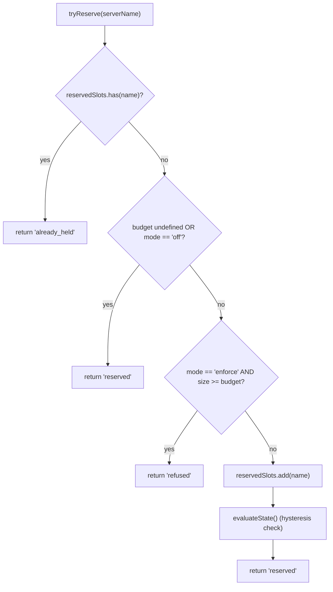
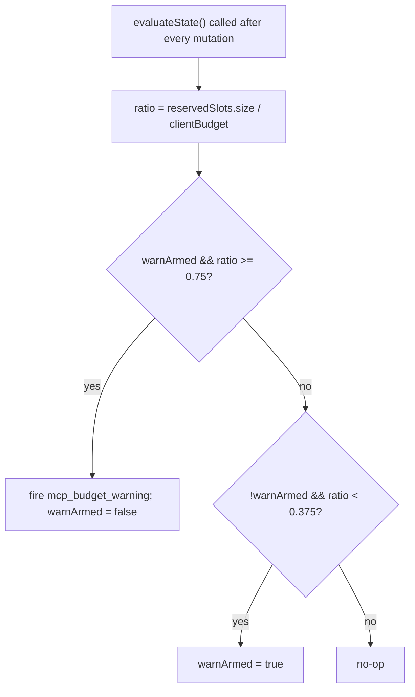

# Ограничения бюджета MCP рабочего пространства

## Обзор

`WorkspaceMcpBudget` (`packages/core/src/tools/mcp-workspace-budget.ts`) — контроллер бюджета клиентов MCP на уровне рабочего пространства из F2 (#4175, коммит 6). Он реализует тот же автомат состояний, который встроен в `McpClientManager` (резервирование слотов, предупреждение с гистерезисом на уровне 75 %, объединение отказов в пакет в ходе прохода `discoverAllMcpTools*`), но существует **в единственном экземпляре для рабочего пространства** внутри `McpTransportPool`, а не отдельно в менеджере каждого дочернего ACP-процесса сессии. Пул делегирует ему вызовы `acquire` и `release`, поэтому ограничение применяется к **рабочему пространству**, а не к каждой сессии.

Устаревший механизм бюджета `McpClientManager` сохраняется для автономного nessy и MCP-серверов SDK (они обходят пул согласно исправлению в коммите 4). В режиме пула ограничения обеспечивает `WorkspaceMcpBudget`; для автономного режима и MCP SDK — встроенный механизм менеджера. Двойного учёта нет, поскольку обнаружение через пул не вызывает `tryReserveSlot` менеджера.

## Обязанности

- Хранить `reservedSlots: Set<string>` с ИМЕНАМИ серверов, слоты которых сейчас заняты (ключ слота задаётся на ИМЯ, как в PR 14 v1).
- `tryReserve(name) → 'reserved' | 'already_held' | 'refused'` — атомарная синхронная операция, чтобы параллельные вызовы `Promise.all` не могли преодолеть ограничение на границе `await`.
- `release(name) → boolean` — идемпотентная операция (семантика `Set.delete`).
- Однократно отправлять `mcp_budget_warning` при пересечении снизу уровня 75 % для `reservedSlots.size / clientBudget`; повторно взводить предупреждение только после снижения ниже 37,5 %.
- Объединять отказы отдельных серверов в ходе массового обнаружения: вызовы `beginBulkPass()` / `endBulkPass()` ограничивают окно накопления отказов в одно событие `mcp_child_refused_batch`.
- Хранить `lastRefusedServerNames` для потребителей снимка (`GET /workspace/mcp`): список очищается в НАЧАЛЕ следующего массового прохода, а НЕ при отправке события, чтобы снимок между проходами по-прежнему содержал последний набор отказов.

## Архитектура

### Конфигурация

```ts
new WorkspaceMcpBudget({
  clientBudget?: number,           // undefined = unlimited
  mode: 'off' | 'warn' | 'enforce',
  onEvent?: (event: McpBudgetEvent) => void,
});
```

Семантика `mode`:

- `off` — все методы ничего не делают; `tryReserve` всегда возвращает `'reserved'`; события не отправляются.
- `warn` — слоты учитываются, а на уровне 75 % отправляется `mcp_budget_warning`, но `tryReserve` НИКОГДА не отказывает.
- `enforce` — `tryReserve` отказывает после исчерпания `clientBudget`; `recordRefusal` ставит отказы отдельных серверов в очередь; `endBulkPass` отправляет `mcp_child_refused_batch`.

### Константы из `mcp-client-manager.ts`

- `MCP_BUDGET_WARN_FRACTION = 0.75` — верхний порог.
- `MCP_BUDGET_REARM_FRACTION = 0.375` — нижний порог повторного взведения гистерезиса.
- `McpBudgetMode = 'off' | 'warn' | 'enforce'`.

### Внутреннее состояние

| Состояние                                          | Назначение                                                                                                                    |
| -------------------------------------------------- | ----------------------------------------------------------------------------------------------------------------------------- |
| `reservedSlots: Set<string>`                       | Авторитетный набор резервирований; гистерезис оценивает `size / clientBudget`.                                                |
| `pendingRefusalNames: Set<string>`                 | Имена отказов, накопленные в текущем окне `beginBulkPass`/`endBulkPass`; извлекаются в `endBulkPass`.                         |
| `pendingRefusalTransports: Map<string, transport>` | Вспомогательное хранилище транспорта каждого сервера для отправляемого пакета.                                                |
| `lastRefusedServerNames: readonly string[]`        | Доступный в снимке список отказов последнего завершённого прохода. Очищается в начале следующего прохода.                     |
| `warnArmed: boolean`                               | Состояние гистерезиса: true — предупреждение готово к отправке, false — уже отправлено после последнего снижения ниже 37,5 %. |
| `bulkPassDepth: number`                            | Счётчик повторного входа для вложенных массовых проходов (вложенные проходы не должны дублировать событие).                   |

## Рабочий процесс

### `tryReserve`



`tryReserve` выполняется **синхронно**. Метод пула `acquire` асинхронный, но резервирование происходит до любого `await`, поэтому два параллельных вызова `Promise.all` для разных имён не могут одновременно пройти ограничение.

### Гистерезис



Гистерезис предотвращает повторные предупреждения, когда нагрузка колеблется около 75 %. Первое пересечение вызывает событие; последующие пересечения без снижения до 37,5 % — нет.

### Объединение отказов в пакет

```mermaid
sequenceDiagram
    autonumber
    participant POOL as pool.discoverAllMcpToolsViaPool
    participant BDG as WorkspaceMcpBudget
    participant EB as EventBus

    POOL->>BDG: beginBulkPass()
    BDG->>BDG: bulkPassDepth++<br/>clear lastRefusedServerNames if outermost
    loop per server in pass
        POOL->>BDG: tryReserve(name)
        alt refused
            POOL->>BDG: recordRefusal(name, transport)
            BDG->>BDG: pendingRefusalNames.add; pendingRefusalTransports.set
            Note over BDG: NO event yet (coalesce)
        end
    end
    POOL->>BDG: endBulkPass()
    BDG->>BDG: bulkPassDepth--
    alt outermost (depth == 0) AND pending non-empty
        BDG->>EB: emit mcp_child_refused_batch<br/>{refusedServers, budget, liveCount, reservedCount, mode: 'enforce', scope?: 'workspace'}
        BDG->>BDG: lastRefusedServerNames = drain pendingRefusalNames
    end
```

Отказы вне прохода (например, ленивый запуск `readResource`, полностью обходящий массовый проход) немедленно отправляются как пакеты длины 1 для единообразия формы. Вложенные проходы (`bulkPassDepth > 0`) не отправляют событие; объединённый пакет отправляет только завершение самого внешнего прохода.

## Состояние и жизненный цикл

- Контроллер бюджета создаётся один раз на рабочее пространство при инициализации пула.
- `clientBudget` неизменяем после создания; изменение во время работы требует пересоздания пула.
- `mode` также неизменяем (`onEvent` сохраняется как `undefined` при `mode === 'off'` для эшелонированной защиты).
- `warnArmed` изначально равен true и возвращается в true после снижения ниже 37,5 %.
- `lastRefusedServerNames` НЕ очищается при отправке из `endBulkPass`, а только в НАЧАЛЕ следующего массового прохода. Поэтому маршрут снимка между проходами всё ещё показывает последний набор отказов; иначе панели сразу после доставки события показывали бы пустой список.

## Зависимости

- `packages/core/src/tools/mcp-client-manager.ts` — повторно используются `McpBudgetEvent`, `McpBudgetMode`, `McpRefusedServer`, `MCP_BUDGET_WARN_FRACTION`, `MCP_BUDGET_REARM_FRACTION`, `BudgetExhaustedError` (пул выбрасывает его из `acquire` при отказе).
- `packages/core/src/tools/mcp-transport-pool.ts` — потребляет бюджет и передаёт события в EventBus демона через обработчик пула `onEvent`.
- Маршрут снимка демона `GET /workspace/mcp` — читает `getReservedSlots()`, `getRefusedServerNames()`, `getReservedCount()`, `getBudget()`, `getMode()`.

## Конфигурация

| Источник          | Параметр                                                                                 | Эффект                                                                                                      |
| ----------------- | ---------------------------------------------------------------------------------------- | ----------------------------------------------------------------------------------------------------------- |
| Флаг              | `--mcp-client-budget=N`                                                                  | Задаёт `clientBudget` контроллера рабочего пространства.                                                    |
| Флаг              | `--mcp-budget-mode={off,warn,enforce}`                                                   | Задаёт `mode`. Для `enforce` требуется положительный `clientBudget`, иначе запуск явно завершается ошибкой. |
| Переменная среды  | `NESSY_SERVE_MCP_CLIENT_BUDGET`, `NESSY_SERVE_MCP_BUDGET_MODE`                           | Передаются дочернему ACP-процессу через `childEnvOverrides`; их читает дочерний `readBudgetFromEnv()`.      |
| Теги возможностей | `mcp_guardrails` (всегда; `modes: ['warn', 'enforce']`), `mcp_guardrail_events` (всегда) | См. [`11-capabilities-versioning.md`](./11-capabilities-versioning.md).                                     |

## Оговорки и известные ограничения

- **Ключ резервирования задаётся на ИМЯ.** Две записи пула с одинаковым именем сервера, но разными отпечатками (например, сессии передают разные заголовки OAuth), вместе занимают ОДИН слот. Учёт подпроцессов отдельно доступен в поле `subprocessCount` снимка пула. Бюджет следует понимать как число «слотов настроенных серверов», а не число подпроцессов.
- **Гистерезис зависит от числа резервирований, а не активных подключений (`CONNECTED`).** Резервирования включают выполняющиеся подключения и сохраняются при временных разрывах, поэтому гистерезис стабилен во время переподключений. Число активных подключений передаётся в событиях как `liveCount` для потребителей SDK, которым нужен этот срез.
- **Режим `warn` никогда не отказывает.** Он учитывает резервирования и отправляет `mcp_budget_warning`, но `tryReserve` всегда возвращает `'reserved'`. Отказы существуют только в режиме `enforce`.
- **События бюджета уровня рабочего пространства содержат `scope: 'workspace'`**, поэтому одновременно распространяются на все подключённые сессии. Счётчики редьюсеров SDK `mcpBudgetWarningCount` / `mcpChildRefusedBatchCount` синхронно увеличиваются во всех сессиях одного соединения. Устаревшие события уровня сессии от `McpClientManager` не содержат `scope` (семантически по умолчанию `'session'`).
- **Аварийный переключатель `NESSY_SERVE_NO_MCP_POOL=1`** полностью отключает пул и бюджет рабочего пространства; управление переходит к `McpClientManager` каждой сессии. Из конверта возможностей исчезают `mcp_workspace_pool` и `mcp_pool_restart`, точно отражая режим.
- **`ServeMcpBudgetStatusCell.scope` имеет расширяемую форму списка.** Ячейки снимка содержат `budgets[]`, а не одиночное поле `budget?`. PR 14 v1 отправляет одну ячейку `scope: 'session'` на каждую ACP-сессию, поскольку `acpAgent.newSessionConfig()` создаёт для неё собственные `Config` / `McpClientManager`. Область `'pool'` зарезервирована для ячейки уровня пула из Wave 5 PR 23, которая будет располагаться рядом с ячейками сессий. Потребители должны игнорировать дополнительные неизвестные значения `scope`, а не завершаться с ошибкой.

## Ссылки

- `packages/core/src/tools/mcp-workspace-budget.ts` (весь класс)
- `packages/core/src/tools/mcp-client-manager.ts` (`BudgetExhaustedError`, `McpBudgetEvent`, константы гистерезиса)
- `packages/core/src/tools/mcp-transport-pool.ts` (место вызова `tryReserve` из `acquire` пула)
- Проектный документ F2 (v2.2): [`../../../design/f2-mcp-transport-pool.md`](../../../design/f2-mcp-transport-pool.md), §11 о бюджете уровня рабочего пространства и записи журнала изменений v2.2 о последующих изменениях бюджета и отпечатка.
- Проектные заметки F2: задача [#4175](https://github.com/NessyLM/nessy-cli/issues/4175), коммит 6.
