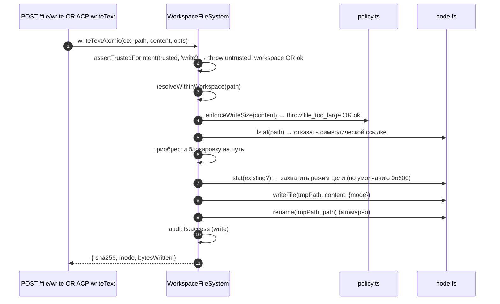
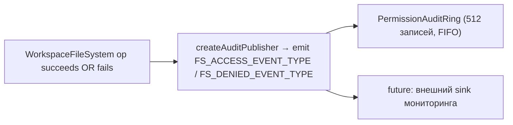

# Граница файловой системы рабочей области

## Обзор

Демон никогда не позволяет HTTP-маршрутам или вызовам агента на стороне ACP напрямую касаться файловой системы хоста. Каждое чтение, запись, список, glob и stat идут через границу `WorkspaceFileSystem` (`packages/cli/src/serve/fs/`), которая предоставляет:

- **Разрешение путей** — канонизация путей и отклонение всего, выходящего за пределы связанной рабочей области, включая через символические ссылки.
- **Управление доверием** — отказ в записи, когда рабочая область не доверена (`untrusted_workspace`).
- **Политика размера и содержимого** — ограничение чтения (`MAX_READ_BYTES = 256 KiB`), ограничение записи (`MAX_WRITE_BYTES = 5 MiB`), обнаружение бинарных файлов.
- **Атомарность** — запись-затем-переименование с сохранением режима цели и `0o600` по умолчанию для новых файлов.
- **Аудит** — каждый доступ / отказ emit'ит структурированное событие для `PermissionAuditRing` / мониторинга.
- **Типизированные ошибки** — закрытое объединение `FsErrorKind`, сопоставленное с HTTP-статусами.

HTTP-маршруты файлов (`GET /file`, `GET /file/bytes`, `POST /file/write`, `POST /file/edit`, `GET /list`, `GET /glob`, `GET /stat`) и адаптер `BridgeFileSystem` на стороне ACP (чтобы вызовы агента `readTextFile` / `writeTextFile` получали те же ограничения) оба идут через эту границу.

## Обязанности

- Разрешение путей, предоставленных пользователем, в брендированные значения `ResolvedPath`, которые остальная часть границы может безопасно использовать.
- Отказ путей вне связанной рабочей области (`path_outside_workspace`) и путей, цель которых — символическая ссылка (`symlink_escape`).
- Отказ чтений выше `MAX_READ_BYTES`, записей выше `MAX_WRITE_BYTES` и бинарных файлов (`binary_file`).
- Отказ записи/редактирования, когда рабочая область не доверена (`untrusted_workspace`) — управляется `assertTrustedForIntent(trusted, intent)`.
- Соблюдение паттернов `.gitignore` / `.nessyignore` через `shouldIgnore`.
- Выполнение атомарной записи-затем-переименования с сохранением режима цели; режим нового файла по умолчанию — `0o600`.
- Emit'ить события аудита `fs.access` / `fs.denied` на каждую операцию.
- Сопоставлять каждый сбой с `FsError` с kind и HTTP-статусом; обработчики маршрутов сериализуют их единообразно.

## Архитектура

### Макет модуля

| Файл                       | Назначение                                                                                                                                                                                                                                            |
| -------------------------- | ----------------------------------------------------------------------------------------------------------------------------------------------------------------------------------------------------------------------------------------------------- |
| `paths.ts`                 | `canonicalizeWorkspace`, `resolveWithinWorkspace`, `hasSuspiciousPathPattern`, брендированный `ResolvedPath`, объединение `Intent` (`read \| write \| list \| stat \| glob`).                                                                         |
| `policy.ts`                | `MAX_READ_BYTES`, `MAX_WRITE_BYTES`, `BINARY_PROBE_BYTES`, `assertTrustedForIntent`, `detectBinary`, `enforceReadBytesSize`, `enforceReadSize`, `enforceWriteSize`, `shouldIgnore`.                                                                   |
| `audit.ts`                 | `FS_ACCESS_EVENT_TYPE`, `FS_DENIED_EVENT_TYPE`, `createAuditPublisher`, типы полезной нагрузки аудита.                                                                                                                                                |
| `errors.ts`                | Класс `FsError`, `isFsError`, объединение `FsErrorKind` (14 видов), объединение `FsErrorStatus` (`400 / 403 / 404 / 409 / 413 / 422 / 500 / 503`).                                                                                                    |
| `workspace-file-system.ts` | `createWorkspaceFileSystemFactory`, `WorkspaceFileSystem` (оркестратор, который читает/пишет/списки), `WriteMode`, `ContentHash`, `FsEntry`, `FsStat`, `ListOptions`, `GlobOptions`, `ReadTextOptions`, `ReadBytesOptions`, `WriteTextAtomicOptions`. |

### Таксономия `FsErrorKind`

| Вид                      | HTTP по умолчанию | Значение                                                                                                                                                                                            |
| ------------------------ | ----------------- | --------------------------------------------------------------------------------------------------------------------------------------------------------------------------------------------------- |
| `path_outside_workspace` | 400               | Разрешённый путь находится вне связанной рабочей области.                                                                                                                                           |
| `symlink_escape`         | 400               | Цель — символическая ссылка (отклонено согласно консервативной позиции PR 14 + PR 20).                                                                                                              |
| `path_not_found`         | 404               | `ENOENT`.                                                                                                                                                                                           |
| `binary_file`            | 422               | Содержимое определено как бинарное на текстовом маршруте.                                                                                                                                           |
| `file_too_large`         | 413               | Выше `MAX_READ_BYTES` или `MAX_WRITE_BYTES`.                                                                                                                                                        |
| `hash_mismatch`          | 409               | Оптимистичная конкуренция `expectedSha256` не удалась.                                                                                                                                              |
| `file_already_exists`    | 409               | `mode: 'create'` против существующего файла.                                                                                                                                                        |
| `text_not_found`         | 422               | Искомая строка `POST /file/edit` не была в файле.                                                                                                                                                   |
| `ambiguous_text_match`   | 422               | Несколько совпадений, когда требовалось ровно одно.                                                                                                                                                 |
| `untrusted_workspace`    | 403               | Попытка записи в недоверенной рабочей области.                                                                                                                                                      |
| `permission_denied`      | 403               | `EACCES` / `EPERM` на уровне ОС.                                                                                                                                                                    |
| `io_error`               | 503               | `ENOSPC` / `EIO` / `EBUSY` / `ETXTBSY` / `ENAMETOOLONG` / `EMFILE` / `ENFILE`. **Отлично от `permission_denied`**, чтобы конвейеры мониторинга не paging'или security-респондеров для "диск полон". |
| `internal_error`         | 500               | Не-errno ошибка, достигающая границы (`TypeError`, ошибка программиста).                                                                                                                            |
| `parse_error`            | 400 / 422         | Ошибка разбора тела запроса (400) или нарушение инварианта уровня сервиса (422).                                                                                                                    |

### `BridgeFileSystem` (адаптер на стороне ACP)

`packages/acp-bridge/src/bridgeFileSystem.ts` определяет:

```ts
interface BridgeFileSystem {
  readText(params: ReadTextFileRequest): Promise<ReadTextFileResponse>;
  writeText(params: WriteTextFileRequest): Promise<WriteTextFileResponse>;
}
```

Это точка инъекции для ACP `readTextFile` / `writeTextFile`. Тесты моста и встраивающие Mode A могут опустить его в `BridgeOptions`; `BridgeClient` падает обратно на встроенный прокси `fs.readFile` / `fs.writeFile` (сохраняет поведение до-F1). Продакшн `nessy serve` подключает `BridgeFileSystem` через `createBridgeFileSystemAdapter(fsFactory)` (`packages/cli/src/serve/bridge-file-system-adapter.ts`), чтобы записи ACP на стороне агента получали те же ограничения TOCTOU, символических ссылок, ворот доверия и аудита, которые используют HTTP-маршруты.

Два защитных ограничения, которые адаптер ДОЛЖЕН реплицировать (потому что встроенный прокси полностью обходится, когда адаптер инъекцирован):

1. **Отклонять не-обычные файлы** — сокеты / каналы / символьные устройства / procfs / sysfs записи могут передавать неограниченные данные, несмотря на `stats.size === 0`. Встроенный путь бросает с `describeStatKind(stats)` в сообщении.
2. **Ограничивать буферизованный размер** на `READ_FILE_SIZE_CAP = 100 MiB`. Крошечный запрос `{ line: 1, limit: 10 }` против 500 MB лога иначе стоил бы 500 MB RSS только для возврата 10 строк.

Адаптер идёт дальше: он использует `WorkspaceFileSystem.writeTextOverwrite` (примитив PR 14) для атомарных записей через временный файл и переименование с сохранением режима, `0o600` по умолчанию и отклонением символических ссылок внутри блокировки на путь. Это **расхождение от встроенного прокси до-F1**, который разрешал символические ссылки и записывал в их цель — агенты, полагавшиеся на запись через symlinked dotfiles, теперь должны адресовать разрешённый путь напрямую.

### Сохранение FsError через провод ACP

Когда адаптер `BridgeFileSystem` бросает `FsError` (`kind: 'untrusted_workspace'` / `'symlink_escape'` / `'file_too_large'` / и т.д.), путь ошибки RPC SDK ACP по умолчанию сериализует только `error.message` как обобщённую `-32603 "Internal error"` — `kind` / `status` / `hint` удаляются. Нижестоящий RPC-клиент агента должен был бы regex-сопоставлять человекочитаемое сообщение для диспетчеризации типизированного UI (повторная аутентификация vs выбор файла vs подсказка прокси).

`BridgeClient.writeTextFile` и `BridgeClient.readTextFile` устанавливают тонкий защитник (`packages/acp-bridge/src/bridgeClient.ts`), который ловит броски формы FsError и перебрасывает их как ACP `RequestError`:

```ts
function isFsErrorShape(err: unknown): err is FsErrorShape {
  return (
    err instanceof Error &&
    err.name === 'FsError' &&
    typeof (err as { kind?: unknown }).kind === 'string'
  );
}

function preserveFsErrorOverAcp(err: unknown): never {
  if (isFsErrorShape(err)) {
    throw new RequestError(-32603, err.message, {
      errorKind: err.kind,
      ...(err.hint !== undefined ? { hint: err.hint } : {}),
      ...(err.status !== undefined ? { status: err.status } : {}),
    });
  }
  throw err;
}
```

RPC-клиент агента теперь получает `data.errorKind` (закрытое значение `FsErrorKind`) плюс опциональные `data.hint` и `data.status`, поэтому SDK-потребители ветвятся на типизированном enum вместо regex-сопоставления сообщения.

Две заметки дизайна:

- **Утиная типизация поверх импорта** — `FsError` живёт в `packages/cli/src/serve/fs/errors.ts`, в то время как `BridgeClient` живёт в `packages/acp-bridge`. Прямой `import { FsError }` инвертировал бы зависимость. Утиная проверка (`name === 'FsError'` + `kind: string`) зеркалит то, что `mapDomainErrorToErrorKind` (`status.ts`) уже делает для `TrustGateError` / `SkillError` по той же причине кросс-пакетной bundling.
- **JSON-RPC код остаётся на -32603** — мост не может надёжно сопоставить `FsError.kind` с формой кода ошибки JSON-RPC, поэтому структурированное поле `data` несёт семантическую информацию для SDK-потребителей. Код статуса провода (`-32603` "internal error") неизменен; клиенты маршрутизируют по `data.errorKind`.

### Ворота доверия

`assertTrustedForIntent(trusted, intent)` потребляет boolean доверия, инъекцированный вызывающим; слой политики не читает `Config.isTrustedFolder()` напрямую. Чтение / список / stat / glob всегда разрешены (доверие только для записей). Намерения записи в недоверенных рабочих областях бросают
`FsError('untrusted_workspace', ..., status: 403)`. Сигнал доверия входит через `WorkspaceFileSystemFactoryDeps.trusted: boolean` — `runNessyServe` передаёт
`true`, потому что оператор загрузил демона против рабочей области, которой они неявно доверяют; `createServeApp` (прямой embed без `runNessyServe`) по умолчанию `false` и предупреждает один раз на процесс (см.
[`02-serve-runtime.md`](./02-serve-runtime.md)).

## Рабочий процесс

### Чтение

```mermaid
sequenceDiagram
    autonumber
    participant R as HTTP route OR BridgeFileSystem.readText
    participant FS as WorkspaceFileSystem
    participant POL as policy.ts
    participant FSP as node:fs

    R->>FS: readText(ctx, path, opts)
    FS->>FS: resolveWithinWorkspace(path) → ResolvedPath OR throw
    FS->>FSP: stat(path)
    FSP-->>FS: stats
    FS->>FS: отказать, если не обычный файл (describeStatKind)
    FS->>POL: enforceReadSize(stats.size, opts.maxBytes?)<br/>→ throw file_too_large OR план нарезки
    FS->>FSP: readFile(path)
    FSP-->>FS: buffer
    FS->>POL: detectBinary(buffer)
    POL-->>FS: isBinary?
    FS->>FS: отказать, если бинарный; sha256 hash; усечь до окна строки
    FS->>FS: shouldIgnore? → аннотировать meta.matchedIgnore
    FS->>FS: audit fs.access
    FS-->>R: { content, sha256, truncated?, meta }
```

`readText` не пропускает и не отклоняет чтения из-за правил игнорирования. Он читает файл нормально и записывает классификацию игнорирования в `meta.matchedIgnore`. `list` и `glob` фильтруют игнорируемые результаты только когда `includeIgnored` не включён.

### Запись



Атомарная запись-затем-переименование гарантирует, что SIGKILL / OOM в середине записи НЕ оставит цель усечённой. `mode: 'create'` прерывает с `file_already_exists` на lstat; `mode: 'overwrite'` продолжается; `expectedSha256` вооружает оптимистичную конкуренцию (`hash_mismatch` при несовпадении).

### `POST /file/edit` (одна текстовая замена)

Добавляет два режима сбоя поверх записи:

- `text_not_found` (422) — искомая строка не в файле.
- `ambiguous_text_match` (422) — несколько совпадений, когда требовалось ровно одно (контракт маршрута).

### Веер аудита



`FS_ACCESS_EVENT_TYPE` / `FS_DENIED_EVENT_TYPE` несут контекст (`ctx`), путь, намерение, исход, errorKind?, bytesRead/written, sha256?.

## Состояние и жизненный цикл

- Фабрика строится один раз при загрузке демона (`runNessyServe` → `resolveBridgeFsFactory` → адаптер).
- Каждый запрос конструирует `RequestContext` и вызывает оркестратор фабрики только для этого вызова — нет долгоживущего состояния на файл.
- Блокировки на путь живут только длительность операции записи (нет блокировок кросс-вызовов; конкурентные записи в один путь гоняются на блокировке и сериализуются).
- Кольцо аудита принадлежит `runNessyServe` и разделяется с издателем аудита разрешений.

## Зависимости

- `@nestor/nessy-cli-core` — `Ignore`, `isBinaryFile`, `Config.isTrustedFolder()`.
- `node:fs`, `node:path`, `node:crypto`.
- `@nestor/nessy-cli-acp-bridge` — контракт `BridgeFileSystem` на стороне ACP.
- HTTP-маршруты: `packages/cli/src/serve/routes/workspace-file-read.ts`, `workspace-file-write.ts`.

## Конфигурация

| Источник                                          | Ручка                                                                 | Эффект                                                                                                        |
| ------------------------------------------------- | --------------------------------------------------------------------- | ------------------------------------------------------------------------------------------------------------- |
| `WorkspaceFileSystemFactoryDeps.trusted: boolean` | Вход конструктора                                                     | Разрешены ли записи; по умолчанию `true` от `runNessyServe`, `false` от `createServeApp` (с предупреждением). |
| Константа                                         | `MAX_READ_BYTES = 256 KiB`                                            | Ограничение чтения; `file_too_large` после этого.                                                             |
| Константа                                         | `MAX_WRITE_BYTES = 5 MiB`                                             | Ограничение записи; размер ниже `express.json({ limit: '10mb' })`.                                            |
| Константа                                         | `BINARY_PROBE_BYTES = 4096`                                           | Размер выборки для бинарного обнаружения по содержимому.                                                      |
| Теги возможностей                                 | `workspace_file_read`, `workspace_file_bytes`, `workspace_file_write` | См. [`11-capabilities-versioning.md`](./11-capabilities-versioning.md).                                       |
| Файлы рабочей области                             | `.gitignore`, `.nessyignore`                                          | Игнорируемые пути всплывают как `ignored: true` от `shouldIgnore`.                                            |

## Ограничения и известные пределы

- **Символические ссылки отклонены, не прослежены.** Это расхождение от встроенного прокси `BridgeClient.writeTextFile` до-F1, который разрешал символические ссылки. Агенты, пишущие через symlinked dotfiles, должны адресовать разрешённый путь напрямую.
- **`io_error` и `permission_denied` различны.** Не смешивайте их. Конвейеры мониторинга ключат по `errorKind` для алертинга — сворачивание ENOSPC в permission_denied paging'ило бы security-респондеров для проблем `df -h`.
- **Режим нового файла по умолчанию `0o600`, не umask по умолчанию.** Аргумент `mode` системного вызова записи обходит umask. Агенты, пишущие публичные файлы, должны явно передать переопределение режима.
- **`createServeApp` по умолчанию `trusted: false`** молча отклоняет записи ACP с `untrusted_workspace` для встраивающих, которые не инъекцируют кастомный `fsFactory` или `bridge`. Одноразовое stderr-предупреждение стреляет первый раз; дальнейшие вызывающие не видят напоминания. См. [`02-serve-runtime.md`](./02-serve-runtime.md).
- **Ограничение чтения применяется пре-декод.** Файл на `MAX_READ_BYTES + 1` отклоняется, даже если запрос хочет только 10 строк — потому что базовый `readFileWithLineAndLimit` читает весь файл в память перед нарезкой.
- **Адаптер `BridgeFileSystem` ДОЛЖЕН реплицировать оба ограничения встроенного прокси** (отказ не-обычных файлов + ограничение буферизованного размера). Встроенный путь полностью обходится, когда адаптер инъекцирован.

## Ссылки

- `packages/cli/src/serve/fs/index.ts` (barrel)
- `packages/cli/src/serve/fs/paths.ts`
- `packages/cli/src/serve/fs/policy.ts`
- `packages/cli/src/serve/fs/errors.ts`
- `packages/cli/src/serve/fs/audit.ts`
- `packages/cli/src/serve/fs/workspace-file-system.ts`
- `packages/cli/src/serve/bridge-file-system-adapter.ts`
- `packages/acp-bridge/src/bridgeFileSystem.ts`
- Ссылка на HTTP-маршрут: [`../../nessy-serve-protocol.md`](../../nessy-serve-protocol.md).
