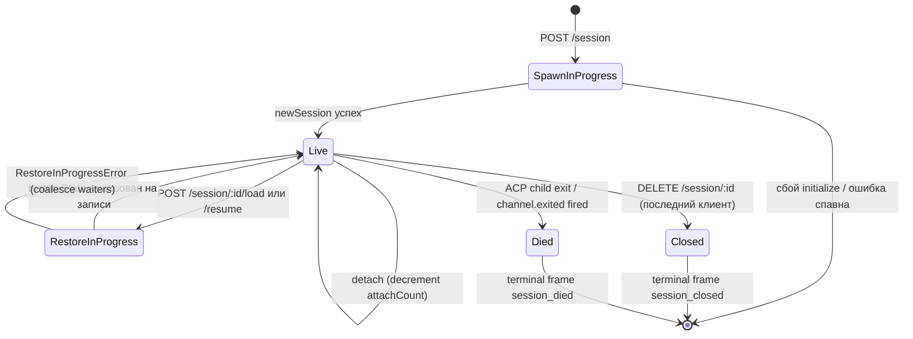

# Жизненный цикл и идентичность сессии

## Обзор

**Сессия демона** — это один логический разговор, прикреплённый к одному `sessionId` ACP. Мост поддерживает `SessionEntry` на сессию (см. [`03-acp-bridge.md`](./03-acp-bridge.md)), который связывает соединение дочернего процесса ACP с учётом на стороне HTTP: FIFO подсказок, FIFO изменений модели, шина событий, ожидающие разрешения, прикреплённые клиенты, heartbeats, состояние восстановления, надгробия terminal-frame.

**Клиент демона** идентифицируется по `X-Nessy-Client-Id` — непрозрачная, проверенная демоном строка, которую HTTP-вызывающий штампует на своих запросах. Мост отслеживает, какие клиенты прикреплены к каким сессиям, и использует originator client id для управления политикой разрешений `designated`, аудит-трейлов и атрибуции событий.

Этот документ объясняет каждый переход жизненного цикла сессии (создание / прикрепление / загрузка / возобновление / закрытие / смерть / вытеснение) и каждую поверхность идентичности, которую демон предоставляет.

## Обязанности

- Создание, прикрепление, восстановление и очистка сессий.
- Проверка `X-Nessy-Client-Id` и отклонение malformed id.
- Отслеживание нескольких прикреплённых клиентов на сессию (`clientIds: Map<string, count>`, `attachCount`).
- Штамповка `originatorClientId` на исходящих событиях.
- Запуск heartbeats, чтобы дашборды знали, какие клиенты всё ещё подключены.
- Предоставление метаданных сессии (`displayName`), которые операторы устанавливают через `PATCH /session/:id/metadata`.
- Управление emit'ом terminal frame (`session_died`, `session_closed`, `client_evicted`, `stream_error`).

## Архитектура

| Concern                     | Источник                                                     | Заметки                                                                                         |
| --------------------------- | ------------------------------------------------------------ | ----------------------------------------------------------------------------------------------- |
| `SessionEntry`              | `packages/acp-bridge/src/bridge.ts`                          | Структура на сессию; см. [`03-acp-bridge.md`](./03-acp-bridge.md) для полного списка полей.     |
| `BridgeSession` (публичный) | `packages/acp-bridge/src/bridgeTypes.ts`                     | `{ sessionId, workspaceCwd, attached, clientId?, createdAt? }`, возвращаемый HTTP-обработчикам. |
| `BridgeSessionState`        | `packages/acp-bridge/src/bridgeTypes.ts`                     | `LoadSessionResponse \| ResumeSessionResponse`, кэшируемый на записи как `restoreState`.        |
| `DaemonSession` (SDK)       | `packages/sdk-typescript/src/daemon/types.ts`                | `{ sessionId, workspaceCwd, attached, clientId?, createdAt? }`.                                 |
| Проверка client-id          | `packages/acp-bridge/src/bridge.ts` (вокруг `spawnOrAttach`) | Паттерн `[A-Za-z0-9._:-]{1,128}`; `InvalidClientIdError`, если malformed.                       |
| Session disconnect-reaper   | `packages/cli/src/serve/server.ts`                           | Отслеживает отключения владельца спавна с `attachCount` + `spawnOwnerWantedKill`.               |

### Автомат состояний



### Attach vs spawn

При `sessionScope: 'single'` (по умолчанию), `defaultEntry` моста разделяется каждым подключающимся клиентом. `POST /session`, пришедший, когда `defaultEntry` уже существует, возвращает `attached: true` без создания нового дочернего процесса ACP. Мост синхронно поднимает `attachCount` и регистрирует `X-Nessy-Client-Id` вызывающего в `clientIds`.

При `sessionScope: 'thread'`, каждый поток может создать отдельную сессию. Вызывающий всё ещё соблюдает `maxSessions`.

### Идентичность

`X-Nessy-Client-Id` **опционален**, но **настоятельно рекомендуется**. Демон не генерирует его от имени вызывающего — клиенты выбирают свой собственный и повторно используют его across запросов, чтобы демон мог атрибутировать голоса, аудит-события и обнаруживать переподключения.

Правила проверки:

- Charset: `[A-Za-z0-9._:-]`.
- Длина: 1–128.
- Вне этого набора: `InvalidClientIdError` (`400`).

Демон штампует `originatorClientId` на исходящих SSE-событиях, когда:

1. Запрос, вызвавший событие, нёс `X-Nessy-Client-Id`, И
2. Id в настоящее время зарегистрирован в наборе `clientIds` сессии, И
3. Сессия имеет установленный `activePromptOriginatorClientId` (inline `sessionUpdate` и `permission_request` наследуют originator от активного prompt).

Анонимные вызывающие (без `X-Nessy-Client-Id`) работают нормально для политики `first-responder`; `designated` отклоняет их голоса с `permission_forbidden{ reason: 'designated_mismatch' }`; `consensus` отклоняет с той же причиной `forbidden`, потому что голосующий не в снимке `votersAtIssue` времени выпуска; `local-only` — единственная политика, принимающая анонимных loopback-голосующих.

## Рабочий процесс

### Создание или прикрепление

```mermaid
sequenceDiagram
    autonumber
    participant C as Client
    participant R as POST /session
    participant B as Bridge.spawnOrAttach
    participant CH as ACP child

    C->>R: POST /session<br/>X-Nessy-Client-Id: alice<br/>{cwd, sessionScope?}
    R->>R: проверить паттерн clientId
    R->>B: spawnOrAttach({cwd, sessionScope, clientId})
    alt single scope + defaultEntry существует
        B->>B: bump attachCount; зарегистрировать clientId
        B-->>R: {sessionId, attached: true, restoreState?}
    else cold
        B->>CH: spawn + ACP initialize + newSession
        CH-->>B: sessionId
        B->>B: построить SessionEntry; зарегистрировать в byId
        B-->>R: {sessionId, attached: false}
    end
    R-->>C: 200 { sessionId, attached, ... }
```

### Загрузка / возобновление

`POST /session/:id/load` — воспроизводит полную историю ACP (уведомления `session/load` срабатывают до возврата ответа).
`POST /session/:id/resume` — восстанавливает без воспроизведения (`connection.unstable_resumeSession`, предоставляется под стабильной возможностью демона `session_resume`; `unstable_session_resume` остаётся устаревшим псевдонимом).

Оба:

1. Используют набор `pendingRestoreIds` на сессию на канале, чтобы конкурентные вызовы восстановления coalesced (`RestoreInProgressError`).
2. Кэшируют `restoreState` на записи, чтобы поздний прикрепляющий получил ту же полезную нагрузку, что и оригинальный восстановитель.

### Heartbeat

`POST /session/:id/heartbeat` обновляет `sessionLastSeenAt` независимо от `clientId`. Если запрос несёт зарегистрированный `X-Nessy-Client-Id`, `clientLastSeenAt.set(clientId, Date.now())` также обновляется. Вытеснение на клиента **не реализовано** в v1; отзыв запланирован на F-series Wave 5. Сегодня heartbeats предоставляют наблюдаемость для дашбордов и для предстоящей политики отзыва в PR 24.

### Метаданные

`PATCH /session/:id/metadata` принимает `{displayName?}`. Проверка:

- Максимальная длина: `MAX_DISPLAY_NAME_LENGTH = 256`.
- Не должен содержать управляющих символов (`hasControlCharacter` отклоняет кодовые точки ≤ 0x1f или == 0x7f).
- `InvalidSessionMetadataError` (`400`) при нарушении.

Успешное обновление веерно рассылает `session_metadata_updated` каждому подписчику.

### Завершение

| Terminal frame   | Триггер                                                                                                                                                   |
| ---------------- | --------------------------------------------------------------------------------------------------------------------------------------------------------- |
| `session_closed` | `DELETE /session/:id` (client_close) или программное закрытие.                                                                                            |
| `session_died`   | `channel.exited` срабатывает по любой причине (сбой, child kill). Несёт `exitCode?` + `signalCode?`, когда использовался путь выхода ОС.                  |
| `client_evicted` | Переполнение очереди подписчика на EventBus (см. [`10-event-bus.md`](./10-event-bus.md)). НЕ завершение на уровень сессии — только этот подписчик закрыт. |
| `stream_error`   | SubscriberLimitExceededError или другой сбой потока на уровне маршрута.                                                                                   |

Ожидающие разрешения разрешаются как `{kind:'cancelled', reason:'session_closed'}` через `mediator.forgetSession(sessionId)` на каждом пути завершения.

### Защитник disconnect-reaper

Когда HTTP-ответ клиента, владеющего спавном, не может быть записан (сброс TCP mid-handshake), маршрут вызывает `killSession({ requireZeroAttaches: true })`. Если другой клиент уже прикрепился (`attachCount > 0`), защитник коротко замыкает и сессия живёт дальше. Установка `spawnOwnerWantedKill = true` запоминает намерение, чтобы более поздний `detachClient()`, возвращающий `attachCount` к 0, завершил отложенную очистку. Без этого быстро отключающийся владелец спавна разрушал бы здоровую сессию при каждом переподключении.

## Состояние и жизненный цикл

Поля `SessionEntry`, критичные для жизненного цикла:

| Поле                             | Тип                   | Значение                                                                                            |
| -------------------------------- | --------------------- | --------------------------------------------------------------------------------------------------- |
| `clientIds`                      | `Map<string, number>` | Зарегистрированные client ids → счётчик ссылок регистрации.                                         |
| `attachCount`                    | `number`              | Разы `spawnOrAttach` вернул `attached: true` для этой записи.                                       |
| `activePromptOriginatorClientId` | `string?`             | Originator для prompt, currently running.                                                           |
| `restoreState`                   | `BridgeSessionState?` | Кэшированный ответ load/resume, чтобы поздние прикрепляющие видели согласованные полезные нагрузки. |
| `spawnOwnerWantedKill`           | `boolean`             | Надгробие отложенной очистки (см. disconnect-reaper выше).                                          |
| `sessionLastSeenAt`              | `number?`             | Последний heartbeat across любого клиента (epoch ms).                                               |
| `clientLastSeenAt`               | `Map<string, number>` | Per-client heartbeat.                                                                               |
| `pendingPermissionIds`           | `Set<string>`         | ACP requestIds, currently pending — используется при отмене/закрытии для разрешения как cancelled.  |

## Зависимости

- Слой ACP: `connection.newSession`, `connection.unstable_resumeSession`, `connection.loadSession`.
- [`03-acp-bridge.md`](./03-acp-bridge.md) для окружающей архитектуры моста.
- [`04-permission-mediation.md`](./04-permission-mediation.md) для того, как originator + идентичность управляют решениями политики.
- [`10-event-bus.md`](./10-event-bus.md) для доставки terminal-frame.

## Дополнительные конечные точки сессии

Эти конечные точки расширяют базовую поверхность жизненного цикла:

### Неблокирующий Prompt (тег возможности `non_blocking_prompt`)

`POST /session/:id/prompt` теперь возвращает HTTP **202** с
`{ promptId, lastEventId }` вместо блокировки до завершения prompt. Фактический результат приходит на SSE как `turn_complete` / `turn_error`, и поле `promptId` коррелирует эти события с ответом 202.
`DaemonSessionClient.prompt()` автоматически использует неблокирующий путь, когда имеет активную подписку на события и прозрачно сопоставляет результат из потока SSE.

### Session Recap (тег возможности `session_recap`)

`POST /session/:id/recap` запрашивает у быстрой модели однострочное резюме "где я остановился". Возвращает `{ sessionId, recap: string | null }`; `null` означает, что история была слишком короткой или модель временно не удалась. Эта конечная точка best-effort.

### Session BTW / Side Question (тег возможности `session_btw`)

`POST /session/:id/btw` задаёт одноразовый вопрос против контекста сессии без прерывания основного потока разговора. Использует `runForkedAgent` на пути кэша для одноразового LLM-вызова без инструментов и возвращает
`{ sessionId, answer: string | null }`. Реализация применяет `BTW_MAX_INPUT_LENGTH`, защитники от межсессионной утечки и обработку таймаутов.

### Выполнение shell-команд

`POST /session/:id/shell` выполняет shell-команду напрямую на хосте демона,
без маршрутизации через LLM. Транслирует вывод на сессию SSE через
события `user_shell_command` / `user_shell_result` и инъекцирует команду плюс
результат в историю разговора LLM. Ответ —
`{ exitCode, output, aborted }`.

### Отсоединение сессии

`POST /session/:id/detach` явно отсоединяет клиент от сессии,
уменьшая `attachCount`; сам по себе не закрывает сессию. Если никакое другое
прикрепление или подписчик не остаётся, сессия очищается. Конечная точка возвращает 204.

### Пакетное удаление сессий

`POST /sessions/delete` принимает `{ sessionIds: string[] }` (до 100 id),
закрывает сессии моста и удаляет файлы транскриптов. Использует
`Promise.allSettled` для устойчивости и возвращает `{ removed, notFound, errors }`.

### Использование контекста (тег возможности `session_context_usage`)

`GET /session/:id/context-usage` возвращает структурированное использование окна контекста.
`?detail=true` включает более детальное использование, сгруппированное по инструменту, памяти и навыку.

### Статистика сессии (тег возможности `session_stats`)

`GET /session/:id/stats` возвращает статистику использования: метрики модели
(входные/выходные токены, чтения/записи кэша, общая стоимость), количество вызовов на инструмент и
задержки, и количество редактирований файлов.

### Задачи сессии (тег возможности `session_tasks`)

`GET /session/:id/tasks` возвращает снимок фоновых задач для задач агента,
shell-задач, задач мониторинга и их состояний жизненного цикла.

### Статус LSP сессии (тег возможности `session_lsp`)

`GET /session/:id/lsp` возвращает санированный статус LSP на сессию для клиентов демона: включение, агрегированные количества серверов, недоступное/состояние инициализации и на сервер `name`, `status`, `languages`, `transport`, `command` и `error`. Отключённый или недоступный LSP представлен как данные статуса HTTP 200,
не как ошибка транспорта.

### Сжатое воспроизведение

`POST /session/:id/load` теперь возвращает `BridgeRestoredSession`, который может включать
`compactedReplay?: BridgeEvent[]`, `liveJournal?: BridgeEvent[]` и
`lastEventId?: number`. `compactedReplay` производится
`TurnBoundaryCompactionEngine`: на границах оборотов он складывает последовательные блоки text / thought, сворачивает последовательности вызовов инструментов до их конечного состояния, отбрасывает преходящие сигналы и производит журналы воспроизведения O(turns) вместо O(tokens) (типично уменьшение 25-30x).

### Предварительный нагрев дочернего процесса ACP

`bridge.preheat()` нагревает дочерний процесс ACP перед первой сессией, чтобы
первая реальная сессия избежала задержки холодного старта. Он сочетается с
`channelIdleTimeoutMs`, который держит дочерний процесс ACP живым после закрытия последней сессии, и поведением пропуска перезапуска, которое повторно использует уже простаивающий ребёнок при прибытии новой сессии.

## Конфигурация

- `BridgeOptions.maxSessions` (по умолчанию 20) — ограничение.
- `BridgeOptions.sessionScope` (по умолчанию `'single'`; опционально `'thread'`).
- `BridgeOptions.initializeTimeoutMs` (по умолчанию 10 с) — рукопожатие ACP `initialize`.
- `BridgeOptions.channelIdleTimeoutMs` (по умолчанию 0; немедленная очистка дочернего процесса ACP).
- Теги возможностей: `session_create`, `session_scope_override`, `session_load`, `session_resume`, `unstable_session_resume` (устаревший псевдоним), `session_list`, `session_close`, `session_metadata`, `session_set_model`, `client_identity`, `client_heartbeat`, `session_recap`, `session_btw`, `session_context_usage`, `session_tasks`, `session_stats`, `session_lsp`, `non_blocking_prompt`.

## Ограничения и известные пределы

- `connection.unstable_resumeSession` может всё ещё быть нестабильным на уровне ACP, но демон рекламируетcommitted v1 контракт маршрута с `session_resume`. `unstable_session_resume` сохраняется только как устаревший псевдоним совместимости.
- v1 имеет **нет вытеснения на клиента**; только завершение на сессию и на подписчика. Политика отзыва — F-series Wave 5 / PR 24.
- `client_evicted` — на подписчика, не на сессию. Клиент, чей SSE-подписчик был вытеснен, может переподключиться.
- Анонимные клиенты (без `X-Nessy-Client-Id`) не могут голосовать по политикам `designated` или `consensus`.

## Ссылки

- `packages/acp-bridge/src/bridge.ts` (определение SessionEntry)
- `packages/acp-bridge/src/bridgeTypes.ts` (`HttpAcpBridge`, `BridgeSession`, `BridgeSessionState`)
- `packages/sdk-typescript/src/daemon/types.ts` (`DaemonSession`)
- `packages/sdk-typescript/src/daemon/DaemonSessionClient.ts`
- Ссылка на провод: [`../../nessy-serve-protocol.md`](../../nessy-serve-protocol.md) (каталог маршрутов).
