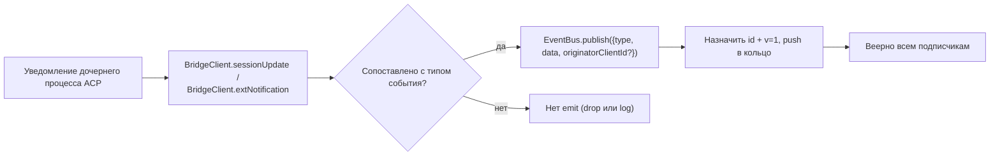
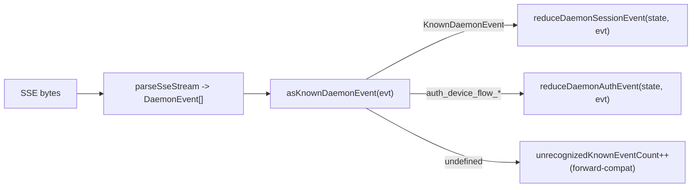

# Типизированная схема событий демона v1

## Обзор

Каждый SSE-кадр, emit'емый демоном на `GET /session/:id/events`, имеет форму `{ id, v, type, data, originatorClientId?, _meta? }`. `v: 1` — текущая `EVENT_SCHEMA_VERSION`. `type` происходит из закрытого, зафиксированного по версии набора `DAEMON_KNOWN_EVENT_TYPE_VALUES` в `packages/sdk-typescript/src/daemon/events.ts`; текущий набор имеет 43 известных типа событий. Обёртка `_meta` штампуется на границе записи SSE через `formatSseFrame()` в `server.ts`; см. [Метаданные уровня обёртки](#метаданные-уровня-обёртки).

SDK предоставляет `asKnownDaemonEvent(evt)`. Он возвращает дискриминированный `KnownDaemonEvent` для известных типов событий и `undefined` для других типов. Потребители SDK могут поэтому обрабатывать прямую совместимость без требования синхронного обновления SDK, когда новый демон добавляет тип события; редуктор сессии записывает их как `unrecognizedKnownEventCount`.

Формат провода описан в [`../../nessy-serve-protocol.md`](../../nessy-serve-protocol.md). Эта страница задаёт контракт полезной нагрузки каждого события.

## Обязанности

- Предоставлять единый источник истины для словаря событий (`DAEMON_KNOWN_EVENT_TYPE_VALUES`).
- Предоставлять типизированную обёртку для каждого типа события (`DaemonEventEnvelope<TType, TData>`).
- Предоставлять чистые редукторы (`reduceDaemonSessionEvent`, `reduceDaemonAuthEvent`), которые проецируют поток событий в состояние представления SDK.
- Транслировать тег возможности `typed_event_schema` как информационный сигнал. Если тег отсутствует, `asKnownDaemonEvent` всё ещё падает обратно на `unknown`.

## Словарь событий (43 известных типа)

Сгруппировано по домену.

### Основная сессия

| Тип                        | Направление    | Триггер                                                                                   | Ключевые поля полезной нагрузки                                                  |
| -------------------------- | -------------- | ----------------------------------------------------------------------------------------- | -------------------------------------------------------------------------------- |
| `session_update`           | S->C           | Любое уведомление ACP `sessionUpdate`: агентский текст, мысль, вызов инструмента или план | `sessionUpdate: string, content?: ...` (непрозрачная форма ACP)                  |
| `session_metadata_updated` | S->C           | `PATCH /session/:id/metadata`                                                             | `sessionId, displayName?`                                                        |
| `session_died`             | S->C terminal  | `channel.exited`                                                                          | `sessionId, reason, exitCode? \| null, signalCode? \| null`                      |
| `session_closed`           | S->C terminal  | `DELETE /session/:id` или программное закрытие                                            | `sessionId, reason: 'client_close' \| string, closedBy?`                         |
| `session_snapshot`         | S->C synthetic | Кадр снимка после прикрепления / воспроизведения SSE                                      | `sessionId, currentModelId: string \| null, currentApprovalMode: string \| null` |

### Синтетические кадры уровня подписчика

| Тип                     | Триггер                                                                                                                                                                                                                                  | Заметки                                                                                                                                                                                                                                                                                                                                          |
| ----------------------- | ---------------------------------------------------------------------------------------------------------------------------------------------------------------------------------------------------------------------------------------- | ------------------------------------------------------------------------------------------------------------------------------------------------------------------------------------------------------------------------------------------------------------------------------------------------------------------------------------------------ |
| `client_evicted`        | Переполнение очереди EventBus на подписчика. **Нет `id`**                                                                                                                                                                                | `reason: string, droppedAfter?: number`; terminal только для текущего подписчика, пока сессия остаётся живой.                                                                                                                                                                                                                                    |
| `slow_client_warning`   | Очередь >= 75%; force-pushed и **не имеет `id`**                                                                                                                                                                                         | `queueSize, maxQueued, lastEventId`; переармируется после падения очереди ниже 37,5%.                                                                                                                                                                                                                                                            |
| `stream_error`          | `SubscriberLimitExceededError` или другая ошибка потока маршрута                                                                                                                                                                         | `error: string`; terminal для подписки.                                                                                                                                                                                                                                                                                                          |
| `state_resync_required` | `subscribe({lastEventId})` обнаруживает, что кольцо демона больше не держит `[lastEventId+1, earliestInRing-1]`, или курсор клиента из предыдущей эпохи шины. Force-pushed **до** оставшихся кадров воспроизведения и **не имеет `id`**. | `reason: 'ring_evicted' \| 'epoch_reset' \| string`, `lastDeliveredId: number`, `earliestAvailableId: number`. Это сигнал восстановления, не terminal: SSE-поток остаётся открытым и воспроизведение + live-кадры продолжаются. SDK-редуктор устанавливает `awaitingResync = true` и пропускает дельты до сброса вызывающим через `loadSession`. |
| `replay_complete`       | Безыдентификаторный сентинел, emit'емый после завершения цикла воспроизведения `Last-Event-ID`, для обоих путей чистого воспроизведения и ring-evicted, даже когда `data.replayedCount === 0`. **Нет `id`**                              | `replayedCount: number`; позволяет потребителям детерминированно удалить catch-up UI без таймаута.                                                                                                                                                                                                                                               |

### Разрешения (F3 + база)

| Тип                           | Направление | Триггер                                            | Ключевые поля полезной нагрузки                                                                                                                          |
| ----------------------------- | ----------- | -------------------------------------------------- | -------------------------------------------------------------------------------------------------------------------------------------------------------- |
| `permission_request`          | S->C        | Агент вызывает `requestPermission`                 | `requestId, sessionId, toolCall, options[]`; обёртка штампуе `originatorClientId` от originator prompt.                                                  |
| `permission_resolved`         | S->C        | Медиатор решил                                     | `requestId, outcome` (ACP `PermissionOutcome`)                                                                                                           |
| `permission_already_resolved` | S->C        | Голос приходит после того, как запрос уже решён    | `requestId, sessionId, outcome`                                                                                                                          |
| `permission_partial_vote`     | S->C        | Политика `consensus` записывает не-финальный голос | `requestId, sessionId, votesReceived, votesNeeded (>= 1), quorum, optionTallies: Record<string, number>, originatorClientId?`                            |
| `permission_forbidden`        | S->C        | Политика отклоняет голос                           | `requestId, sessionId, clientId?, reason: 'designated_mismatch' \| 'remote_not_allowed', originatorClientId?`; анонимные голосующие опускают `clientId`. |

### Модели

| Тип                   | Направление | Полезная нагрузка                            |
| --------------------- | ----------- | -------------------------------------------- |
| `model_switched`      | S->C        | `sessionId, modelId`                         |
| `model_switch_failed` | S->C        | `sessionId, requestedModelId, error: string` |

### Guardrails MCP (PR 14b + F2)

| Тип                          | Направление | Полезная нагрузка                                                                                                                                                                                                                                                                                                                                                                                                                                                                      |
| ---------------------------- | ----------- | -------------------------------------------------------------------------------------------------------------------------------------------------------------------------------------------------------------------------------------------------------------------------------------------------------------------------------------------------------------------------------------------------------------------------------------------------------------------------------------- |
| `mcp_budget_warning`         | S->C        | `liveCount, reservedCount, budget, thresholdRatio: 0.75, mode: 'warn' \| 'enforce', scope?: 'workspace' \| 'session'`                                                                                                                                                                                                                                                                                                                                                                  |
| `mcp_child_refused_batch`    | S->C        | `refusedServers: [{ name, transport, reason: 'budget_exhausted' }], budget, liveCount, reservedCount, mode: 'enforce', scope?: 'workspace' \| 'session'`                                                                                                                                                                                                                                                                                                                               |
| `mcp_server_restarted`       | S->C        | `serverName, durationMs, entryIndex?` для перезапусков пула F2 с несколькими записями                                                                                                                                                                                                                                                                                                                                                                                                  |
| `mcp_server_restart_refused` | S->C        | `serverName, reason: 'budget_would_exceed' \| 'in_flight' \| 'disabled' \| 'restart_failed', entryIndex?, details?`. Четвёртое значение, `restart_failed`, несёт базовый жёсткий сбой для перезапуска с несколькими записями в режиме пула. `MCP_RESTART_REFUSED_REASONS` отклоняет неизвестные причины; старый SDK-редуктор молча опускает аддитивные новые значения причин, потому что `parseDaemonEvent` возвращает `undefined`. Отправляйте новую причину с SDK, который её знает. |

### Управление мутациями (Wave 4 PR 16+17)

| Тип                     | Направление | Полезная нагрузка                                                                                                         |
| ----------------------- | ----------- | ------------------------------------------------------------------------------------------------------------------------- |
| `memory_changed`        | S->C        | `scope: 'workspace' \| 'global', filePath, mode: 'append' \| 'replace', bytesWritten`                                     |
| `agent_changed`         | S->C        | `change: 'created' \| 'updated' \| 'deleted', name, level: 'project' \| 'user'`                                           |
| `approval_mode_changed` | S->C        | `sessionId, previous, next, persisted: boolean`                                                                           |
| `tool_toggled`          | S->C        | `toolName, enabled`; влияет на следующий спавн дочернего процесса ACP и не мутирует уже запущенные сессии.                |
| `settings_changed`      | S->C        | Запись настроек рабочей области завершена. Полезная нагрузка открыта; потребители должны обновить через read-after-write. |
| `settings_reloaded`     | S->C        | Сервис рабочей области демона перечитал настройки. Полезная нагрузка открыта.                                             |
| `workspace_initialized` | S->C        | `path, action: 'created' \| 'overwrote' \| 'noop', originatorClientId?`                                                   |

### Поток устройства аутентификации (PR 21)

Эти события ключатся по рабочей области, не по сессии. Редуктор сессии считает их no-ops; `reduceDaemonAuthEvent` проецирует их в состояние аутентификации на уровень рабочей области.

| Тип                           | Направление | Полезная нагрузка                                     |
| ----------------------------- | ----------- | ----------------------------------------------------- |
| `auth_device_flow_started`    | S->C        | `deviceFlowId, providerId, expiresAt`                 |
| `auth_device_flow_throttled`  | S->C        | `deviceFlowId, intervalMs`                            |
| `auth_device_flow_authorized` | S->C        | `deviceFlowId, providerId, expiresAt?, accountAlias?` |
| `auth_device_flow_failed`     | S->C        | `deviceFlowId, errorKind, hint?`                      |
| `auth_device_flow_cancelled`  | S->C        | `deviceFlowId`                                        |

### Мутация runtime MCP

| Тип                  | Направление | Триггер                                                                 | Ключевые поля полезной нагрузки                                              |
| -------------------- | ----------- | ----------------------------------------------------------------------- | ---------------------------------------------------------------------------- |
| `mcp_server_added`   | S->C        | Сервер добавлен во время выполнения через `POST /workspace/mcp/servers` | `name, transport, replaced, shadowedSettings, toolCount, originatorClientId` |
| `mcp_server_removed` | S->C        | Сервер удалён во время выполнения                                       | `name, wasShadowingSettings, originatorClientId`                             |

### Жизненный цикл оборота / assistant pushes

| Тип                   | Направление | Триггер                                                                                                              | Ключевые поля полезной нагрузки                                                                                                                                                                         |
| --------------------- | ----------- | -------------------------------------------------------------------------------------------------------------------- | ------------------------------------------------------------------------------------------------------------------------------------------------------------------------------------------------------- |
| `prompt_cancelled`    | S->C        | Prompt был отменён через явный маршрут `cancelSession` **или** отключение originator SSE                             | Обёртка штампуе `originatorClientId` для отменяющего клиента. Это означает "запрошена отмена", не "отмена подтверждена". Peer-подписчики узнают, что prompt закончился.                                 |
| `turn_complete`       | S->C        | Оборот успешно завершён                                                                                              | `sessionId, stopReason, promptId?`. `promptId` связывает с ответами неблокирующего prompt (`202`). SDK сопоставляет SSE-события с originating prompt через него.                                        |
| `turn_error`          | S->C        | Оборот не удался                                                                                                     | `sessionId, message, code?, promptId?`; тот же механизм корреляции `promptId`.                                                                                                                          |
| `session_rewound`     | S->C        | `POST /session/:id/rewind` удался                                                                                    | `sessionId, promptId, targetTurnIndex, filesChanged[], filesFailed[], originatorClientId?`                                                                                                              |
| `session_branched`    | S->C        | `POST /session/:id/branch` создал ветку из существующей сессии                                                       | `sourceSessionId, newSessionId, displayName, originatorClientId?`                                                                                                                                       |
| `followup_suggestion` | S->C        | Дочерний процесс ACP сгенерировал follow-up предложения ghost-text после `end_turn`, пересланные через SSE на сессию | `sessionId, suggestion, promptId`; провод несёт только предложения, чей `getFilterReason()===null`. Клиенты отображают их как ghost-text input-placeholder и инвалидируют их на следующий `sendPrompt`. |
| `user_shell_command`  | S->C        | Пользователь запустил shell-команду через `POST /session/:id/shell`; разослано другим подписчикам в той же сессии    | `sessionId, command, shellId, originatorClientId?`. Нет типизированного интерфейса `DaemonXxxData`; `asKnownDaemonEvent` возвращает `undefined` и UI-нормализатор разбирает это ad hoc.                 |
| `user_shell_result`   | S->C        | Результат shell-команды выше                                                                                         | `sessionId, shellId, exitCode, output, aborted`. Та же заметка ad hoc разбора, что и `user_shell_command`.                                                                                              |

## Архитектура

| Concern                                | Источник                                       | Заметки                                                                                                                           |
| -------------------------------------- | ---------------------------------------------- | --------------------------------------------------------------------------------------------------------------------------------- |
| `EVENT_SCHEMA_VERSION = 1`             | `packages/acp-bridge/src/eventBus.ts`          | Отправляется на каждом кадре.                                                                                                     |
| `DAEMON_KNOWN_EVENT_TYPE_VALUES`       | `packages/sdk-typescript/src/daemon/events.ts` | Закрытый список с 43 типами.                                                                                                      |
| `DaemonEventEnvelope<TType, TData>`    | `events.ts`                                    | Generic обёртка.                                                                                                                  |
| `DaemonKnownEventType`                 | `events.ts`                                    | `typeof DAEMON_KNOWN_EVENT_TYPE_VALUES[number]`.                                                                                  |
| Типы полезной нагрузки на событие      | `events.ts`                                    | Большинство типов событий имеют интерфейс `DaemonXxxData`; `user_shell_*` в настоящее время разбирается ad hoc UI-нормализатором. |
| `asKnownDaemonEvent(evt)`              | `events.ts`                                    | Возвращает `KnownDaemonEvent \| undefined`.                                                                                       |
| `reduceDaemonSessionEvent(state, evt)` | `events.ts`                                    | Проецирует в `DaemonSessionViewState`.                                                                                            |
| `reduceDaemonAuthEvent(state, evt)`    | `events.ts`                                    | Проецирует в `DaemonAuthState`.                                                                                                   |
| `isWorkspaceScopedBudgetEvent(evt)`    | `events.ts`                                    | Обнаруживает F2 `scope: 'workspace'`.                                                                                             |

### `DaemonSessionViewState`

`reduceDaemonSessionEvent` заполняет это состояние представления. CLI TUI адаптер, `DaemonChannelBridge` и VS Code IDE потребляют его. Ключевые поля:

- `alive: boolean` — становится `false` после terminal frame (`session_died`, `session_closed`, `client_evicted`, `stream_error`).
- `currentModelId?: string` — из `model_switched`.
- `displayName?: string` — из `session_metadata_updated`.
- `pendingPermissions: Record<string, DaemonPermissionRequestData>` — открытые запросы по ключу `requestId`; очищаются через `permission_resolved` / `permission_already_resolved`.
- `lastSessionUpdate?: DaemonSessionUpdateData` — последний `session_update`.
- `lastModelSwitchFailure?: DaemonModelSwitchFailedData` — из `model_switch_failed`.
- `terminalEvent?` — сырое terminal event.
- `streamError?: DaemonStreamErrorData` — последняя полезная нагрузка `stream_error`.
- `unrecognizedKnownEventCount`, `lastUnrecognizedKnownEvent?` — событие распознано через `asKnownDaemonEvent`, но у редуктора нет пока выделенных полей состояния для него.
- `droppedPermissionRequestCount`, `lastDroppedPermissionRequestId?` — malformed запрос разрешения не вошёл в pending map.
- `unmatchedPermissionResolutionCount`, `lastUnmatchedPermissionResolutionId?` — разрешение разрешения не имело совпадающего pending запроса.
- `slowClientWarningCount`, `lastSlowClientWarning?` — из `slow_client_warning`.
- `mcpBudgetWarningCount`, `lastMcpBudgetWarning?` — из `mcp_budget_warning`.
- `mcpChildRefusedBatchCount`, `lastMcpChildRefusedBatch?` — из `mcp_child_refused_batch`.
- `lastWorkspaceMutation?`, `lastWorkspaceMutationType?` — из `memory_changed` / `agent_changed`.
- `approvalMode?`, `approvalModeChangedCount`, `lastApprovalModeChange?` — из `approval_mode_changed`.
- `toolToggleCount`, `lastToolToggle?` — из `tool_toggled`.
- `workspaceInitCount`, `lastWorkspaceInit?` — из `workspace_initialized`.
- `mcpRestartCount`, `lastMcpRestart?` — из `mcp_server_restarted`.
- `mcpRestartRefusedCount`, `lastMcpRestartRefused?` — из `mcp_server_restart_refused`.
- `settings_changed` / `settings_reloaded` — распознаны через `asKnownDaemonEvent`; редуктор сессии не поддерживает выделенные поля состояния представления, и UI обычно считают их сигналами обновления.
- `permissionVoteProgress: Record<string, DaemonPermissionPartialVoteData>` — прогресс голосования consensus.
- `forbiddenVotes: DaemonPermissionForbiddenData[]`, `forbiddenVoteCount` — записи голосов, отклонённых политикой, ограничены 32.
- `awaitingResync: boolean` — установлено через `state_resync_required`; очищается, когда потребитель сбрасывает состояние представления.
- `resyncRequiredCount`, `lastResyncRequired?` — наблюдаемость ресинхронизации.
- `lastFollowupSuggestion?: DaemonFollowupSuggestionData` — последнее follow-up предложение, pushed демоном.
- `lastTurnComplete?: DaemonTurnCompleteData` — последнее успешное завершение оборота.
- `lastTurnError?: DaemonTurnErrorData` — последняя ошибка оборота.
- `rewindCount`, `lastRewind?`, `lastBranch?` — последние события rewind / branch.

### `DaemonAuthState`

Одна запись на `providerId`, управляемая через `auth_device_flow_*`. Каждый поток предоставляет `{ deviceFlowId, status, providerId, expiresAt?, lastThrottleIntervalMs?, lastError? }`.

## Поток

### Сторона продюсера



### Сторона потребителя (SDK)



## Метаданные уровня обёртки

За пределами полезной нагрузки `data` каждого события, демон штампует два поля уровня обёртки.

### `_meta.serverTimestamp` — часы демона

`formatSseFrame()` в `packages/cli/src/serve/server.ts` штампует это на границе записи SSE, **не** внутри `EventBus.publish`. В-memory тип `BridgeEvent` остаётся неизменным; внутренние потребители демона не видят `_meta`, в то время как wire SSE-кадры видят.

```jsonc
{
  "id": 47,
  "v": 1,
  "type": "session_update",
  "data": { ... },
  "_meta": { "serverTimestamp": 1716287345123 }
}
```

Слияние сохраняет любые существующие ключи `_meta`
(`{...existingMeta, serverTimestamp: Date.now()}`). **Никакой текущий продюсер демона не пишет `_meta` уровня обёртки**. Слияние верхнего уровня — это escape-хatch прямой совместимости.

Почему это важно: multi-client UI, которые отображают относительное время или сортируют блоки транскрипта, должны использовать серверное время вместо локальных часов каждого браузера/вкладки/телефона. Серверная штамповка держит порядок согласованным across клиентов.

Доступ SDK: предпочитайте `event._meta?.serverTimestamp`. Пути совместимости могут также зондировать `event.serverTimestamp` или `event.data._meta.serverTimestamp`. Не смешивайте ACP payload `data._meta` с обёрткой демона `_meta`.

### `originatorClientId`

События, вызванные запросом, который нёс зарегистрированный `X-Nessy-Client-Id`, могут штамповать это поле. См. [`08-session-lifecycle.md`](./08-session-lifecycle.md).

## `_meta` вызова инструмента (провенанс / serverId)

Это отдельно от обёртки `_meta`: полезные нагрузки ACP `session/update` могут нести свою собственную `_meta` в `event.data._meta`. `ToolCallEmitter` (`packages/cli/src/acp-integration/session/emitters/ToolCallEmitter.ts`) штампует два поля на `emitStart`, `emitResult` и `emitError`:

| Поле         | Тип                                          | Правило разрешения                                                                                                                                                                          |
| ------------ | -------------------------------------------- | ------------------------------------------------------------------------------------------------------------------------------------------------------------------------------------------- |
| `provenance` | `'builtin' \| 'mcp' \| 'subagent'`           | `ToolCallEmitter.resolveToolProvenance`: `subagentMeta` побеждает с `subagent`; имя инструмента, совпадающее с `mcp__<server>__<tool>`, мапится в `mcp`; всё остальное мапится в `builtin`. |
| `serverId`   | `string` только когда `provenance === 'mcp'` | Извлекается эвристически из `mcp__<serverId>__<tool>`.                                                                                                                                      |

Существующее отображаемое имя `_meta.toolName` сохраняется. UI использует эти поля для отображения бейджей builtin / MCP server / subagent без перепарсинга имени инструмента.

## Поведение редуктора SDK

`reduceDaemonSessionEvent(state, evt)` в `packages/sdk-typescript/src/daemon/events.ts` проецирует поток в `DaemonSessionViewState`. Поля, связанные с ресинхронизацией:

- **`awaitingResync: boolean`** — установлено через `state_resync_required`; вызывающий очищает его, обычно после `POST /session/:id/load` сбрасывает состояние представления.
- **`resyncRequiredCount: number`** — счётчик наблюдаемости.
- **`lastResyncRequired?: DaemonStateResyncRequiredData`** — последняя полезная нагрузка.

Пока `awaitingResync = true`, редуктор **пропускает применение дельт** и позволяет только закрытый набор `RESYNC_PASSTHROUGH_TYPES`:

| Тип пасsthrough         | Почему всё ещё применяется во время ресинхронизации                                 |
| ----------------------- | ----------------------------------------------------------------------------------- |
| `state_resync_required` | Редкий второй ресинх должен обновлять `lastResyncRequired` / `resyncRequiredCount`. |
| `session_died`          | Terminal сигнал потока должен оставаться видимым во время ресинхронизации.          |
| `session_closed`        | То же, что выше.                                                                    |
| `client_evicted`        | То же, что выше.                                                                    |
| `stream_error`          | То же, что выше.                                                                    |
| `session_snapshot`      | Авторитетный кадр полного состояния; безопасно применять во время ресинхронизации.  |

`lastEventId` всё ещё монотонно продвигается через `advanceLastEventId(base)` во время ресинхронизации. После того как вызывающий сбрасывает и очищает `awaitingResync`, последующие дельты выравниваются к правильному курсору.

`reduceDaemonAuthEvent` проецирует события device-flow в записи состояния аутентификации на уровень рабочей области формы
`{deviceFlowId, status, providerId, expiresAt?, lastThrottleIntervalMs?, lastError?}`
концептуально. В коде редуктор хранит `status`, `errorKind`, `hint`,
`intervalMs`, `lastSeenEventId`, `authorizedExpiresAt` и `accountAlias` на
`DaemonDeviceFlowReducerState`; полезные нагрузки событий демона сами остаются
формами на событие, перечисленными выше.

## Состояние и прямая совместимость

- Добавьте известный тип события добавлением в `DAEMON_KNOWN_EVENT_TYPE_VALUES`. Старые SDK возвращают `undefined` для нераспознанных типов событий через fallback-путь и инкрементируют `unrecognizedKnownEventCount`; новые SDK полагаются на дискриминированное объединение.
- Добавление опциональных полей к существующей полезной нагрузке безопасно, потому что полезные нагрузки открыты (`{ [key: string]: unknown }`).
- Изменение **формы** существующей полезной нагрузки — breaking и должно поднять `EVENT_SCHEMA_VERSION` плюс рекламировать совместимый тег возможности, такой как `caps.features.typed_event_schema_v2`.
- `id` — на сессию монотонный. Синтетические кадры уровня подписчика (`client_evicted`, `slow_client_warning`, `stream_error`, `state_resync_required`, `replay_complete`, `session_snapshot`) намеренно не имеют id, чтобы другие подписчики не видели пробелов.
- `originatorClientId` живёт на обёртке, а не `data`. Полезные нагрузки partial-vote / forbidden F3 также merging'ят его в `data` через `mergeOriginator`, чтобы потребители view-state не должны были удерживать обёртку.

## Зависимости

- [`10-event-bus.md`](./10-event-bus.md) — канал доставки.
- [`11-capabilities-versioning.md`](./11-capabilities-versioning.md) — как SDK preflight `typed_event_schema`, `mcp_guardrail_events` и `permission_mediation`.
- [`04-permission-mediation.md`](./04-permission-mediation.md) — как производятся события разрешений.
- [`13-sdk-daemon-client.md`](./13-sdk-daemon-client.md) — `asKnownDaemonEvent`, редукторы и форма view-state.

## Конфигурация

- Всегда рекламируется: `typed_event_schema`, `mcp_guardrail_events` и `permission_mediation` (с поддерживаемыми режимами политики).
- Никакой env var или флаг напрямую не контролирует саму схему. `NESSY_SERVE_NO_MCP_POOL=1` меняет MCP event `scope` с `'workspace'` на отсутствующий или `'session'`.

## Ограничения и известные пределы

- Шесть типов синтетических кадров намеренно не имеют `id`; код SDK не должен предполагать, что каждое событие имеет id.
- `permission_partial_vote` появляется только при `consensus`. `permission_forbidden` появляется при `designated`, `consensus` и `local-only`, но не при `first-responder`.
- `mcp_child_refused_batch` появляется только в `mode: 'enforce'`; режим `warn` никогда не отказывает.
- События `auth_device_flow_*` не ключатся по сессии. При потреблении через `DaemonSessionClient`, используйте `reduceDaemonAuthEvent` для них, а не редуктор сессии.

## Ссылки

- `packages/sdk-typescript/src/daemon/events.ts`
- `packages/acp-bridge/src/eventBus.ts` (`EVENT_SCHEMA_VERSION`)
- `packages/cli/src/serve/capabilities.ts` (`typed_event_schema`, `mcp_guardrail_events`, `permission_mediation`)
- Справочник wire-протокола: [`../../nessy-serve-protocol.md`](../../nessy-serve-protocol.md)
