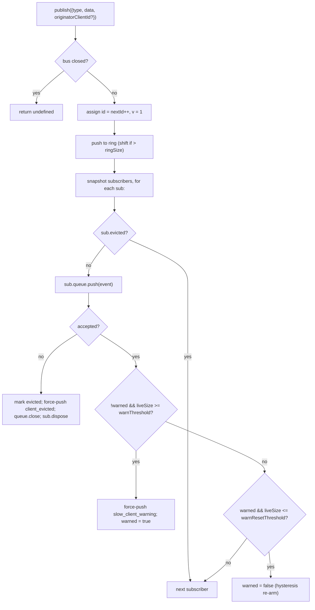

# Шина событий SSE и обратное давление

## Обзор

`EventBus` (`packages/acp-bridge/src/eventBus.ts`) — внутрипроцессная система публикации и подписки на уровне сессии, питающая SSE-маршрут демона `GET /session/:id/events`. Она назначает каждому событию монотонный идентификатор, хранит последние события в ограниченном кольцевом буфере для воспроизведения по `Last-Event-ID`, распространяет опубликованные события всем подписчикам, применяет обратное давление отдельно для каждого подписчика (предупреждение при заполнении очереди на 75 %, вытеснение при достижении предела) и отправляет два синтетических терминальных кадра (`client_evicted`, `slow_client_warning`). SDK считает их полноценными событиями, но шина помечает их **без `id`**, чтобы они не занимали место в последовательности сессии.

Сейчас `EventBus` закрыт в пределах пакета `acp-bridge` и используется фабрикой моста: на каждую сессию создаётся один замкнутый экземпляр. Будущий рефакторинг (отмечен в строках 150–159 `eventBus.ts`) поднимет его до строительного блока верхнего уровня, чтобы каналы, двойной вывод и будущие транспорты WebSocket подписывались через одну шину, а не вели параллельные потоки.

## Обязанности

- Назначать монотонные идентификаторы событий сессии, начиная с 1.
- Хранить последние `ringSize` событий для воспроизведения при подписке с `lastEventId`.
- Распространять события не более чем `maxSubscribers` одновременным подписчикам.
- Применять ограниченные очереди на подписчика; при переполнении отключать подписчика синтетическим терминальным кадром `client_evicted`.
- Однократно отправлять `slow_client_warning` при заполнении очереди на 75 %, используя гистерезис 37,5 % для предотвращения повторных предупреждений.
- Быстро закрывать подписки при `AbortSignal.abort()`.
- Корректно закрывать всех подписчиков при закрытии шины (например, при завершении сессии).
- Никогда не выбрасывать исключение из `publish` (контракт: «вызов publish всегда безопасен»).

## Архитектура

| Константа                             | Значение    | Назначение                                                                                         |
| ------------------------------------- | ----------- | -------------------------------------------------------------------------------------------------- |
| `EVENT_SCHEMA_VERSION`                | `1`         | Записывается в каждый `BridgeEvent.v`; увеличивается при несовместимом изменении кадров.           |
| `DEFAULT_RING_SIZE`                   | `8000`      | Кольцевой буфер воспроизведения сессии. Оператор меняет его через `--event-ring-size`.             |
| `DEFAULT_MAX_QUEUED`                  | `256`       | Максимальная очередь одного подписчика.                                                            |
| `DEFAULT_MAX_SUBSCRIBERS`             | `64`        | Максимум подписчиков одной сессии.                                                                 |
| `WARN_THRESHOLD_RATIO`                | `0.75`      | Доля `maxQueued`, при которой возникает `slow_client_warning`.                                     |
| `WARN_RESET_RATIO`                    | `0.375`     | Доля повторного взведения гистерезиса.                                                             |
| `MAX_EVENT_RING_SIZE` (в `bridge.ts`) | `1_000_000` | Мягкий верхний предел `BridgeOptions.eventRingSize`, защищающий от нехватки памяти из-за опечаток. |

### `BridgeEvent`

```ts
interface BridgeEvent {
  id?: number; // monotonic per session; absent on synthetic terminal frames
  v: 1; // EVENT_SCHEMA_VERSION
  type: string; // one of the 43 known types or future-extensible
  data: unknown; // payload (typed per-type by the SDK; see 09-event-schema.md)
  originatorClientId?: string; // set when the event derives from a clientId-stamped request
}
```

### `SubscribeOptions`

```ts
interface SubscribeOptions {
  lastEventId?: number; // replay from after this id (Last-Event-ID resume)
  signal?: AbortSignal; // aborts the subscription promptly
  maxQueued?: number; // per-subscriber backlog cap; default 256
}
```

`subscribe()` возвращает `AsyncIterable<BridgeEvent>`. SSE-маршрут перебирает его через `for await`. Регистрация выполняется **синхронно**: к моменту возврата `subscribe()` подписчик уже подключён, поэтому вызов `publish()`, конкурирующий с первым `next()` потребителя, всё равно будет доставлен.

### `BoundedAsyncQueue`

Очередь отдельного подписчика. Два ключевых свойства:

- **Ограничение живых элементов учитывает только живые элементы.** Элементы, добавленные через `forcePush()`, получают признак `forced: true` и никогда не учитываются в `maxSize`. Поэтому путь воспроизведения `Last-Event-ID` может принудительно поместить сотни исторических кадров в очередь нового подписчика, не достигнув немедленно ограничения живых кадров и не вытеснив только что восстановленного подписчика.
- **`liveCount` хранится отдельным полем**, а не вычисляется по позиции `forcedInBuf`. Прежняя позиционная эвристика сломалась, когда `slow_client_warning` начали принудительно добавлять в середину потока (предупреждения попадают в КОНЕЦ очереди, в отличие от воспроизведения в начале). Признак `forced` у каждого элемента не зависит от позиции.

`push(value)` возвращает `false` (вместо блокировки или исключения), когда живая очередь достигла предела; по этому сигналу шина вытесняет подписчика. `forcePush(value)` обходит предел. `close({drain?: boolean})` по умолчанию выдаёт оставшиеся элементы; путь прерывания передаёт `drain: false`, чтобы сразу их отбросить.

## Рабочий процесс

### Публикация



`publish` никогда не выбрасывает исключение. Если шина закрывается в ходе публикации (при остановке шины сессий закрываются до ожидания `channel.kill()`), метод возвращает `undefined`: агент ещё может отправлять уведомления `sessionUpdate` в небольшом окне между закрытием шины и завершением канала.

### Подписка и воспроизведение (с обнаружением вытеснения из кольца)

```mermaid
sequenceDiagram
    autonumber
    participant SR as SSE route
    participant EB as EventBus
    participant Q as BoundedAsyncQueue

    SR->>EB: subscribe({lastEventId: 42, maxQueued: 256, signal})
    EB->>EB: refuse if subs.size >= maxSubscribers<br/>(throws SubscriberLimitExceededError)
    EB->>Q: new BoundedAsyncQueue(256)
    EB->>EB: subs.add(sub)
    EB->>EB: epochReset = lastEventId >= nextId
    alt epochReset (old bus epoch)
        EB->>Q: forcePush state_resync_required<br/>{ reason: 'epoch_reset', lastDeliveredId: 42, earliestAvailableId: ring[0]?.id ?? nextId }
        Note over EB,Q: id-less synthetic, frame goes BEFORE replay.<br/>Replay scans the whole current ring.
    else same bus epoch
        EB->>EB: earliestInRing = ring[0]?.id
        opt earliestInRing > lastEventId + 1 (gap evicted)
            EB->>Q: forcePush state_resync_required<br/>{ reason: 'ring_evicted', lastDeliveredId: 42, earliestAvailableId: earliestInRing }
            Note over EB,Q: id-less synthetic, frame goes BEFORE replay.<br/>Stream stays open; SDK reducer flips awaitingResync.
        end
    end
    loop ring scan
        EB->>EB: for e in ring where e.id > (epochReset ? 0 : 42)
        EB->>Q: forcePush(e)
    end
    EB->>EB: attach AbortSignal listener<br/>(onAbort → queue.close({drain:false}); dispose)
    EB-->>SR: AsyncIterable
    SR->>Q: next() in for-await loop
```

Если при подписке `subs.size >= maxSubscribers`, выбрасывается `SubscriberLimitExceededError`. SSE-маршрут перехватывает его и сериализует синтетический кадр `stream_error` для отклонённого клиента, чтобы тот не увидел молча пустой поток. Возврат пустого итератора лишил бы операторов объяснения ситуации «под нагрузкой одни клиенты получают события, а другие нет».

### Вытеснение из кольца → `state_resync_required` (восстановление)

Когда потребитель подключается повторно с `Last-Event-ID: N`, а самое раннее сохранившееся событие кольца имеет `id > N + 1`, события `[N+1, earliestInRing-1]` были вытеснены до переподключения. Наивное воспроизведение молча вернуло бы несмежный суффикс, редьюсер SDK продолжил бы применять изменения как непрерывный поток, и его состояние без терминального сигнала разошлось бы с истиной демона.

Реализация в `EventBus.subscribe()`:

1. Сначала проверяется `opts.lastEventId >= this.nextId`. Если условие истинно, курсор клиента относится к старой эпохе шины (перезапуск демона или пересоздание EventBus), поэтому шина отправляет `reason: 'epoch_reset'` и воспроизводит всё текущее кольцо.
2. Иначе вычисляется `earliestInRing = this.ring[0]?.id`.
3. Если `earliestInRing > opts.lastEventId + 1`, перед кадрами воспроизведения принудительно добавляется синтетический кадр:

   ```jsonc
   {
     "v": 1,
     "type": "state_resync_required",
     "data": {
       "reason": "ring_evicted",
       "lastDeliveredId": <opts.lastEventId>,
       "earliestAvailableId": <earliestInRing>
     }
   }
   ```

4. Затем продолжается обычный цикл воспроизведения.

Критически важные контракты (и исправления ревью #4360):

- **Нет `id`** — как у `client_evicted`, кадр не занимает место в монотонной последовательности сессии, видимой другим подписчикам.
- **Поток остаётся открытым** — в отличие от действительно терминального `client_evicted`, `state_resync_required` предназначен для восстановления. После него продолжаются воспроизведение и живые кадры.
- **Редьюсер автоматически пропускает изменения** — SDK выставляет `awaitingResync = true` и применяет только `state_resync_required`, терминальные кадры и снимки полного состояния, пока код потребителя не вызовет `loadSession` и не очистит флаг. См. `RESYNC_PASSTHROUGH_TYPES` в [`09-event-schema.md`](./09-event-schema.md).
- **Удобство для сети** — кадры остаются в проводном потоке, поэтому SDK при желании может позже вычислить разницу «что было пропущено». Дополнительный цикл переподключения не нужен.

### Терминальный поток вытеснения

Когда живая очередь подписчика равна `maxQueued`, а следующий `push()` возвращает `false`:

1. Установить `sub.evicted = true`.
2. Создать кадр `client_evicted` **без `id`**: `{ v: 1, type: 'client_evicted', data: { reason: 'queue_overflow', droppedAfter: <last delivered id> } }`.
3. Вызвать `queue.forcePush(evictionFrame)`, чтобы итератор потребителя получил один терминальный кадр.
4. Вызвать `queue.close()`, чтобы после терминального кадра перебор завершился.
5. Вызвать `sub.dispose()` — удалить подписчика из `subs` и отсоединить обработчик `AbortSignal`; без очистки замыкания остановившихся потребителей жили бы до сборки мусора `AbortSignal`.

### Прерывание

`AbortSignal.abort()` → `onAbort()`:

1. `queue.close({drain: false})` — отбросить буфер, чтобы SSE-маршрут не продолжал сериализовать события в сокет, который уже никто не слушает.
2. `dispose()` — идемпотентная операция благодаря флагу `disposed`.

Для уже прерванного сигнала `onAbort()` вызывается синхронно до возврата итератора.

## Состояние и жизненный цикл

- `nextId` начинается с 1 и только увеличивается. Геттер `lastEventId` возвращает `nextId - 1`.
- `ring` ограничен; после заполнения вытеснение через shift имеет сложность O(n). При `ringSize=8000` на высоконагруженных сессиях это занимает единицы миллисекунд — значительно меньше бюджета задержки кадра. Переход к циклическому буферу отложен до появления сигнала в профилировании или увеличения операторами `--event-ring-size` на порядок.
- `close()` устанавливает `closed`, закрывает очереди всех подписчиков и очищает `subs`. Последующие `publish()` / `subscribe()` ничего не делают (`publish` возвращает undefined, `subscribe` — `emptyAsyncIterable`).
- У каждой сессии один `EventBus`. Шина закрывается до `channel.kill()`, поэтому публикации во время остановки возвращают undefined, а не выбрасывают исключение.

## Зависимости

- Используется в `packages/acp-bridge/src/bridge.ts` (`BridgeClient.sessionUpdate` / `BridgeClient.extNotification` → `events.publish(...)`).
- Используется в `packages/cli/src/serve/server.ts` (обработчик SSE-маршрута вызывает `events.subscribe(...)`, затем форматирует `BridgeEvent` в проводные кадры SSE).
- Повторно экспортирующий адаптер: `packages/cli/src/serve/event-bus.ts` → `@nestor/nessy-cli-acp-bridge/eventBus`.
- Потребитель SDK: `packages/sdk-typescript/src/daemon/sse.ts` (`parseSseStream`), затем `asKnownDaemonEvent` (см. [`09-event-schema.md`](./09-event-schema.md), [`13-sdk-daemon-client.md`](./13-sdk-daemon-client.md)).

## Конфигурация

- `--event-ring-size <n>` — глубина кольца сессии; мягко ограничена `MAX_EVENT_RING_SIZE = 1_000_000`.
- Параметр подписчика `?maxQueued=N` в `GET /session/:id/events`, диапазон `[16, 2048]`. Клиенты SDK предварительно проверяют `caps.features.slow_client_warning`.
- `BridgeOptions.eventRingSize` — переопределяет значение демона при встраивании.
- Теги возможностей: `session_events`, `slow_client_warning`, `typed_event_schema`.

## Оговорки и известные ограничения

- **У синтетических кадров нет `id`.** Потребители SDK, восстанавливающиеся по `Last-Event-ID`, записывают только кадры с идентификаторами; `slow_client_warning`, `client_evicted`, `state_resync_required` и `replay_complete` не перемещают курсор и не расходуют номера последовательности сессии. Реальный разрыв между двумя живыми кадрами с `id` следует обрабатывать через путь повторной синхронизации после вытеснения из кольца или сброса эпохи, а не считать приватным синтетическим кадром.
- `client_evicted` относится **к подписчику**, а не к сессии. Тот же клиент может переподключиться.
- Итератор `BoundedAsyncQueue` **небезопасно обходить параллельно**: два одновременных вызова `.next()` будут конкурировать за одно событие. Демон использует последовательный `for await ... of` в обработчике SSE, поэтому в рабочем окружении это безопасно.
- Сейчас шина закрыта внутри пакета; каналы и веб-интерфейс должны подписываться через HTTP SSE-маршрут демона, а не обращаться к шине напрямую. На этапе 1.5 она будет поднята выше.

## Ссылки

- `packages/acp-bridge/src/eventBus.ts` (весь файл)
- `packages/acp-bridge/src/bridge.ts` (места публикации, особенно `BridgeClient.sessionUpdate` и события разрешений F3)
- `packages/cli/src/serve/server.ts` (обработчик SSE-маршрута, форматирующий `BridgeEvent` в проводной SSE)
- `packages/sdk-typescript/src/daemon/sse.ts` (клиентский парсер проводного SSE)
- Справочник протокола: [`../../nessy-serve-protocol.md`](../../nessy-serve-protocol.md) (контракт переподключения `Last-Event-ID`).
