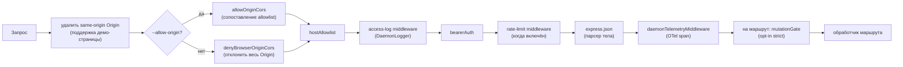
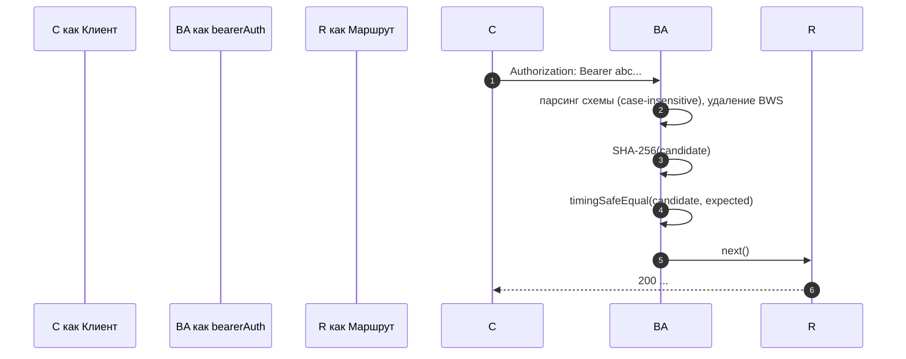
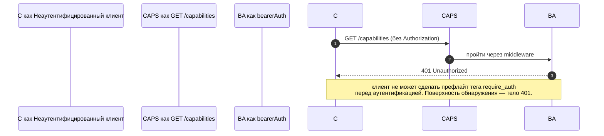

# Модель аутентификации и безопасности

## Обзор

`nessy serve` — это локальный демон по умолчанию и открытая поверхность при неправильной конфигурации. Его модель безопасности **многослойная**, так что неправильная конфигурация завершается неудачей в закрытом состоянии:

1. **Bind** — привязка не к loopback без bearer-токена **отказывается запускаться**.
2. **Bearer auth** — middleware `bearerAuth` со сравнением SHA-256 за постоянное время защищает каждый маршрут, кроме `/health` на loopback (`require_auth` расширяет это на loopback и `/health` тоже).
3. **Allowlist заголовка Host** — на loopback принимаются только `localhost`, `127.0.0.1`, `[::1]`, `host.docker.internal` (плюс порт); защита от DNS rebinding.
4. **Контроль Origin** — по умолчанию любой запрос с заголовком `Origin` отклоняется с 403. Когда настроен `--allow-origin <pattern>`, демон переключается в режим CORS allowlist (`allowOriginCors`) и разрешает только совпадающие origins.
5. **Gate мутации на маршрут** — маршруты мутации Wave 4 могут явно включить ответы `401` даже на loopback, когда токен не настроен, используя отдельную ошибку `code: 'token_required'`.
6. **Device-flow auth** — отдельная поверхность OAuth для провайдеров (`POST /workspace/auth/device-flow` + GET/DELETE на `/:id`).

Этот документ проходит по каждому слою и явным инвариантам, которые обеспечивает путь загрузки.

## Ответственность

- Отказаться от загрузки в небезопасных конфигурациях.
- Пропустить каждый HTTP-запрос через bearer (когда настроен) + host (loopback) + origin проверки.
- Предоставить gate мутации на маршрут, в который маршруты Wave 4 явно включаются.
- Размещать реестр device-flow, который управляет OAuth-потоками провайдеров, видимыми через SSE-события.

## Архитектура

### Правила отказа при загрузке

В `run-nessy-serve.ts`:

```ts
if (!isLoopbackBind(opts.hostname) && !token) {
  throw new Error('Refusing to bind <host>:<port> without a bearer token. ...');
}
if (opts.requireAuth && !token) {
  throw new Error(
    'Refusing to start with --require-auth set but no bearer token configured. ...',
  );
}
```

У wildcard allow-origin есть своё правило отказа:

```ts
const parsed = parseAllowOriginPatterns(opts.allowOrigins);
if (parsed.allowAny && !token) {
  throw new Error(
    "Refusing to start with --allow-origin '*' but no bearer token configured. ...",
  );
}
```

Все три отказа — это явные сбои загрузки (видны в stderr / выбрасываются внедрённому коду), никогда не молчат. Модель угроз из #3803 явно запрещает молчаливо позволять демону привязываться за пределами loopback в открытом состоянии.

### Цепочка middleware (порядок HTTP-запроса)



`mutationGate` — это фабрика middleware на маршрут (`createMutationGate` возвращает `mutate()`); маршруты вызывают `mutate()` или `mutate({strict: true})` во время регистрации. Это не глобальный middleware `app.use()`. Логирование доступа регистрируется перед `bearerAuth`, так что отклонения 401 всё ещё логируются. Rate limiting работает после `bearerAuth` и перед `express.json()`, так что только аутентифицированные запросы считаются, а большие тела отклоняются перед парсингом, когда лимит превышен.

### `bearerAuth`

- **Токен не настроен** → middleware не работает (loopback developer по умолчанию).
- **Токен настроен** → SHA-256 настроенного токена один раз при построении; при каждом запросе хешировать кандидата и сравнивать `timingSafeEqual`. Нет короткого замыкания равенства строк; нет утечки времени.
- **Парсинг схемы**: case-insensitive `Bearer` по RFC 7235 §2.1; допускает `SP\tHTAB` между схемой и учётными данными по RFC 7230 §3.2.6 BWS; отклоняет чистый HTAB как разделитель.
- **CodeQL hardening**: ручной парсинг `indexOf`, а не regex с `\s+` / `.+` перекрытием (нет риска полиномиального regex).

### `hostAllowlist`

Только loopback. Поддерживает `Set<string>` с ключом по порту. Разрешённые Hosts:

- `localhost:<port>`, `127.0.0.1:<port>`, `[::1]:<port>`, `host.docker.internal:<port>`.
- Плюс формы без порта (`localhost`, `127.0.0.1`, `[::1]`, `host.docker.internal`) **только** при привязке к порту 80 (по опущению порта по умолчанию RFC 7230 §5.4).

Сравнение Host **case-insensitive** — Express нормализует имена заголовков, но не значения, поэтому Docker-прокси, которые капитализируют Host (`Localhost:4170`, `HOST.docker.internal`), получили бы 403 при сравнении строк точно.

Привязки не к loopback обходят этот middleware (оператор выбрал площадь поверхности; bearer token gate подделку Host вместо этого).

### `denyBrowserOriginCors`

Отклонить любой запрос с заголовком `Origin`. CLI/SDK никогда не устанавливают Origin; только браузеры делают. Возвращает детерминированный `403 { error: 'Request denied by CORS policy' }`, а не 500 HTML, который производит callback ошибки пакета `cors`.

Исключение: same-origin XHR демо-страницы обрабатываются отдельным middleware (в `server.ts`), который удаляет `Origin`, когда он совпадает с собственным адресом демона.

### `allowOriginCors` (режим `--allow-origin`)

Когда настроен `--allow-origin <pattern>`, `denyBrowserOriginCors` заменяется на `allowOriginCors(parsedPatterns)`:

- Совпадающие значения `Origin` получают `Access-Control-Allow-Origin`, `Access-Control-Allow-Headers` и `Access-Control-Allow-Methods`; `OPTIONS` preflight возвращает `204`.
- Несовпадающие значения `Origin` получают тот же детерминированный `403 { error: 'Request denied by CORS policy' }`, что и режим отказа.
- `--allow-origin '*'` требует `--token`; иначе загрузка отказывает.
- `parseAllowOriginPatterns()` проверяет синтаксис паттерна при загрузке.
- Тег возможности `allow_origin` рекламируется только когда этот режим настроен.

### `createMutationGate`

Opt-in gate на маршрут. Матрица поведения:

| конфигурация демона       | маршрут opts    | результат                        |
| ------------------------- | --------------- | -------------------------------- |
| `requireAuth=true`        | любые           | passthrough¹                     |
| `token` настроен          | любые           | passthrough²                     |
| нет токена (loopback dev) | `strict: false` | passthrough                      |
| нет токена (loopback dev) | `strict: true`  | `401 { code: 'token_required' }` |

¹ `--require-auth` загружается только с токеном, так что глобальный `bearerAuth` уже 401 неаутентифицированных вызывающих.
² Любая конфигурация токена заставляет глобальный `bearerAuth` требовать bearer везде; gate избыточен, но безвреден.

Форма `code: 'token_required'` отличается от простой `Unauthorized` от `bearerAuth`, так что SDK-клиенты могут отрисовывать подсказку «настройте --token / --require-auth» вместо общей 401.

**Маршруты strict Wave 4+**: `/workspace/memory`, `/workspace/agents/*`, `/workspace/agents/generate`, `/file/write`, `/file/edit`, `/workspace/tools/:name/enable`, `/workspace/mcp/:server/restart`, `/workspace/mcp/:server/{enable,disable,authenticate,clear-auth}`, `/workspace/mcp/servers` (POST/DELETE), `/workspace/auth/device-flow`, `/workspace/init`, `/session/:id/approval-mode`.

### Исключение `/health`

На привязках loopback `/health` регистрируется **перед** middleware bearer, так что liveness-пробы внутри pod не должны носить токен. Привязки не к loopback gate `/health` за bearer, как и каждый другой маршрут. `--require-auth` удаляет исключение: `/health` требует `Authorization: Bearer <token>` на loopback тоже.

### v1 client identity (`X-Nessy-Client-Id`) — самоотчётный

Демон проверял только формат `X-Nessy-Client-Id` (`[A-Za-z0-9._:-]{1,128}`) и отслеживал прикреплённые client id на сессию. В настоящее время не выполняет proof-of-possession. Клиент, который наблюдает `originatorClientId` на SSE, может перерегистрировать тот же id и выдать себя за originator в более поздних запросах.

Влияние:

- `designated` — удалённый вызывающий может выдать себя за originator и голосовать по запросу, предназначенному только для originator prompt.
- `consensus` — если подделанный id уже был в снимке `votersAtIssue`, он может голосовать.
- `local-only` не затронут, потому что он gate на `fromLoopback`, который демон штампует из удалённого адреса соединения.
- `first-responder` не затронут, потому что он identity-agnostic.

Будущий механизм pair-token выдаст секрет на сессию из `POST /session`; голоса `designated` / `consensus` должны будут представить его. До тех пор развёртывания, которым нужна жёсткая политика designated, должны привязывать loopback или запускаться за аутентифицированным обратным прокси. См. [`04-permission-mediation.md`](./04-permission-mediation.md) для деталей на уровне политики.

### Device-flow auth

Отдельная поверхность OAuth для аутентификации провайдера (DP Auth и т.д.):

- `POST /workspace/auth/device-flow` — начать поток; возвращает `{deviceFlowId, providerId, expiresAt, verificationUrl, userCode}`.
- `GET /workspace/auth/device-flow/:id` — опрос состояния.
- `DELETE /workspace/auth/device-flow/:id` — отмена.
- `GET /workspace/auth/status` — текущий снимок аккаунта / провайдера.

SSE-события `auth_device_flow_{started, throttled, authorized, failed, cancelled}` fan-out состояние потока всем подписчикам, так что multi-client UI остаются синхронизированными. См. [`09-event-schema.md`](./09-event-schema.md).

Реализация: `packages/cli/src/serve/auth/device-flow.ts` + `qwen-device-flow-provider.ts`.

**Защита от инъекции логов / Trojan Source**: `sanitizeForStderr(value)` (`device-flow.ts`) заменяет управляющие символы ASCII и управляющие символы Unicode на `?`. Вредоносный IdP мог бы подделать строки логов или скрыть полезную нагрузку:

| Диапазон                         | Почему удаляется                                                                                                                                                                                                                                                                 |
| -------------------------------- | -------------------------------------------------------------------------------------------------------------------------------------------------------------------------------------------------------------------------------------------------------------------------------- |
| `\x00–\x1f`, `\x7f`, `\x80–\x9f` | ASCII C0 / DEL / C1 controls, терминальные escape-последовательности и подделка строк логов.                                                                                                                                                                                     |
| U+200B-U+200F                    | Символы нулевой ширины плюс LRM / RLM; невидимы, но могут изменить отображение терминала.                                                                                                                                                                                        |
| U+2028-U+2029                    | LINE / PARAGRAPH SEPARATOR; многие Unicode-совместимые терминалы обрабатывают их как разрывы строк.                                                                                                                                                                              |
| U+202A-U+202E                    | Bidirectional EMBEDDING / OVERRIDE controls.                                                                                                                                                                                                                                     |
| U+2066-U+2069                    | Bidirectional ISOLATE controls (LRI / RLI / FSI / PDI), основной вектор [CVE-2021-42574 "Trojan Source"](https://trojansource.codes/). IdP, использующий U+2066 (LRI) вместо U+202D (LRO), может обойти фильтры EMBEDDING/OVERRIDE с аналогичным визуальным переупорядочиванием. |
| U+FEFF                           | BOM / zero-width no-break space.                                                                                                                                                                                                                                                 |

Длина сохраняется заменой каждой удалённой кодовой точки на `?`, а не удалением, так что операторы всё ещё могут видеть, что что-то присутствовало в этом индексе. Оба слоя используют санитайзер: `nessyDeviceFlowProvider` санитайзирует IdP `oauthError`, а late-poll observer реестра санитайзирует контролируемые провайдером значения, интерполированные в аудит-подсказки (`latePollResult.kind` / `lateErr.name`).

Тег возможности `auth_device_flow` рекламируется **безусловно**; сами маршруты возвращают `400 unsupported_provider`, если демон не может удовлетворить конкретного провайдера. Список поддерживаемых провайдеров находится на `/workspace/auth/status`, а не на `/capabilities`, чтобы сохранить единообразную форму дескриптора.

## Поток

### Успешный запрос bearer auth



### Режимы отказа bearer auth

Все возвращают `401 { error: 'Unauthorized' }` (единообразно для `missing header` / `wrong scheme` / `wrong token`, так что зондирование не может различить).

### Тень `--require-auth`



После аутентификации `caps.features.includes('require_auth')` подтверждает, что развёртывание жёсткое.

### Gate мутации Wave 4 на loopback без токена

```mermaid
sequenceDiagram
    autonumber
    participant C как Клиент
    participant BA как bearerAuth (no-op, нет токена)
    participant MG как mutationGate({strict: true})
    participant R как Обработчик

    C->>BA: POST /workspace/memory (без Authorization)
    BA->>MG: passthrough
    MG-->>C: 401 { code: 'token_required', error: '...' }
```

## Состояние и жизненный цикл

- Bearer-токен читается при загрузке и обрезается (новые строки из `cat token.txt` иначе молча сломают сравнение).
- Set разрешённых Host кэшируется на порт; перестраивается при изменении порта (эфемерный `0` → реальный порт после `listen`).
- Mutation gate конструирует `passthrough` и `strictDenier` один раз на сборку приложения; вызов на маршрут возвращает кэшированное замыкание (без выделения на запрос).
- Реестр device-flow утилизируется на `shutdown()` Phase 1, так что ожидающие потоки разрешаются как `cancelled` перед HTTP teardown.

## Зависимости

- `node:crypto` — `createHash`, `timingSafeEqual`.
- `packages/cli/src/serve/loopback-binds.ts` — `isLoopbackBind`.
- `packages/cli/src/serve/auth/device-flow.ts` — state machine device-flow.
- `@nestor/nessy-cli-acp-bridge` — поверхности события device-flow на шине SSE на сессию.

## Конфигурация

| Источник          | Рычаг                                                                             | Влияние                                                                 |
| ----------------- | --------------------------------------------------------------------------------- | ----------------------------------------------------------------------- |
| Env               | `NESSY_SERVER_TOKEN`                                                              | Bearer-токен (обрезанный).                                              |
| Флаг              | `--token`                                                                         | Bearer-токен (переопределяет env).                                      |
| Флаг              | `--require-auth`                                                                  | Расширяет bearer на loopback + `/health`. Загружается только с токеном. |
| Флаг              | `--hostname`                                                                      | Привязка не к loopback требует `--token` (или env).                     |
| Флаг              | `--allow-origin <pattern>`                                                        | Переключить в режим CORS allowlist. `'*'` требует токена.               |
| Теги возможностей | `require_auth` (условный), `auth_device_flow` (всегда), `allow_origin` (условный) | См. [`11-capabilities-versioning.md`](./11-capabilities-versioning.md). |

## Ограничения и известные пределы

- **`--require-auth` скрывает префлайт функции.** Неаутентифицированные клиенты не могут обнаружить тег `require_auth`; их поверхность обнаружения — само тело 401.
- **Порядок body-parser gate мутации**: ответы 401 `mutationGate({strict: true})` срабатывают **после** того, как `express.json()` парсит тело. Худший случай на насыщенном loopback listener: `--max-connections × express.json({limit: '10mb'})` ≈ 2.5 GB транзиентно. Поверхность атаки только loopback, намеренно принята.
- **Удаление same-origin Origin** в `server.ts` происходит _перед_ `denyBrowserOriginCors`. Если будущее изменение переместит удаление в другое место, демо-страница сломается.
- **Сравнение токена — по дайджесту SHA-256**, а не по сырому токену. Уменьшает утечку времени, сворачивая сравнения токена переменной длины в сравнение дайджеста фиксированного размера.
- Демон **не несёт** mTLS, подписи запросов или proof-of-possession pair-token сегодня. `--rate-limit` предоставляет HTTP rate limiting по ключу client-id / IP; это не аутентификация идентичности клиента.

## Ссылки

- `packages/cli/src/serve/auth.ts` (весь файл)
- `packages/cli/src/serve/run-nessy-serve.ts` (правила отказа)
- `packages/cli/src/serve/loopback-binds.ts`
- `packages/cli/src/serve/auth/device-flow.ts`
- `packages/cli/src/serve/auth/qwen-device-flow-provider.ts`
- Модель угроз для пользователя: [`../../../users/work/features/nessy-serve.md`](../../../users/work/features/nessy-serve.md).
- Справочник провода: [`../../nessy-serve-protocol.md`](../../nessy-serve-protocol.md).
