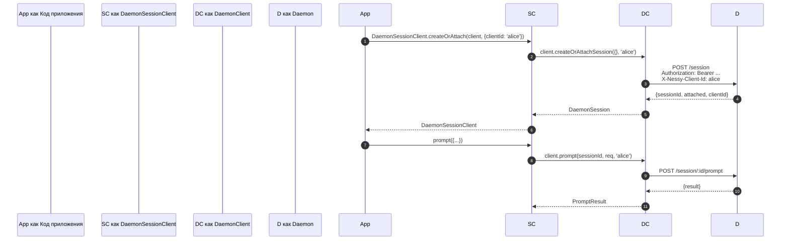
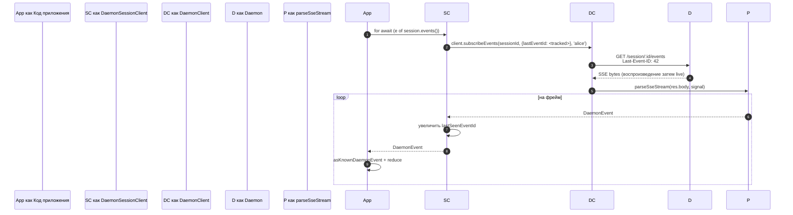
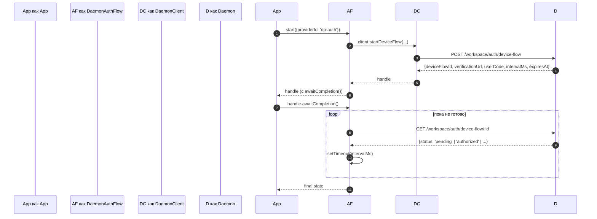

# TypeScript SDK Daemon Client

## Обзор

`packages/sdk-typescript/src/daemon/` — это **daemon-клиент TypeScript SDK**. Это канонический способ подключения к работающему демону `nessy serve` от любого хоста TypeScript / JavaScript (собственный TUI-адаптер CLI, бэкенды channel-ботов, IDE-компаньон VS Code, пользовательские скрипты и серверные веб-бэкенды). Все остальные адаптеры зависят от него.

Структура пакета намеренно мала:

| Файл                     | Поверхность                                                                                                                   |
| ------------------------ | ----------------------------------------------------------------------------------------------------------------------------- |
| `index.ts`               | Публичный barrel (`DaemonClient`, `DaemonSessionClient`, `DaemonAuthFlow`, `parseSseStream`, редукторы событий, типы).        |
| `DaemonClient.ts`        | Низкоуровневая фасад HTTP/SSE — один метод на маршрут `nessy-serve-protocol.md`.                                              |
| `DaemonSessionClient.ts` | Обёртка на сессию с отслеживанием воспроизведения SSE.                                                                        |
| `DaemonAuthFlow.ts`      | Высокоуровневый помощник OAuth device-flow.                                                                                   |
| `sse.ts`                 | `parseSseStream` (парсер фреймов NDJSON / SSE).                                                                               |
| `events.ts`              | `asKnownDaemonEvent`, `reduceDaemonSessionEvent`, `reduceDaemonAuthEvent` (см. [`09-event-schema.md`](./09-event-schema.md)). |
| `types.ts`               | `DaemonCapabilities`, `DaemonSession`, `DaemonEvent`, `PermissionResponse`, `PromptResult`, MCP / agent / memory / auth типы. |

Пример walkthrough находится в [`../examples/daemon-client-quickstart.md`](../examples/daemon-client-quickstart.md); этот документ — ссылка на архитектуру и контракт.

## Ответственность

- Предоставить один метод TypeScript на HTTP-маршрут демона.
- Корректно штамповать bearer-токен + `X-Nessy-Client-Id` на каждом запросе.
- Компонировать таймауты на вызов с предоставленным вызывающим `AbortSignal` (не убивая long-lived SSE).
- Потоковая передача и парсинг фреймов SSE в типизированные `DaemonEvent`s.
- Отслеживать `lastSeenEventId` на сессию, так что переподключения воспроизводятся корректно.
- Предоставить поверхность аутентификации device-flow, которая опрашивает с интервалами, предоставленными демоном.

## Архитектура

### `DaemonClient` (`DaemonClient.ts`)

Конструктор:

```ts
new DaemonClient({
  baseUrl: string,                  // по умолчанию 'http://127.0.0.1:4170'
  token?: string,
  fetch?: typeof globalThis.fetch,  // инжектируемо для тестов
  fetchTimeoutMs?: number,          // 0 = отключён; по умолчанию DEFAULT_FETCH_TIMEOUT_MS
});
```

Группы методов (каждый метод принимает опциональный `clientId` для штамповки `X-Nessy-Client-Id`):

| Группа              | Методы                                                                                                                                                                                                                              |
| ------------------- | ----------------------------------------------------------------------------------------------------------------------------------------------------------------------------------------------------------------------------------- |
| Plumbing            | `health()`, `capabilities()`, `auth` (ленивый аксессуар `DaemonAuthFlow`)                                                                                                                                                           |
| Сессии              | `createOrAttachSession`, `loadSession`, `resumeSession`, `listSessions`, `closeSession`, `setSessionMetadata`, `getSessionContext`, `getSessionSupportedCommands`, `setSessionApprovalMode`, `setSessionModel`                      |
| Prompting           | `prompt`, `cancel`, `heartbeat`                                                                                                                                                                                                     |
| События             | `subscribeEvents` (SSE generator), `subscribeEventsStream` (raw response)                                                                                                                                                           |
| Разрешения          | `respondToPermission`, `respondToSessionPermission`                                                                                                                                                                                 |
| Workspace snapshots | `getWorkspaceMcp`, `getWorkspaceSkills`, `getWorkspaceProviders`, `getWorkspaceEnv`, `getWorkspacePreflight`                                                                                                                        |
| Workspace мутации   | `writeWorkspaceMemory`, `readWorkspaceMemory`, `listWorkspaceAgents`, `getWorkspaceAgent`, `createWorkspaceAgent`, `updateWorkspaceAgent`, `deleteWorkspaceAgent`, `toggleWorkspaceTool`, `restartMcpServer`, `initializeWorkspace` |
| Файлы               | `readFile`, `readFileBytes`, `writeFile`, `editFile`, `listDirectory`, `globPaths`, `statPath`                                                                                                                                      |
| Auth                | `startDeviceFlow`, `pollDeviceFlow`, `cancelDeviceFlow`, `getAuthStatus`                                                                                                                                                            |

### `fetchWithTimeout`

Каждый запрос проходит через `fetchWithTimeout`. Критичные детали:

- **Чтение тела внутри таймера.** Предыдущие реализации очищали таймер при прибытии заголовков; если прокси зависал посередине тела, `await res.json()` мог зависнуть за пределами `fetchTimeoutMs`. Текущая форма передаёт код чтения тела как callback, так что таймер покрывает и прибытие заголовков, И потребление тела.
- **`perCallTimeoutMs`** позволяет одному вызову переопределить клиентское значение по умолчанию. Самый заметный вызывающий — `restartMcpServer`: SDK использует `MCP_RESTART_DEFAULT_TIMEOUT_MS = 330_000` (5 мин 30с). Собственный `MCP_RESTART_TIMEOUT_MS` демона — ровно 300с; если клиент соответствовал этому значению, перезапуск, который завершается около 300с, мог проиграть гонку, пока демон сериализует и отправляет свой структурированный ответ, вызывая ложноположительную `TimeoutError`. Дополнительные 30с покрывают сериализацию, передачу по сети и декодирование с обеих сторон. Вызывающие, которым нужен более жёсткий бюджет, могут передать `timeoutMs`; передача `0` отключает таймаут.
- **`AbortSignal.any`** компонует предоставленный вызывающим сигнал с сигналом таймера на вызов, так что отмена вызывающим и таймаут на вызов оба чисто прерывают.
- **`AbortController` + отменяемый `setTimeout`** вместо `AbortSignal.timeout()`, так что быстро разрешающиеся запросы не протекают ожидающими таймерами в event loop. Таймер очищается в `finally`.
- **Streaming endpoints (`subscribeEvents`) обходят таймаут** — long-lived SSE не должен убиваться им.

### `DaemonSessionClient` (`DaemonSessionClient.ts`)

Привязывает одну сессию и автоматически отслеживает `lastSeenEventId`, так что воспроизведение SSE и переподключение работают без дополнительного состояния вызывающего.

```ts
class DaemonSessionClient {
  readonly client: DaemonClient;
  readonly session: DaemonSession;
  readonly state: DaemonSessionState;
  private lastSeenEventId: number | undefined;

  static createOrAttach(client, req?): Promise<DaemonSessionClient>;
  static load(client, sessionId, req?): Promise<DaemonSessionClient>;
  static resume(client, sessionId, req?): Promise<DaemonSessionClient>;

  events(opts?: DaemonSessionSubscribeOptions): AsyncIterable<DaemonEvent>;
  prompt(req: PromptRequest): Promise<PromptResult>;
  cancel(): Promise<void>;
  respondToPermission(...): Promise<PermissionResponse>;
  setModel(modelServiceId): Promise<SetModelResult>;
  heartbeat(): Promise<HeartbeatResult>;
  setMetadata(metadata): Promise<SessionMetadataResult>;
  close(): Promise<void>;
}
```

`events()` проксирует `client.subscribeEvents` с `resume: true` по умолчанию — он передаёт отслеживаемый `lastSeenEventId`, так что переподключения воспроизводят с того места, где остановилась предыдущая подписка. Каждое выданное событие увеличивает `lastSeenEventId`.

### `DaemonAuthFlow` (`DaemonAuthFlow.ts`)

```ts
class DaemonAuthFlow {
  start(opts: { providerId, ... }): Promise<DaemonAuthFlowHandle>;
}
interface DaemonAuthFlowHandle {
  deviceFlowId: string;
  providerId: string;
  expiresAt: string;
  verificationUrl: string;
  userCode: string;
  awaitCompletion(opts?): Promise<DaemonAuthDeviceFlowState>;
  cancel(): Promise<void>;
}
```

`awaitCompletion()` опрашивает `GET /workspace/auth/device-flow/:id` с интервалом `intervalMs`, предоставленным демоном, пока поток не станет `authorized`, `failed` или `cancelled`. Он лениво конструируется через `client.auth`, так что клиенты, которые никогда не касаются auth, не несут затрат на выделение.

### `parseSseStream` (`sse.ts`)

Превращает `Response.body` (`ReadableStream<Uint8Array>`) в `AsyncIterable<DaemonEvent>`. Обрабатывает:

- Фрейминг LF и CRLF.
- Ограничение переполнения буфера (16 MiB) — защитная граница от демона, выдающего один абсурдно большой фрейм.
- Подключение AbortSignal — прерывание закрывает поток и итератор.
- Фреймы только с комментариями и неизвестные типы событий (передаются как `DaemonEvent`; потребители SDK сужают ниже по потоку через `asKnownDaemonEvent`).

### Типы (`types.ts`)

Заметные экспорты: `DaemonCapabilities`, `DaemonSession` (`{ sessionId, workspaceCwd, attached, clientId?, createdAt? }`), `DaemonEvent`, `DaemonSessionState`, `DaemonSessionContextStatus`, `DaemonSessionSupportedCommandsStatus`, `PermissionResponse`, `PromptResult`, `HeartbeatResult`, `SetModelResult`, `SessionMetadataResult`, плюс MCP / agent / memory / auth типы результатов.

## Поток

### Create-or-attach + первый prompt



### Подписка с воспроизведением



### Device-flow auth



## Состояние и жизненный цикл

- `DaemonClient` не имеет соединения; ничего не происходит при конструировании. Каждый метод открывает свежий `fetch`.
- `DaemonSessionClient` сохраняет `lastSeenEventId` между вызовами `events()`; переподключения воспроизводят с последнего увиденного.
- `DaemonAuthFlow` ленив — `client.auth` конструирует его при первом доступе.
- SSE-итератор закрывается, когда (a) демон завершает поток, (b) `AbortSignal.abort()` срабатывает, (c) потребитель выходит из `for await`, или (d) достигается ограничение переполнения буфера (16 MiB).

## Зависимости

- `globalThis.fetch` (Node 18+ built-in, browser, undici и т.д.). Инжектируемо на `DaemonClient` для тестов.
- Native `AbortController` / `AbortSignal.any` / `setTimeout`.
- Нет транзитивных зависимостей на `@nestor/nessy-cli-core` или `@nestor/nessy-cli-acp-bridge` — пакет SDK полностью разделён, так что внешние потребители не тянут внутренности демона.

## Подпакет `ui/*` ([#4328](https://github.com/NessyLM/nessy-cli/pull/4328) + [#4353](https://github.com/NessyLM/nessy-cli/pull/4353))

SDK также экспортирует `packages/sdk-typescript/src/daemon/ui/`, набор примитивов, независимых от хоста, которые превращают события демона в блоки транскрипта:

- `normalizeDaemonEvent(evt)` отображает 43 известных сетевых события демона в 37 UI-дружелюбных значений `DaemonUiEventType`, таких как `assistant.text.delta`, `tool.update` и `session.metadata.changed`; не смоделированные или неправильно сформированные события нормализуются в `debug`.
- `createDaemonTranscriptState()` плюс `reduceDaemonTranscriptEvents(state, events)` проецируют UI-события в `DaemonTranscriptBlock[]`.
- `createDaemonTranscriptStore()` обёртывает subscribe / dispatch.
- `render.ts` / `terminal.ts` предоставляют baseline-рендереры HTML и терминала, а `toolPreview.ts` производит сводки вызовов инструментов.
- Селекторы включают `selectTranscriptBlocksOrderedByEventId`, `selectPendingPermissionBlocks`, `selectCurrentTool`, `selectApprovalMode`, `selectToolProgress`, `selectSubagentChildBlocks`, `formatMissedRange` и `formatBlockTimestamp`.
- Публичные константы включают `DAEMON_PLAN_TOOL_CALL_ID`.
- `conformance.ts` содержит набор тестов кросс-хост согласованности.

Первый производственный потребитель — `packages/webui/src/daemon/` через React's `DaemonSessionProvider`. См. [`14-cli-tui-adapter.md`](./14-cli-tui-adapter.md) для подробной архитектуры, глоссария, таблицы селекторов и связи с устаревшим `DaemonTuiAdapter`.

Подпакет экспортируется из подпути `@nestor/nessy-cli-sdk/daemon`. Существующий код, который делает `import { DaemonClient }`, не затронут.

## Конфигурация

| Рычаг              | Где                                    | Влияние                                                                                     |
| ------------------ | -------------------------------------- | ------------------------------------------------------------------------------------------- |
| `baseUrl`          | конструктор `DaemonClient`             | URL демона; конечные слеши удаляются.                                                       |
| `token`            | конструктор `DaemonClient`             | Штампуется как `Authorization: Bearer`.                                                     |
| `fetch`            | конструктор `DaemonClient`             | Точка инжекции теста.                                                                       |
| `fetchTimeoutMs`   | конструктор `DaemonClient`             | Таймаут на вызов; `0` = отключён.                                                           |
| `clientId`         | опциональный аргумент на метод         | Заголовок `X-Nessy-Client-Id` (см. [`08-session-lifecycle.md`](./08-session-lifecycle.md)). |
| `lastEventId`      | конструктор `DaemonSessionClient`      | Начать курсор воспроизведения.                                                              |
| `maxQueued`        | опция на подписку                      | `?maxQueued=N` для SSE-маршрута; сначала pre-flight `caps.features.slow_client_warning`.    |
| `perCallTimeoutMs` | на метод (например `restartMcpServer`) | Переопределить клиентский таймаут.                                                          |

## Ограничения и известные пределы

- **`fetchTimeoutMs` — на вызов, а не на уровень соединения.** Долгие чтения тела разделяют таймер. Демон, который потоково передаёт ответы, должен переопределить на вызов или установить таймаут в `0`.
- **SSE обходит таймаут fetch** — long-lived SSE-соединения не убиваются `fetchTimeoutMs`. Используйте `AbortSignal` для отмены, управляемой вызывающим.
- **Ограничение буфера `parseSseStream` — 16 MiB** как защитная граница. Один фрейм больше этого прерывает итератор (демон никогда легитимно не выдаёт такие фреймы).
- **`asKnownDaemonEvent` возвращает `undefined` для нераспознанных типов событий.** Потребители SDK должны обрабатывать эту ветвь, а не предполагать, что союз исчерпывающий; это контракт прямой совместимости. Нераспознанные события увеличивают `DaemonSessionViewState.unrecognizedKnownEventCount`.
- **`client_evicted`, `slow_client_warning`, `stream_error` не в кольце воспроизведения.** Переподключение после eviction забирает из кольца демона; вы не увидите фрейм eviction снова.
- **`DaemonClient` не делает авто-повтор.** Сбои сети всплывают как отклонения; стратегия переподключения / воспроизведения — ответственность вызывающего (`DaemonSessionClient.events()` делает воспроизведение лёгким, но переподключение всё ещё на вызов).

## Ссылки

- `packages/sdk-typescript/src/daemon/DaemonClient.ts`
- `packages/sdk-typescript/src/daemon/DaemonSessionClient.ts`
- `packages/sdk-typescript/src/daemon/DaemonAuthFlow.ts`
- `packages/sdk-typescript/src/daemon/sse.ts`
- `packages/sdk-typescript/src/daemon/events.ts`
- `packages/sdk-typescript/src/daemon/types.ts`
- End-to-end walkthrough: [`../examples/daemon-client-quickstart.md`](../examples/daemon-client-quickstart.md).
