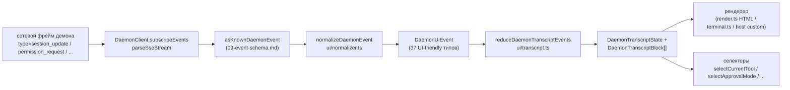

# Общий слой транскрипта UI

> **Текущий статус**: `packages/cli/src/ui/daemon/daemon-tui-adapter.ts` всё ещё присутствует на `main` как устаревший экспериментальный адаптер на стороне CLI. Этот документ описывает новый общий слой транскрипта UI на стороне SDK: повторно используемые нормализацию событий демона и примитивы транскрипта, которые может потреблять любой хост UI, включая Web, TUI, IDE и IM channels. Миграции CLI TUI, channel и VS Code IDE — последующая работа.

## Обзор

`packages/sdk-typescript/src/daemon/ui/` добавляет подпакет `ui/*` в SDK. Он превращает поток SSE-событий демона в блоки транскрипта, рендеримые в UI, через повторно используемые примитивы:

- **Нормализация** (`normalizer.ts`): отображает 43 известных типа сетевых событий демона (см. [`09-event-schema.md`](./09-event-schema.md)) в 37 семантических событий `DaemonUiEventType`, дружелюбных к UI, таких как `assistant.text.delta`, `tool.update` и `session.metadata.changed`.
- **State machine** (`transcript.ts`, `store.ts`): чистый редуктор плюс подписываемый store, который проецирует UI-события в упорядоченный `DaemonTranscriptBlock[]`.
- **Рендереры** (`render.ts`, `terminal.ts`, `toolPreview.ts`): блоки транскрипта в HTML, терминальный текст и строки предпросмотра инструментов. Хосты могут использовать или заменять их.
- **Conformance** (`conformance.ts`): тесты кросс-хост согласованности, используемые при миграции поверхностей channel, TUI и IDE на эти примитивы.

Первый производственный потребитель — **`packages/webui/src/daemon/`** ([#4328](https://github.com/NessyLM/nessy-cli/pull/4328)). Его React `DaemonSessionProvider` и адаптер транскрипта позволяют веб-UI подключаться напрямую к HTTP+SSE демона вместо того, чтобы только рендерить трафик `postMessage` хоста. CLI TUI, channel base и VS Code IDE могут позже использовать тот же слой; [`../daemon-ui/MIGRATION.md`](../daemon-ui/MIGRATION.md) документирует руководство по инкрементальной миграции v2.

## Ответственность

- Нормализовать 43 сетевых события демона в стабильную лексику UI (`DaemonUiEventType`), так что рендереры не инспектируют `rawEvent.data`.
- Сохранить монотонный SSE `eventId` демона как **первичный ключ упорядочивания**, так что разные клиенты рендерят транскрипты в одном порядке.
- Использовать чистый редуктор для производства блоков транскрипта с селекторами для ожидающих разрешений, текущего инструмента, режима одобрения, прогресса инструмента и дочерних элементов subagent.
- Предоставить baseline HTML и терминальные рендереры, позволяя рендеринг, специфичный для хоста.
- Предоставить публичные константы, такие как `DAEMON_PLAN_TOOL_CALL_ID` для панелей плана.
- Сохранить аддитивную совместимость провода: неизвестные типы событий нормализуются в `debug`, а не отбрасываются.

## Архитектура

### Структура пакета

| Файл                                             | Экспорты                                                                                                                                                        | Назначение                      |
| ------------------------------------------------ | --------------------------------------------------------------------------------------------------------------------------------------------------------------- | ------------------------------- |
| `packages/sdk-typescript/src/daemon/ui/index.ts` | Barrel подпакета                                                                                                                                                | Публичная точка входа           |
| `ui/types.ts`                                    | `DaemonUiEventType`, интерфейсы `DaemonUiEvent*` на тип, `DaemonTranscriptBlock`, `DaemonTranscriptState`, `DaemonUiToolProvenance`, `DAEMON_PLAN_TOOL_CALL_ID` | Типы                            |
| `ui/normalizer.ts`                               | `normalizeDaemonEvent(evt) -> DaemonUiEvent`, `getSessionUpdatePayload(evt)`                                                                                    | Маппинг wire-to-UI              |
| `ui/transcript.ts`                               | `createDaemonTranscriptState()`, `appendLocalUserTranscriptMessage()`, `reduceDaemonTranscriptEvents()`, `rebuildDaemonTranscriptBlockIndex()`, селекторы       | State machine и селекторы       |
| `ui/store.ts`                                    | `createDaemonTranscriptStore(initial?)`                                                                                                                         | Подписываемый reducer store     |
| `ui/toolPreview.ts`                              | `createDaemonToolPreview(toolEvent)`                                                                                                                            | Текст сводки вызова инструмента |
| `ui/render.ts`                                   | `DaemonHtmlRenderOptions`, `DaemonRenderOptions`, функции рендеринга                                                                                            | HTML и общий рендеринг          |
| `ui/terminal.ts`                                 | Рендеринг, специфичный для терминала                                                                                                                            | Подготовка TUI                  |
| `ui/conformance.ts`                              | Набор тестов кросс-хост согласованности                                                                                                                         | Тесты паритета миграции         |
| `ui/utils.ts`                                    | Хелперы, такие как `DaemonUiContentPart`                                                                                                                        | Общие внутренние утилиты        |

### Лексика `DaemonUiEventType`

`ui/types.ts` определяет 37 типов UI-событий, сгруппированных по домену.

**Chat stream (Stage 1)**

- `user.text.delta`, `user.image.delta`, `user.shell.command`, `assistant.text.delta`, `assistant.done`, `thought.text.delta`
- `tool.update`, `shell.output`, `user.shell.output`
- `permission.request`, `permission.resolved`
- `model.changed`, `status`, `error`, `debug`

**Метаданные сессии**

- `session.metadata.changed`, `session.approval_mode.changed`
- `session.available_commands`, `session.state_resync_required`, `session.replay_complete`

**Жизненный цикл Prompt (cross-client)**

- `prompt.cancelled`, `followup.suggestion`

**Workspace (Wave 3-4)**

- `workspace.memory.changed`, `workspace.agent.changed`
- `workspace.tool.toggled`, `workspace.settings.changed`, `workspace.initialized`
- `workspace.mcp.budget_warning`, `workspace.mcp.child_refused`
- `workspace.mcp.server_restarted`, `workspace.mcp.server_restart_refused`

**Auth flow (Wave 4 OAuth)**

- `auth.device_flow.started`, `auth.device_flow.throttled`, `auth.device_flow.authorized`
- `auth.device_flow.failed`, `auth.device_flow.cancelled`

`normalizeDaemonEvent` отображает 43 известных сетевых события демона в эту лексику. Неизвестные, не смоделированные или неправильно сформированные типы событий нормализуются в `debug` и сохраняют `rawEvent` для диагностики хоста.

### Редуктор и селекторы

```ts
// Создать начальное состояние.
const state = createDaemonTranscriptState();

// Применить последовательность SSE-событий.
const next = reduceDaemonTranscriptEvents(state, daemonUiEvents);

// Селекторы.
selectTranscriptBlocks(state); // все блоки
selectTranscriptBlocksOrderedByEventId(state); // упорядочено по eventId; предпочтительный ключ
selectPendingPermissionBlocks(state);
selectCurrentTool(state);
selectApprovalMode(state);
selectToolProgress(state, toolCallId);
selectSubagentChildBlocks(state, parentBlockId);
isSubagentChildBlock(block);
formatBlockTimestamp(block);
formatMissedRange(state); // текст "you missed X" после state_resync_required
```

### Store

`createDaemonTranscriptStore()` предоставляет subscribe и dispatch:

```ts
const store = createDaemonTranscriptStore();
store.subscribe(() => render(store.getState()));
store.dispatch(uiEvents); // внутренне запускает редуктор
```

React-контекст веб-UI `DaemonSessionProvider` строит свой контекст React поверх этого store.

## Поток

### Одно SSE-событие end-to-end



Хосты могут остановиться на `(E)` и реализовать свой собственный редуктор или потреблять `(G)` и предоставленные селекторы. Веб-UI использует полный путь `(B) -> (H)`. Мигрированный TUI может потреблять `(G)` и рендерить компонентами, специфичными для Ink.

### `state_resync_required`

`session.state_resync_required` отображается в маркер «пропущенный диапазон» транскрипта. UI-код может вызвать `formatMissedRange(state)` для рендеринга текста, такого как «пропущенные события X-Y». Редуктор **продолжает применять более поздние события**, но помечает затронутые блоки `resyncRecovery: true`, так что рендереры могут добавить визуальный контекст. См. [`10-event-bus.md`](./10-event-bus.md) для семантики ring-eviction и `state_resync_required`.

## Потребители

### `packages/webui/src/daemon/`

Это приземлилось в [#4328](https://github.com/NessyLM/nessy-cli/pull/4328).

| Файл                        | Экспорты                                                                                                                                                                                                                                                                                                                     |
| --------------------------- | ---------------------------------------------------------------------------------------------------------------------------------------------------------------------------------------------------------------------------------------------------------------------------------------------------------------------------- |
| `DaemonSessionProvider.tsx` | React `<DaemonSessionProvider />`; хуки `useDaemonSession()`, `useDaemonTranscriptStore()`, `useDaemonTranscriptState()`, `useDaemonTranscriptBlocks()`, `useDaemonPendingPermissions()`, `useDaemonActions()`, `useDaemonConnection()`; типы `DaemonConnectionStatus`, `DaemonConnectionState`, `DaemonSessionContextValue` |
| `transcriptAdapter.ts`      | Адаптирует `DaemonTranscriptBlock` SDK в `UnifiedMessage` веб-UI, включая слияние чанков потокового markdown и сводки вызовов инструментов                                                                                                                                                                                   |
| `index.ts`                  | Barrel подпакета                                                                                                                                                                                                                                                                                                             |

Веб-UI теперь может подключаться напрямую к HTTP+SSE демона и рендерить транскрипт. Старый путь `postMessage` хоста `ACPAdapter` остаётся доступным.

### Последующие миграции

[`../daemon-ui/MIGRATION.md`](../daemon-ui/MIGRATION.md) предоставляет инкрементальное руководство v2 для адаптеров веб-чата и веб-терминала. Оно явно указывает, что **CLI TUI, channel base и VS Code IDE не мигрированы этим PR**; каждый переместится в последующих PR и будет использовать набор согласованности для сохранения паритета рендеринга.

## Связь с устаревшим `daemon-tui-adapter.ts`

| Измерение               | Устаревший CLI `DaemonTuiAdapter`                               | Новый общий слой транскрипта                                   |
| ----------------------- | --------------------------------------------------------------- | -------------------------------------------------------------- |
| Пакет                   | `packages/cli/src/ui/daemon/`                                   | `packages/sdk-typescript/src/daemon/ui/`                       |
| Публичная поверхность   | `DaemonTuiAdapter`, `DaemonTuiUpdate`, `DaemonTuiSessionClient` | `DaemonUiEventType`, `reduceDaemonTranscriptEvents`, селекторы |
| Область                 | Только CLI Ink TUI                                              | Web, TUI, IDE или IM UI                                        |
| Форма состояния         | TUI-локальный союз обновлений                                   | Чистый список блоков транскрипта плюс поля состояния           |
| Упорядочивание          | `createdAt`                                                     | `eventId` (монотонный демон, согласованный между клиентами)    |
| Неизвестный сетевой тип | Отброшен в `reduceDaemonEventToTuiUpdates`                      | Нормализован в `debug` и сохранён                              |
| Тесты                   | Юнит-тесты одного пакета                                        | Глобальный набор согласованности для кросс-хост паритета       |

## Зависимости

- Вышестоящие сетевые типы: `packages/sdk-typescript/src/daemon/events.ts` (см. [`09-event-schema.md`](./09-event-schema.md)).
- Реальный нижестоящий потребитель: `packages/webui/src/daemon/`.
- Последующие цели миграции: `packages/cli/src/ui/`, `packages/channels/base/` и `packages/vscode-ide-companion/src/services/daemonIdeConnection.ts`.
- Параллельные ссылки: [`../daemon-ui/README.md`](../daemon-ui/README.md), [`../daemon-ui/MIGRATION.md`](../daemon-ui/MIGRATION.md) и [`../daemon-client-adapters/web-ui.md`](../daemon-client-adapters/web-ui.md).

## Конфигурация

- Нет конфигурации времени выполнения. Редукторы и селекторы — чистые функции.
- Хосты выбирают свой рендерер: HTML (`render.ts`), терминал (`terminal.ts`) или пользовательский рендеринг.
- Для отладки `render.ts` поддерживает `includeRawEvent: true` для включения сетевого фрейма в рендеримый вывод.

## Ограничения и известные пределы

- **`daemon-tui-adapter.ts` всё ещё существует**. Это устаревший экспериментальный адаптер пакета CLI. Новый код должен предпочитать SDK `ui/*`: `normalizeDaemonEvent`, `reduceDaemonTranscriptEvents` и `DaemonTranscriptBlock`.
- **CLI TUI, channel base и VS Code IDE ещё не мигрированы**. Они всё ещё поддерживают свою собственную логику рендеринга. Директория `docs/developers/daemon-client-adapters/` всё ещё имеет `ide.md`, `channel-web.md` и исторический черновик `tui.md`; newer `web-ui.md` покрывает дизайн адаптера веб-UI.
- **`eventId` — первичный ключ упорядочивания**. `createdAt` остаётся как устаревший псевдоним (`clientReceivedAt`). Новый код должен использовать `selectTranscriptBlocksOrderedByEventId(state)`. `MIGRATION.md` показывает diff кода для переключения с упорядочивания `createdAt` на упорядочивание `eventId`.
- **Неизвестные сетевые типы нормализуются в `debug`**. Они больше не отбрасываются, как в старом адаптере. Рендереры не показывают `debug` по умолчанию; хосты должны явно включить его отображение.
- **Размер бандла**: подпакет `ui/*` экспортируется как ESM подпуть через `@nestor/nessy-cli-sdk/daemon` и не тянет зависимости React или DOM. React-интеграция загружается только когда веб-UI потребитель использует `DaemonSessionProvider`.

## Ссылки

- `packages/sdk-typescript/src/daemon/ui/types.ts` (лексика `DaemonUiEventType`)
- `packages/sdk-typescript/src/daemon/ui/transcript.ts` (редуктор и селекторы)
- `packages/sdk-typescript/src/daemon/ui/normalizer.ts` (маппинг wire-to-UI)
- `packages/sdk-typescript/src/daemon/ui/store.ts`, `render.ts`, `terminal.ts`, `toolPreview.ts`, `conformance.ts`
- `packages/sdk-typescript/src/daemon/index.ts` (блок ре-экспорта `ui/*`)
- `packages/webui/src/daemon/DaemonSessionProvider.tsx`, `transcriptAdapter.ts`
- Вышестоящая документация: [`../daemon-ui/README.md`](../daemon-ui/README.md), [`../daemon-ui/MIGRATION.md`](../daemon-ui/MIGRATION.md), [`../daemon-client-adapters/web-ui.md`](../daemon-client-adapters/web-ui.md)
- Context PRs: [#4328](https://github.com/NessyLM/nessy-cli/pull/4328) (слой транскрипта v1 и провайдер веб-UI), [#4353](https://github.com/NessyLM/nessy-cli/pull/4353) (последующее дополнение v2 unified completeness)
