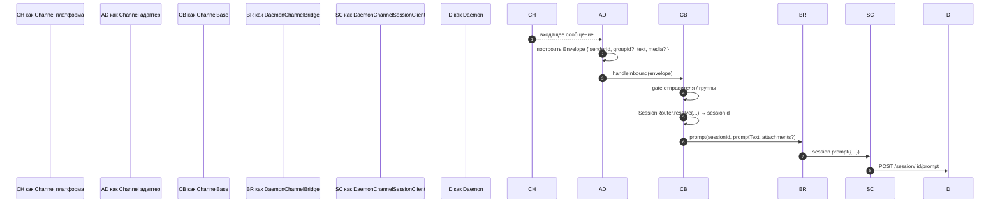
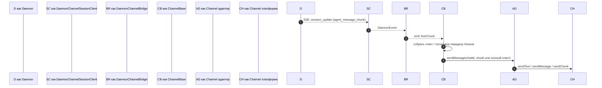
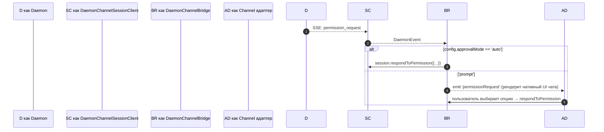

# Channel-адаптеры

## Обзор

`packages/channels/` содержит **IM channel-адаптеры**, которые превращают входящее сообщение чат-платформы в prompt демона, а исходящие события демона — в сообщения чат-платформы. Четыре конкретных channel поставляются сегодня: DingTalk, WeChat (Weixin), Telegram и Feishu. Они разделяют базовый слой (`packages/channels/base/`) плюс `DaemonChannelBridge`, который обрабатывает мультиплексирование сессий и потребление SSE.

Каждый channel отображает входящий чат-трафик на сессии демона под настраиваемым `SessionScope` (`user`, `thread` или `single`). Адаптер делегирует `DaemonChannelBridge`, который делегирует `DaemonSessionClient` SDK (см. [`13-sdk-daemon-client.md`](./13-sdk-daemon-client.md)).

## Ответственность

- Получать входящие сообщения из родного транспорта channel (WebSocket-поток DingTalk, HTTP long-poll WeChat, Bot long-poll Telegram, WebSocket или HTTP webhook Feishu).
- Разрешать `(senderId, groupId?)` в сессию демона через `DaemonChannelSessionFactory`.
- Пересылать сообщение пользователя как prompt демона и потоково передавать ответ обратно как исходящие сообщения чата, возможно, чанками.
- Рендерить запросы разрешений как нативные для чата prompt'ы, когда интерактивно; иначе автоматически одобрять согласно `ChannelConfig.approvalMode`.
- Применять gate отправителя (allowlists / denylists), gate группы и нормализацию контента (markdown / HTML на channel).

## Архитектура

### `DaemonChannelBridge` (общая база, `packages/channels/base/src/DaemonChannelBridge.ts`)

```ts
class DaemonChannelBridge extends EventEmitter {
  constructor(opts: {
    cwd: string;
    sessionFactory: DaemonChannelSessionFactory;
    modelServiceId?: string;
    sessionScope?: SessionScope;
  });
  newSession(cwd: string): Promise<string>;
  loadSession(sessionId: string, cwd: string): Promise<string>;
  prompt(sessionId: string, text: string, options?): Promise<string>;
  cancelSession(sessionId: string): Promise<void>;
  stop(): void;
}
```

Содержит daemon session clients с ключом по `sessionId`; `ChannelBase` и `SessionRouter` решают, какая цель входящего чата отображается на эту сессию. Каждая прикреплённая сессия имеет:

- `DaemonChannelSessionClient` (форма `DaemonSessionClient` минус не относящиеся к channel методы).
- Активный насос потребителя SSE.
- Debounced сборщик prompt (для адаптеров, которые фрагментируют ввод пользователя по нескольким входящим сообщениям).
- Политика auto-approve на запрос.

События: `textChunk`, `toolCall`, `sessionUpdate`, `permissionRequest`, `permissionResolved`, `modelSwitched`, `modelSwitchFailed`, `sessionDied`, `promptComplete` и `error`. Channel-адаптеры подключают их к нативным API платформы.

### `ChannelBase` (`packages/channels/base/src/ChannelBase.ts`)

Абстрактный базовый класс, который расширяет каждый адаптер:

```ts
abstract class ChannelBase {
  abstract connect(): Promise<void>;
  abstract sendMessage(chatId: string, text: string): Promise<void>;
  abstract disconnect(): void;
  handleInbound(envelope: Envelope): Promise<void>; // → SessionRouter.resolve + bridge.prompt
}
```

Обрабатывает общие cross-cutting concerns: gate отправителя (allowlist / denylist), gate группы, потоковую передачу блоков сообщений (размер чанка, троттлинг), debounce входящих.

### Адаптеры на channel

| Адаптер         | Файл                                                | Транспорт                                                    | Примечания                                                                                                          |
| --------------- | --------------------------------------------------- | ------------------------------------------------------------ | ------------------------------------------------------------------------------------------------------------------- |
| DingTalk        | `packages/channels/dingtalk/src/DingtalkAdapter.ts` | WebSocket SDK DingTalk Stream                                | Отправляет через POST `sessionWebhook`; медиа-изображения загружаются через DT API, base64 в конверте.              |
| WeChat (Weixin) | `packages/channels/weixin/src/WeixinAdapter.ts`     | HTTP long-poll бота iLink                                    | Отправляет через проприетарный API `sendText` / `sendImage`; индикаторы набора.                                     |
| Telegram        | `packages/channels/telegram/src/TelegramAdapter.ts` | Bot API long-poll (grammy)                                   | Отправляет HTML-чанки через `sendMessage`.                                                                          |
| Feishu          | `packages/channels/feishu/src/FeishuAdapter.ts`     | WebSocket Feishu/Lark Stream (по умолчанию) или HTTP webhook | Отправляет через Lark SDK как интерактивные карточки; режим webhook требует `encryptKey` для проверки HMAC-подписи. |

Каждый адаптер реализует:

1. Входящий транспорт (subscribe / poll сообщений).
2. Построение конверта (`{ senderId, groupId?, text, media?, raw }`).
3. Gate отправителя / группы (делегирование `ChannelBase`).
4. Сериализация исходящих (markdown → HTML / WeChat-native / DingTalk-native).
5. Жизненный цикл (start / shutdown).

### Матрица адаптеров

| Адаптер      | Транспорт                       | Идентичность                                               | Permission UX                               | Конфигурация auto-approve                         |
| ------------ | ------------------------------- | ---------------------------------------------------------- | ------------------------------------------- | ------------------------------------------------- |
| **DingTalk** | WebSocket stream                | `senderStaffId` (+ опционально `conversationId` для групп) | Inline-кнопки через DT markdown             | `ChannelConfig.approvalMode = 'auto' \| 'prompt'` |
| **WeChat**   | HTTP long-poll                  | `senderWxid` (+ опционально `groupWxid`)                   | Только текстовые prompt'ы с токенами ответа | То же                                             |
| **Telegram** | Bot API long-poll               | `from.id` (+ опционально `chat.id` для групп)              | Inline keyboard buttons                     | То же                                             |
| **Feishu**   | WebSocket stream / HTTP webhook | `sender.open_id` (+ опционально `chat_id` для групп)       | Кнопки интерактивных карточек               | То же                                             |

> **Примечание:** Столбец «Permission UX» описывает родную аффординанс каждой платформы, но ни один ещё не подключён — `AcpBridge.requestPermission` в настоящее время автоматически одобряет каждый запрос (`packages/channels/base/src/AcpBridge.ts`), а `ChannelConfig.approvalMode` объявлен, но ещё не читается. Интерактивное одобрение запланировано (Phase 5).

## Поток

### Входящий prompt



### Исходящий на основе SSE



### Auto-approve разрешения



## Состояние и жизненный цикл

- `DaemonChannelBridge` живёт в течение времени жизни channel-адаптера; сессии внутри него живут согласно настроенному `SessionScope`.
- Каждая активная сессия переподключается автоматически, если SSE падает — `DaemonSessionClient.events()` отслеживает `lastSeenEventId`, так что воспроизведение корректно.
- `shutdown()` закрывает каждую активную сессию и базовый транспорт (WebSocket / long-poll channel).
- WebSocket-поток DingTalk поддерживает server-push; long-poll WeChat требует стратегии backoff на idle-ответы; long-poll Telegram имеет встроенный параметр `timeout`.

## Зависимости

- `packages/channels/base/` — `ChannelBase`, `DaemonChannelBridge`, `types.ts` (`ChannelConfig`, `Envelope`, `SessionScope`, `ChannelPlugin`).
- `packages/sdk-typescript/src/daemon/` — `DaemonSessionClient` и друзья.
- SDK на channel: `@dingtalk/stream` (DingTalk), проприетарный iLink Bot HTTP (Weixin), `grammy` (Telegram).

## Конфигурация

`ChannelConfig` (из `packages/channels/base/src/types.ts`):

| Рычаг                                    | Влияние                                                                                                     |
| ---------------------------------------- | ----------------------------------------------------------------------------------------------------------- |
| `sessionScope`                           | `'user'` (отправитель + чат), `'thread'` (id потока или чат) или `'single'` (одна общая сессия на channel). |
| `approvalMode`                           | `'auto'` (авто-ответ) / `'prompt'` (рендерить UI).                                                          |
| `allowlist?: string[]`                   | Разрешённые sender id; отсутствует = открыто.                                                               |
| `denylist?: string[]`                    | Запрещённые sender ids.                                                                                     |
| `chunkSize`, `chunkIntervalMs`           | Настройки потоковой передачи исходящих блоков.                                                              |
| `daemon: { baseUrl, token?, clientId? }` | Пересылается в `DaemonChannelSessionFactory`.                                                               |

Специфичные для channel ключи накладываются сверху (DingTalk: `streamCredentials`; WeChat: `ilinkUrl`, `botId`; Telegram: `botToken`; Feishu: `clientId` (appId), `clientSecret` (appSecret), `verificationToken`, `encryptKey` (режим webhook)).

## Ограничения и известные пределы

- **Channels не импортируют напрямую `@nestor/nessy-cli-sdk`.** Они идут через `ChannelBase` → `DaemonChannelBridge` → `DaemonChannelSessionClient` (который bridge конструирует из SDK). Косвенность позволяет bridge заменять реализации, такие как test stub, без требования изменений channel.
- **Permission UX — на channel.** DingTalk использует markdown-кнопки; WeChat — только текст; Telegram использует inline keyboards; Feishu использует кнопки интерактивных карточек. (Все в настоящее время auto-approve через `AcpBridge`; интерактивное одобрение запланировано.) Пока нет общей абстракции «интерактивный виджет разрешения».
- **Auto-approve — решение на стороне развёртывания**, а не на стороне демона. Политика `permission_mediation` демона всё ещё применяется; auto-approve означает только, что channel отвечает без prompt человека. Не комбинируйте `auto` с рабочими процессами уровня `enforce`.
- **Rate limits / ограничения размера сообщения на channel — работа адаптера.** `DaemonChannelBridge` обрабатывает только чанкование; превышение размера сообщения WeChat или flood limit Telegram — на адаптере.
- **Нет обратного вызова DingTalk / WeChat / Telegram / Feishu** — channels однонаправленные (чат → демон → чат). Родной путь push IM-платформы, такой как callback карточки DingTalk, ещё не подключён к bridge.

## Ссылки

- `packages/channels/base/src/DaemonChannelBridge.ts`
- `packages/channels/base/src/ChannelBase.ts`
- `packages/channels/base/src/types.ts`
- `packages/channels/dingtalk/src/DingtalkAdapter.ts`
- `packages/channels/weixin/src/WeixinAdapter.ts`
- `packages/channels/telegram/src/TelegramAdapter.ts`
- `packages/channels/plugin-example/` (reference plugin scaffold)
- Руководство по channel plugin: [`../../channel-plugins.md`](../../channel-plugins.md).
- Справочник SDK: [`13-sdk-daemon-client.md`](./13-sdk-daemon-client.md).
