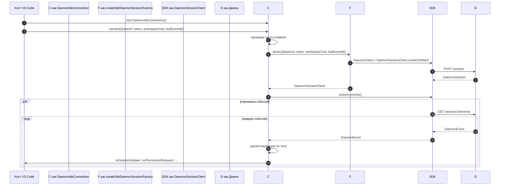
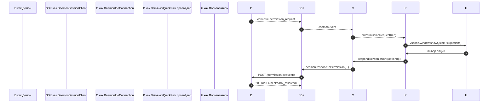
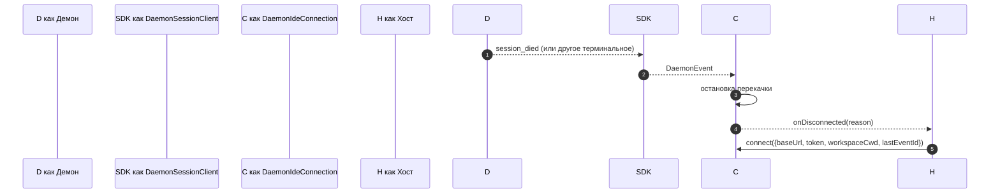

# Адаптер IDE-демона для VS Code

## Обзор

`packages/vscode-ide-companion/src/services/daemonIdeConnection.ts` — это **адаптер демон-соединения для расширения VS Code**. Он позволяет IDE-компаньону подключаться к работающему демону `nessy serve` через HTTP + SSE вместо запуска дочернего процесса `nessy --acp` stdio внутри процесса (устаревший путь `AcpConnectionState`). Это транспортный аналог [`14-cli-tui-adapter.md`](./14-cli-tui-adapter.md) для хостов VS Code.

Веб-вью чата IDE потребляет события демона через этот адаптер; запросы разрешений отображаются как нативные диалоги quick-pick в VS Code.

## Обязанности

- Создание `DaemonClient` + `DaemonSessionClient` из проверенного `baseUrl` локальной петли (loopback), переданного в `connect(options)`.
- Перекачка SSE-событий от клиента сессии в диспетчеризацию по колбэкам (`onSessionUpdate`, `onPermissionRequest`, `onAskUserQuestion`, `onEndTurn`, `onDisconnected`).
- Обеспечение инварианта **только локальная петля** в `connect(options)` (IDE должна подключаться только к демону на том же хосте).
- Мост событий демона в `postMessage` веб-вью, чтобы панель чата оставалась синхронизированной.
- Отображение запросов разрешений через нативный UI quick-pick VS Code.
- Сериализация вызовов в очередь, чтобы быстрое двойное `connect()` от хоста не вызывало гонку.

## Архитектура

### Публичный интерфейс

```ts
class DaemonIdeConnection {
  connect(options: DaemonIdeConnectionOptions): Promise<void>;
  disconnect(): Promise<void>;
  sendPrompt(prompt: string | ContentBlock[]): Promise<DaemonIdePromptResult>;
  cancelSession(): Promise<void>;
  setModel(modelId: string): Promise<DaemonIdeSetModelResult>;

  onSessionUpdate: (data: SessionNotification) => void;
  onPermissionRequest: (
    data: RequestPermissionRequest,
  ) => Promise<{ optionId?: string }>;
  onAskUserQuestion: (data: AskUserQuestionRequest) => Promise<{
    optionId: string;
    answers?: Record<string, string>;
  }>;
  onEndTurn: (reason?: string) => void;
  onDisconnected: (code: number | null, signal: string | null) => void;
}

interface DaemonIdeConnectionOptions {
  baseUrl: string; // ДОЛЖЕН быть loopback (127.0.0.1 / localhost / [::1])
  token?: string;
  workspaceCwd?: string;
  modelServiceId?: string;
  lastEventId?: number;
  sessionFactory?: DaemonIdeSessionFactory;
}
```

### Проверка локальной петли

В `connectInternal()`:

```ts
const baseUrl = validateDaemonBaseUrl(options.baseUrl);
```

Это **жесткое ограничение на стороне клиента**, отдельное от `hostAllowlist` самого демона (см. [`12-auth-security.md`](./12-auth-security.md)). IDE-компаньон никогда не подключится к удалённому демону — даже если оператор настроил его. Обоснование: модель угроз VS Code предполагает, что рабочая область и демон находятся на одном хосте, включая доверие к файловой системе и связанные допущения.

### `createSdkDaemonSessionFactory()`

`createSdkDaemonSessionFactory()` создаёт `DaemonClient` и вызывает
`DaemonSessionClient.createOrAttach()` из `@nestor/nessy-cli-sdk`. Класс соединения хранит фабрику, а не создаёт экземпляры напрямую, чтобы тесты могли внедрить подделку.

### Диспетчеризация событий

Соединение запускает один SSE-потребитель (`for await` по `session.events()`) и маршрутизирует каждое событие по типу:

| Событие демона / источник                                                                         | Колбэк IDE / действие                                                    |
| ------------------------------------------------------------------------------------------------- | ------------------------------------------------------------------------ |
| `session_update`                                                                                  | `onSessionUpdate`                                                        |
| Обычный `permission_request`                                                                      | `onPermissionRequest`, затем `respondToPermission()`                     |
| `permission_request`, где `toolCall.kind === 'ask_user_question'` и `rawInput.questions` — массив | `onAskUserQuestion`, затем пересылка `answers` демону                    |
| `session_died` с `sessionId` в полезной нагрузке, совпадающим с текущей сессией                   | `onDisconnected(null, reason)`                                           |
| Естественный конец SSE / сбой потока / ручной `disconnect()`                                      | `onDisconnected(null, 'stream_ended' / 'daemon_error' / 'disconnected')` |
| Другие события демона                                                                             | Лог уровня отладки; сегодня нет колбэка IDE.                             |

`onEndTurn` не производится диспетчеризацией SSE. `sendPrompt()` ожидает HTTP-ответ демона на запрос и вызывает его с `response.stopReason`; пути с исключениями, не связанными с прерыванием, вызывают `onEndTurn('error')`.

### Мост к веб-вью

Класс соединения — **только транспорт**. Фактическая интеграция с VS Code находится в `packages/vscode-ide-companion/src/webview/providers/ChatWebviewViewProvider.ts` (и друзьях). Провайдер подписывается на колбэки соединения и преобразует их в вызовы `postMessage` веб-вью. Само веб-вью использует общую библиотеку компонентов `packages/webui/` для рендеринга — см. Матрицу адаптеров в [`01-architecture.md`](./01-architecture.md).

### Сериализация подключения

`connect()` использует внутреннюю очередь, чтобы быстрый двойной вызов от хоста (например, пользователь открывает панель дважды во время рукопожатия) не вызывал гонку. Второй вызов ожидает первый; соединение оказывается в единственном детерминированном состоянии.

## Рабочий процесс

### Начальное подключение



### Разрешение через quick-pick



### Отключение / восстановление



## Состояние и жизненный цикл

- Конструкция синхронна; **никакого сетевого ввода-вывода** до `connect(options)`.
- `connect()` идемпотентен через внутреннюю очередь; двойной вызов сериализуется.
- `disconnect()` прерывает SSE-итератор (`AbortController` на перекачке) и очищает регистрации колбэков.
- `lastEventId` захватывается из `DaemonSessionClient` SDK при отключении и может быть повторно передан при следующем `connect()` для возобновления.

## Зависимости

- `packages/sdk-typescript/src/daemon/` — `DaemonClient`, `DaemonSessionClient` (фактический транспорт).
- API расширения VS Code (`vscode.*`) — API хоста, quick-pick, веб-вью.
- `packages/webui/src/adapters/ACPAdapter.ts` — рендеринг веб-вью ACP-образных сообщений, ретранслируемых через `postMessage`.

## Конфигурация

| Рычаг                                                | Где                               | Эффект                                                                                  |
| ---------------------------------------------------- | --------------------------------- | --------------------------------------------------------------------------------------- |
| `baseUrl`                                            | `connect(options)`                | URL демона; должен быть loopback.                                                       |
| `token`                                              | `connect(options)`                | Bearer-токен (проставляется через SDK).                                                 |
| `workspaceCwd`                                       | `connect(options)`                | Используется в `POST /session`; должен совпадать с привязанной рабочей областью демона. |
| `modelServiceId`                                     | `connect(options)` / `setModel()` | Начальная модель.                                                                       |
| `lastEventId`                                        | `connect(options)`                | Курсор возобновления (обычно восстанавливается из состояния хоста).                     |
| Настройка VS Code `nessy.ide.daemonUrl` (или аналог) | Настройки рабочей области         | URL демона, настроенный оператором.                                                     |

## Ограничения и известные проблемы

- **Только loopback — жёсткий отказ в `connect(options)`.** Операторам, желающим направить IDE на удалённый демон, нужно использовать SSH port-forward / локальный прокси; адаптер не подключится к не-loopback URL.
- **Устаревший путь `AcpConnectionState` всё ещё основной** в IDE-компаньоне (stdio дочерний процесс). Этот адаптер — транспорт-брат для миграции Mode-B; см. [`../daemon-client-adapters/ide.md`](../daemon-client-adapters/ide.md) для блокировщиков миграции и запланированной работы по паритету `BridgeFileSystem`.
- **Пока нет обратного RPC или поверхности редакторских аффордансов через HTTP.** Функции, требующие обратного вызова агента в IDE (например, доступ к буферу только для чтения, интеграция предпросмотра diff), сейчас живут только на пути stdio.
- **Связка веб-вью ↔ соединение принадлежит хосту**, а не этому адаптеру. Не проталкивайте логику, специфичную для веб-вью, в `DaemonIdeConnection`.
- **Несоответствие `workspaceCwd`** с привязанной рабочей областью демона возвращает `400 workspace_mismatch` — отображайте это как явную ошибку настройки, а не повторяйте попытки.

## Ссылки

- `packages/vscode-ide-companion/src/services/daemonIdeConnection.ts`
- `packages/vscode-ide-companion/src/services/daemonIdeConnection.ts` (`createSdkDaemonSessionFactory`)
- `packages/vscode-ide-companion/src/types/connectionTypes.ts` (устаревший `AcpConnectionState`)
- `packages/vscode-ide-companion/src/webview/providers/ChatWebviewViewProvider.ts` (мост веб-вью)
- `packages/webui/src/adapters/ACPAdapter.ts` (адаптер ACP-сообщений веб-вью)
- Черновик дизайна: [`../daemon-client-adapters/ide.md`](../daemon-client-adapters/ide.md)
- Ссылка на SDK: [`13-sdk-daemon-client.md`](./13-sdk-daemon-client.md)
