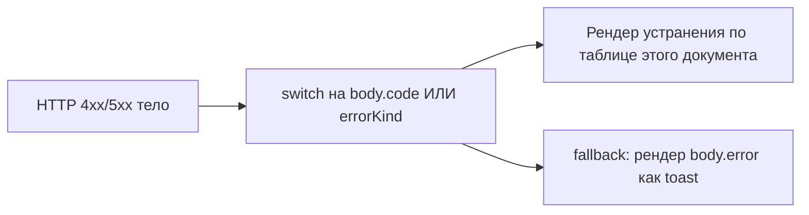
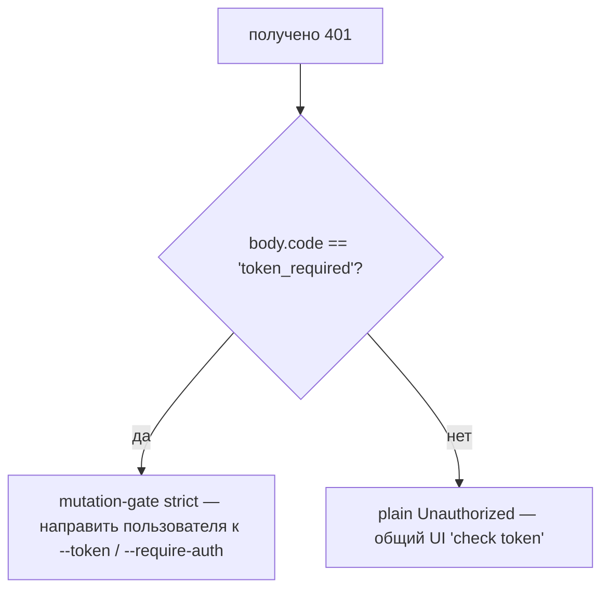

# Таксономия ошибок и устранение

## Обзор

Режимы сбоев демона намеренно являются закрытыми объединениями, чтобы потребители SDK могли исчерпывающе переключаться, а обработчики маршрутов формировали согласованные HTTP-ответы. Этот документ каталогизирует каждый типизированный класс ошибок / вид на трёх уровнях:

1. **`packages/cli/src/serve/`** — ошибки границы на HTTP-крае (аутентификация, файловая система рабочей области, префлайт хоста демона).
2. **`packages/acp-bridge/`** — ошибки моста / медиатора на границе демон-к-ACP-дочернему процессу.
3. **`packages/sdk-typescript/src/daemon/`** — обёртывание ошибок на стороне SDK и структурированные поля ошибок.

Формы ошибок на уровне провода задокументированы в [`../../nessy-serve-protocol.md`](../../nessy-serve-protocol.md); этот документ добавляет руководство по причинам и устранению.

## Граница файловой системы (`packages/cli/src/serve/fs/errors.ts`)

`FsError` несёт `{ kind, message, status, cause? }`. Объединение `FsErrorKind` (14 видов, статус HTTP по умолчанию):

| Вид                      | HTTP      | Причина                                                                              | Устранение                                                                                                                                    |
| ------------------------ | --------- | ------------------------------------------------------------------------------------ | --------------------------------------------------------------------------------------------------------------------------------------------- |
| `path_outside_workspace` | 400       | Разрешённый путь выходит за пределы привязанной рабочей области.                     | Используйте путь внутри `workspaceCwd` демона; проверьте `/capabilities`.                                                                     |
| `symlink_escape`         | 400       | Цель является симлинком.                                                             | Адресуйте разрешённый путь напрямую; симлинки отклоняются по дизайну.                                                                         |
| `path_not_found`         | 404       | `ENOENT`.                                                                            | Подтвердите, что файл существует; проверьте регистрозависимые пути на Linux.                                                                  |
| `binary_file`            | 422       | Содержимое распознано как бинарное на текстовом маршруте.                            | Используйте `GET /file/bytes` для сырых байтов; текстовый маршрут отказывает бинарникам.                                                      |
| `file_too_large`         | 413       | Выше `MAX_READ_BYTES` (256 КиБ) или `MAX_WRITE_BYTES` (5 МиБ).                       | Используйте чтение с диапазоном байт; разделите запись.                                                                                       |
| `hash_mismatch`          | 409       | Оптимистичная конвергенция `expectedSha256` не удалась.                              | Перечитайте файл и повторите с новым хешем.                                                                                                   |
| `file_already_exists`    | 409       | `mode: 'create'` против существующего файла.                                         | Используйте `mode: 'overwrite'` или выберите новый путь.                                                                                      |
| `text_not_found`         | 422       | Искомая строка `POST /file/edit` не найдена в файле.                                 | Перепроверьте искомую строку; обычная причина — несоответствие пробельных символов / кодировки.                                               |
| `ambiguous_text_match`   | 422       | Несколько совпадений, когда требовалось одно.                                        | Добавьте больше окружающего контекста к искомой строке, чтобы сделать её уникальной.                                                          |
| `untrusted_workspace`    | 403       | Запись выполнена в недоверенной рабочей области.                                     | Отметьте рабочую область доверенной (`Config.isTrustedFolder()`) или используйте `runNessyServe` вместо прямого встраивания `createServeApp`. |
| `permission_denied`      | 403       | `EACCES` / `EPERM` на уровне ОС.                                                     | Настройте ACL файловой системы; это **не** оповещение безопасности.                                                                           |
| `io_error`               | 503       | `ENOSPC` / `EIO` / `EBUSY` / `ETXTBSY` / `ENAMETOOLONG` / `EMFILE` / `ENFILE`.       | Операционная проблема на уровне хоста (диск заполнен, истощение fd); страницуйте ops, не security.                                            |
| `internal_error`         | 500       | Не-errno ошибка достигает границы.                                                   | Откройте баг демона.                                                                                                                          |
| `parse_error`            | 400 / 422 | Ошибка парсинга тела запроса (400) или нарушение инварианта на уровне сервиса (422). | Валидируйте тело запроса; проверьте версию SDK.                                                                                               |

Различие `io_error` против `permission_denied` намеренно, чтобы конвейеры мониторинга могли маршрутизироваться по `errorKind`; сворачивание ENOSPC в `permission_denied` привело бы к страницированию ответственных за безопасность для проблемы `df -h`.

## Ошибки моста (`packages/acp-bridge/src/bridgeErrors.ts`)

Типизированные классы, выбрасываемые мостом / медиатором. Большинство несут HTTP-статус через switch обработчика маршрута.

| Класс                                 | HTTP | Причина                                                                               | Устранение                                                                                                                                                                                                     |
| ------------------------------------- | ---- | ------------------------------------------------------------------------------------- | -------------------------------------------------------------------------------------------------------------------------------------------------------------------------------------------------------------- |
| `SessionNotFoundError`                | 404  | sessionId не в `byId`.                                                                | Пересоздайте или прикрепите; сессия могла быть собрана сборщиком.                                                                                                                                              |
| `WorkspaceMismatchError`              | 400  | `POST /session` `cwd` ≠ `boundWorkspace` демона.                                      | Опустите `cwd` (использует привязанный) или маршрутизируйте к демону, привязанному к вашему `cwd`.                                                                                                             |
| `SessionLimitExceededError`           | 503  | `byId.size >= maxSessions`.                                                           | Закройте устаревшие сессии; увеличьте `--max-sessions`.                                                                                                                                                        |
| `InvalidClientIdError`                | 400  | `X-Nessy-Client-Id` вне `[A-Za-z0-9._:-]{1,128}`.                                     | Санируйте client id.                                                                                                                                                                                           |
| `InvalidSessionMetadataError`         | 400  | `displayName` > 256 символов или содержит управляющие символы.                        | Обрежьте / санируйте.                                                                                                                                                                                          |
| `InvalidSessionScopeError`            | 400  | Неизвестное значение `sessionScope`.                                                  | Используйте `'single'` или `'thread'`.                                                                                                                                                                         |
| `RestoreInProgressError`              | 409  | Одновременный `loadSession` / `resumeSession`.                                        | Подождите + повторите.                                                                                                                                                                                         |
| `WorkspaceInitConflictError`          | 409  | `POST /workspace/init` против существующего файла без `force`.                        | Передайте `force: true` или выберите другой путь.                                                                                                                                                              |
| `WorkspaceInitPathEscapeError`        | 400  | Путь инициализации выходит за пределы рабочей области.                                | Используйте путь внутри `workspaceCwd`.                                                                                                                                                                        |
| `WorkspaceInitSymlinkError`           | 400  | Путь инициализации является симлинком.                                                | Адресуйте разрешённый путь.                                                                                                                                                                                    |
| `WorkspaceInitRaceError`              | 409  | TOCTOU гонка при инициализации.                                                       | Повторите.                                                                                                                                                                                                     |
| `McpServerNotFoundError`              | 404  | Перезапуск для неизвестного сервера.                                                  | Проверьте имя сервера в `/workspace/mcp`.                                                                                                                                                                      |
| `McpServerRestartFailedError`         | 502  | Перезапуск не удался внутри дочернего процесса ACP.                                   | Проверьте логи дочернего процесса ACP; может указывать на сломанный MCP сервер.                                                                                                                                |
| `InvalidPermissionOptionError`        | 400  | Голос по проводу попытался внедрить `CANCEL_VOTE_SENTINEL` через `optionId`.          | Голосуйте с `{outcome: 'cancelled'}` вместо `optionId`.                                                                                                                                                        |
| `PermissionForbiddenError`            | 403  | Политика отказала голосующему (`designated_mismatch` / `remote_not_allowed`).         | Используйте originator client id (designated), предварительно зарегистрируйте голосующего (consensus) или голосуйте с loopback (local-only). См. [`04-permission-mediation.md`](./04-permission-mediation.md). |
| `CancelSentinelCollisionError`        | 500  | Агент опубликовал `'__cancelled__'` как легитимную метку опции.                       | Баг агента — измените метку опции на что-либо иное, кроме сентинеля.                                                                                                                                           |
| `PermissionPolicyNotImplementedError` | 500  | Запрошенная политика не встроена в этот демон.                                        | Обновите демон или измените `policy.permissionStrategy`.                                                                                                                                                       |
| `BridgeChannelClosedError`            | 503  | Канал дочернего процесса ACP закрыт во время вызова.                                  | Переподключитесь / повторите; проверьте `session_died` на причину.                                                                                                                                             |
| `BridgeTimeoutError`                  | 504  | Превышены wallclock на уровне моста.                                                  | Повторите; исследуйте основную медлительность.                                                                                                                                                                 |
| `MissingCliEntryError`                | 500  | Файл входа CLI `nessy` отсутствует (определён в `status.ts`, не в `bridgeErrors.ts`). | Подтвердите, что установка CLI завершена; проверьте, что `packages/cli/index.ts` существует.                                                                                                                   |

## Ошибки конфигурации времени запуска (`packages/cli/src/serve/run-nessy-serve.ts`)

| Класс                      | Когда                                                                                                                                                                                                                                                           | Устранение                                                                                                                                                                                                                      |
| -------------------------- | --------------------------------------------------------------------------------------------------------------------------------------------------------------------------------------------------------------------------------------------------------------- | ------------------------------------------------------------------------------------------------------------------------------------------------------------------------------------------------------------------------------- |
| `InvalidPolicyConfigError` | `validatePolicyConfig()` отклоняет объединённые настройки: неизвестный `policy.permissionStrategy` (валидировано против `SERVE_CAPABILITY_REGISTRY.permission_mediation.modes`) или не-положительное-целое `policy.consensusQuorum`. Запуск явно проваливается. | Исправьте offending поле в `settings.json`. Класс поддерживает `instanceof`; `runNessyServe` использует его для различения несоответствия политики от сбоев чтения настроек I/O, которые откатываются к значениям по умолчанию. |

## Аутентификация Device Flow (`packages/cli/src/serve/auth/device-flow.ts`)

| Класс                        | Когда                                                             | Примечания                                                                                                                                                                                                                                                                                                                                                                                                                                                     |
| ---------------------------- | ----------------------------------------------------------------- | -------------------------------------------------------------------------------------------------------------------------------------------------------------------------------------------------------------------------------------------------------------------------------------------------------------------------------------------------------------------------------------------------------------------------------------------------------------- |
| `UpstreamDeviceFlowError`    | Upstream IdP возвращает структурированную ошибку во время опроса. | `oauthError` санируется с `sanitizeForStderr` перед интерполяцией в stderr или подсказки аудита (защита CVE-2021-42574 / Trojan Source; см. [`12-auth-security.md`](./12-auth-security.md)).                                                                                                                                                                                                                                                                   |
| `DeviceFlowPollTimeoutError` | Таймер гонки реестра срабатывает до возврата провайдера.          | Код провайдера не должен выбрасывать этот тип. Он экспортирован для тестов, но реестр проверяет `pollTimedOut` по runtime brand `_isRegistryTimeout: boolean`, а не `instanceof`. Провайдер, импортирующий и выбрасывающий `new DeviceFlowPollTimeoutError(ms)`, всё ещё следует пути аудита общего броска провайдера, потому что `_isRegistryTimeout` по умолчанию `false`; только внутренняя фабрика `makeRegistryPollTimeoutError(ms)` устанавливает brand. |

## Виды ошибок хоста демона (`packages/acp-bridge/src/status.ts`)

`SERVE_ERROR_KINDS` — закрытый enum, используемый диагностическими ячейками и структурированными ошибками демона:

| Вид                        | Значение                                                                              |
| -------------------------- | ------------------------------------------------------------------------------------- |
| `missing_binary`           | Требуемый локальный исполняемый файл или запись CLI не может быть разрешён.           |
| `blocked_egress`           | Неудача исходящего сетевого зонда.                                                    |
| `auth_env_error`           | Переменная окружения аутентификации, провайдер или конфигурация trust-gate невалидны. |
| `init_timeout`             | Шаг инициализации на стороне демона превысил свой wallclock.                          |
| `protocol_error`           | Несоответствие протокола ACP / HTTP.                                                  |
| `missing_file`             | Требуемый локальный файл отсутствует.                                                 |
| `parse_error`              | Ошибка парсинга локального файла или запроса.                                         |
| `stat_failed`              | Локальный filesystem stat не удался.                                                  |
| `budget_exhausted`         | Принуждение бюджета MCP отказало в обнаружении или записи сервера.                    |
| `mcp_budget_would_exceed`  | Перезапуск или мутация MCP превысит настроенный бюджет.                               |
| `mcp_server_spawn_failed`  | Спавн или перезапуск сервера MCP не удался.                                           |
| `invalid_config`           | Конфигурация MCP или демона была невалидна.                                           |
| `prompt_deadline_exceeded` | Истёк deadline wallclock запроса.                                                     |
| `writer_idle_timeout`      | SSE writer не сделал успешных записей до своего таймаута простоя.                     |

Они surfaced через ячейку префлайта `errorKind`, чтобы UI клиентов рендерили структурированное устранение (не сырые трассы стека).

## Формы ошибок аутентификации

| Статус | Тело                                         | Когда                                                                                                                                                            |
| ------ | -------------------------------------------- | ---------------------------------------------------------------------------------------------------------------------------------------------------------------- |
| `401`  | `{ error: 'Unauthorized' }`                  | Отсутствующий / неправильный / no-scheme bearer токен. Единообразно по `missing header` / `wrong scheme` / `wrong token`, чтобы зондирование не могло различить. |
| `401`  | `{ error: '...', code: 'token_required' }`   | Маршрут strict mutation-gate на no-token loopback демоне. SDK рендерят подсказку "configure --token / --require-auth".                                           |
| `403`  | `{ error: 'Request denied by CORS policy' }` | `denyBrowserOriginCors` отклонил запрос с `Origin`.                                                                                                              |
| `403`  | `{ error: 'Invalid Host header' }`           | `hostAllowlist` отклонил заголовок `Host` (защита от DNS rebinding).                                                                                             |

См. [`12-auth-security.md`](./12-auth-security.md) для полной модели аутентификации.

## Исходы разрешений (перегрузка провода против аудита)

`PermissionResolution` имеет два терминальных вида:

- `{kind: 'option', optionId}` — голос выиграл.
- `{kind: 'cancelled', reason: 'timeout' \| 'session_closed' \| 'agent_cancelled'}` — запрос был отменён. Форма провода едина (`{outcome: 'cancelled'}`); журнал аудита различает timeout / session_closed / voter-cancelled / agent-cancelled в `decisionReason.type`. Эта перегрузка сохранена намеренно, чтобы не ломать замороженный контракт `permission.ts`.

## Обёртывание ошибок на стороне SDK

`DaemonClient` возвращает HTTP ошибки как отклонённые Promises с распарсенным телом в качестве значения отклонения. Методы, получающие `404` для неизвестных сессий, отклоняются с `{error, sessionId}`; сейчас SDK не оборачивает их в типизированный класс. Вызывающая сторона не должна полагаться на `instanceof Error` в сочетании с `.message.includes(...)`; вместо этого проверяйте `err.code` или `err.kind` из тела ответа.

`parseSseStream` прерывает итератор при переполнении буфера 16 МиБ (защитная граница).

## Рабочий процесс

### Поверхность ошибки пользователю

### Различение режимов сбоя аутентификации

## Зависимости

- Все классы ошибок экспортированы из соответствующих пакетов; потребители SDK могут `instanceof` против типов `bridgeErrors.ts` при запуске в том же Node процессе. Через провод маршрутизируйтесь по `body.code` / `body.kind` / `body.errorKind`.

## Ограничения и известные проблемы

- **`io_error` против `permission_denied`** различны намеренно. Не смешивайте.
- **Причины `PermissionForbiddenError` (`designated_mismatch` / `remote_not_allowed`) перегружены** по политикам `designated` и `consensus`; журнал аудита точно различает их, но форма провода — нет.
- **`CancelSentinelCollisionError` указывает на баг на стороне агента**, не событие безопасности — мост отклоняет запрос, а не молча позволяет сентинелю совпасть с реальной опцией.
- **Типизированные ошибки на стороне SDK всё ещё развиваются.** Вызывающие должны маршрутизироваться по полям тела, а не полагаться на идентичность JS класса через провод.
- **`internal_error` всегда должен быть исследован.** Он сигнализирует, что конструктор `FsError` был вызван с видом, зарезервированным для не-errno путей (ошибка программиста); поле `cause` тела ответа может нести оригинальный бросок.

## Ссылки

- `packages/cli/src/serve/fs/errors.ts` (`FsErrorKind`, `FsErrorStatus`)
- `packages/acp-bridge/src/bridgeErrors.ts` (каждый типизированный класс)
- `packages/acp-bridge/src/status.ts` (`SERVE_ERROR_KINDS`, `ServeErrorKind`)
- `packages/cli/src/serve/auth.ts` (тела аутентификации)
- Ссылка на провод: [`../../nessy-serve-protocol.md`](../../nessy-serve-protocol.md).
