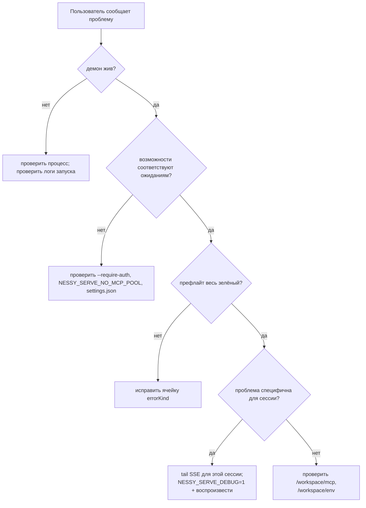

# Наблюдаемость и отладка

## Обзор

`nessy serve` в настоящее время поставляется с **инструментированием span OpenTelemetry**, **структурированными файловыми логами** (`DaemonLogger`), **логами доступа на запрос**, отладочными логами stderr, структурированными ячейками префлайта и кольцом аудита разрешений в памяти. Эта страница — практическое руководство по текущей поверхности наблюдаемости и пробелам, которые нужно помнить во время триажа.

## Что существует сегодня

| Поверхность                                    | Расположение                                   | Назначение                                                                                                                                                                                                                                                                                     |
| ---------------------------------------------- | ---------------------------------------------- | ---------------------------------------------------------------------------------------------------------------------------------------------------------------------------------------------------------------------------------------------------------------------------------------------- |
| Логи stderr `NESSY_SERVE_DEBUG`                | `bridge.ts` и места вызова                     | Значения env `1` / `true` / `on` / `yes` (без учёта регистра) печатают строки `nessy serve debug: ...` в stderr.                                                                                                                                                                               |
| Инструментирование span OpenTelemetry          | `server.ts` `daemonTelemetryMiddleware`        | Каждый HTTP-запрос обёрнут в `withDaemonRequestSpan`; атрибуты включают route, sessionId, clientId и код статуса. Маршруты разрешений имеют выделенные span. Жизненный цикл запросов трассируется от начала до конца. Конфигурация живёт в `settings.json` `telemetry`.                        |
| Структурированные файловые логи `DaemonLogger` | `serve/daemon-logger.ts`                       | Структурированные JSON-подобные строки логов записываются в файл. Запуск печатает `daemon log -> <path>`. Поддерживает уровни `info` / `warn` / `error`, со структурированными полями, такими как `route`, `sessionId`, `clientId`, `childPid` и `channelId`.                                  |
| Middleware логов доступа на запрос             | `server.ts`, зарегистрирован до `bearerAuth`   | Логирует `method`, `path`, `status`, `durationMs`, `sessionId` и `clientId` после каждого запроса. Пропускает `GET /health` и heartbeat. 4xx+ использует `warn`; успех использует `info`.                                                                                                      |
| `/health`                                      | `server.ts` route                              | Зонд живости; `?deep=1` возвращает расширенные детали.                                                                                                                                                                                                                                         |
| `/capabilities`                                | `server.ts` route                              | Префлайт обнаружения возможностей. См. [`11-capabilities-versioning.md`](./11-capabilities-versioning.md).                                                                                                                                                                                     |
| `/workspace/preflight`                         | Route -> `DaemonStatusProvider`                | Структурированные ячейки готовности: версия Node, запись CLI, ripgrep, git, npm, плюс ячейки уровня ACP, когда дочерний процесс жив.                                                                                                                                                           |
| `/workspace/env`                               | Route -> `DaemonStatusProvider`                | Снимок env процесса демона. Секретные env переменные сообщают только наличие; учётные данные proxy URL stripped.                                                                                                                                                                               |
| `/workspace/mcp`                               | Route -> bridge extMethod                      | Снимок пула, бюджета и отказов.                                                                                                                                                                                                                                                                |
| `/workspace/skills`, `/workspace/providers`    | Routes                                         | Живые снимки на стороне ACP; возвращают пустые данные простоя, когда сессии не существует.                                                                                                                                                                                                     |
| SSE на сессию                                  | `GET /session/:id/events`                      | Поток событий реального времени.                                                                                                                                                                                                                                                               |
| Отладочная консоль `/demo`                     | `GET /demo` (`packages/cli/src/serve/demo.ts`) | Доступная через браузер одностраничная консоль: чат, журнал событий, инспектор рабочей области и UX разрешений. На loopback, `http://127.0.0.1:4170/demo` — быстрейший путь валидации end-to-end без написания кода SDK. Правила регистрации в [`02-serve-runtime.md`](./02-serve-runtime.md). |
| `PermissionAuditRing`                          | `permission-audit.ts`                          | FIFO в памяти на 512 решений разрешений.                                                                                                                                                                                                                                                       |
| Аудит `decisionReason` медиатора               | `permissionMediator.ts`                        | Внутренняя структурированная запись, объясняющая, почему запрос разрешения разрешился так, как разрешился.                                                                                                                                                                                     |

## Чего не существует сегодня

- **Нет Prometheus / endpoint метрик.** Нет `process_cpu_seconds_total`, `http_requests_total` или `event_bus_queue_depth`.
- **Нет внешнего audit sink для `PermissionAuditRing`.** Кольцо существует, но хуки fan-out к SIEM или внешнему хранилищу не подключены.

## Рецепты отладки

### 1. Демон жив?

```bash
curl -s http://127.0.0.1:4170/health
# {"status":"ok"}

curl -s 'http://127.0.0.1:4170/health?deep=1' | jq
# {"status":"ok","workspaceCwd":"/path","sessions":N,...}
```

401 на loopback означает, что `--require-auth`, вероятно, включён. Используйте `NESSY_SERVE_DEBUG=1` при запуске, чтобы увидеть логи запуска.

### 2. Какие возможности рекламируются?

```bash
curl -s http://127.0.0.1:4170/capabilities | jq
```

Проверьте `mcp_workspace_pool` (F2 пул включён?), `require_auth` (hardened?), `permission_mediation.modes` (поддерживаемые политики) и `policy.permission` (активная политика).

### 3. Здоровье готовности хоста демона?

```bash
curl -s http://127.0.0.1:4170/workspace/preflight | jq
```

Ячейки `status: 'not_started'` — уровня ACP и заполняются только после подключения первой сессии. Ячейки `status: 'fail'` включают закрытый `errorKind`; рендерите структурированное устранение из [`18-error-taxonomy.md`](./18-error-taxonomy.md).

### 4. Tail потока SSE сессии

```bash
curl -N -H 'Accept: text/event-stream' \
     -H 'Authorization: Bearer XYZ' \
     -H 'X-Nessy-Client-Id: debug-tail' \
     -H 'Last-Event-ID: 0' \
     'http://127.0.0.1:4170/session/<sid>/events'
```

`-N` отключает буферизацию вывода curl. `Last-Event-ID: 0` запрашивает реплей для событий кольца с `id > 0`.

### 5. Почему запрос разрешения разрешился так?

`PermissionAuditRing` в памяти и сегодня не имеет HTTP поверхности. Включите `NESSY_SERVE_DEBUG=1` и воспроизведите; медиатор печатает структурированные строки для каждого голоса и решения, включая `decisionReason.type`. Поздний PR может открыть кольцо через HTTP.

### 6. Какой потребитель медленный?

`slow_client_warning` срабатывает один раз на эпизод переполнения, когда очередь достигает 75%. Подпишитесь на SSE поток сессии и ищите синтетический фрейм; полезная нагрузка включает `queueSize`, `maxQueued` и `lastEventId`. Повторяющиеся предупреждения указывают на застрявшего потребителя, обычно заблокированный цикл `for await` SDK.

### 7. Почему MCP сервер был отклонён?

Объедините `/workspace/mcp` на ячейку `disabledReason: 'budget'`, список `refusedServerNames` и события SSE `mcp_child_refused_batch`. Сравните их с `/capabilities` `mcp_guardrails.modes` (`enforce` активен?) и состоянием `--mcp-client-budget` live, видимым через `getReservedSlots()`.

### 8. Демон не завершает работу

Первый сигнал запускает плавное завершение (см. [`02-serve-runtime.md`](./02-serve-runtime.md)). Если он зависает дольше 10с, проверьте:

- Дочерний процесс ACP не ответил на плавное закрытие.
- Долгие SSE соединения держали HTTP `server.close()` открытым после `SHUTDOWN_FORCE_CLOSE_MS` (5с).

**Второй** SIGTERM/SIGINT намеренно запускает `bridge.killAllSync()` + `process.exit(1)`.

## Поток

### Типичный поток триажа



## Состояние и жизненный цикл

- `NESSY_SERVE_DEBUG` читается на каждую проверку через `isServeDebugMode()` из `debug-mode.ts`; переключение не требует перезапуска. Логи запуска недоступны, если env не был установлен при запуске.
- `PermissionAuditRing` ограничен 512 FIFO записями; старые записи молча отбрасываются.
- `DaemonStatusProvider` перестраивает ячейки на запрос и не кэширует; избегайте ненужного высокочастотного опроса.

## Зависимости

- `process.stderr.write` для отладки stderr.
- `DaemonLogger` для структурированных файловых логов.
- SDK OpenTelemetry через `initializeTelemetry` и `createDaemonBridgeTelemetry`.
- `node:process` для проверки env и сигналов.

## Конфигурация

| Рычаг                        | Эффект                                                                                       |
| ---------------------------- | -------------------------------------------------------------------------------------------- |
| `NESSY_SERVE_DEBUG`          | Включает подробные логи stderr. См. [`17-configuration.md`](./17-configuration.md).          |
| `settings.json` `telemetry`  | Управляет поведением OTel: `enabled`, `otlpEndpoint`, `otlpProtocol` и per-signal endpoints. |
| Путь логов `DaemonLogger`    | Генерируется при запуске и печатается в stderr как `daemon log -> <path>`.                   |
| Размер `PermissionAuditRing` | Жёстко закодирован в 512 сегодня.                                                            |
| Порог `slow_client_warning`  | `0.75` / `0.375`, жёстко закодировано в `eventBus.ts`.                                       |

## Ограничения и известные проблемы

- **Файловые логи DaemonLogger структурированы** и могут фильтроваться по `route`, `sessionId` и `clientId`. Логи stderr `NESSY_SERVE_DEBUG` остаются неструктурированным текстом.
- **Span OpenTelemetry включают корреляцию на запрос.** Каждый span HTTP запроса несёт атрибуты route, sessionId и clientId, которые могут быть соединены в tracing backend.
- **Ячейки `/workspace/preflight` уровня ACP требуют живой сессии.** На простаивающем демоне auth / MCP / skills / providers могут показывать `status: 'not_started'`; это ожидаемо.
- **`/workspace/env` сообщает только наличие секрета, не значения.** Не раскрывайте ответ там, где само наличие секрета чувствительно.
- **Кольцо аудита локально для процесса** и история теряется при перезапуске демона.
- **Рецепт нагрузочного тестирования не задокументирован здесь.** Базовая линия производительности живёт на ветке `test/perf-daemon-baseline`.

## Ссылки

- `packages/cli/src/serve/daemon-status-provider.ts`
- `packages/cli/src/serve/daemon-logger.ts` (`DaemonLogger`, `buildDaemonLogLine`)
- `packages/cli/src/serve/debug-mode.ts` (`isServeDebugMode`)
- `packages/acp-bridge/src/permissionMediator.ts` (`PermissionDecisionReason`)
- `packages/cli/src/serve/server.ts` (`daemonTelemetryMiddleware`, middleware логов доступа)
- Конфигурация: [`17-configuration.md`](./17-configuration.md)
- Таксономия ошибок: [`18-error-taxonomy.md`](./18-error-taxonomy.md)
- Руководство пользователя: [`../../../users/work/features/nessy-serve.md`](../../../users/work/features/nessy-serve.md)
