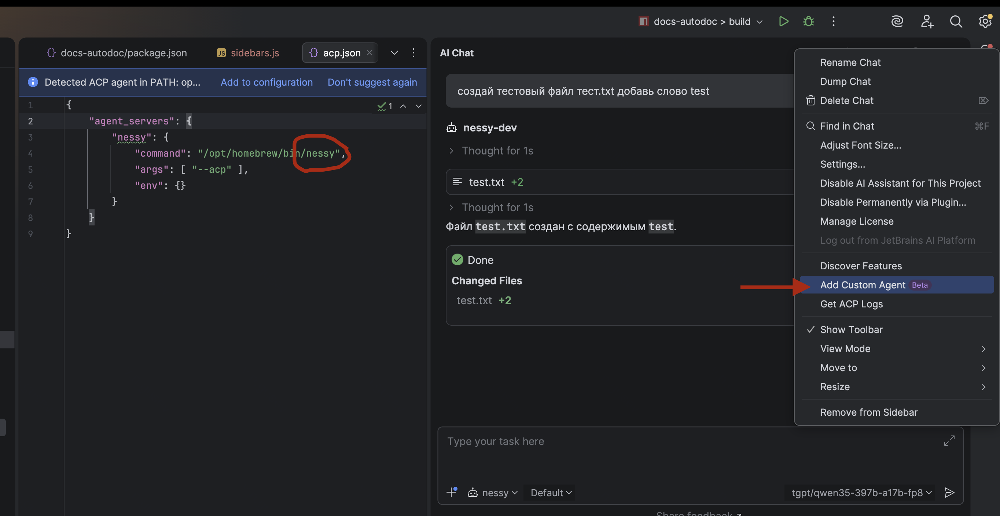

# JetBrains IDEs

> JetBrains IDEs предоставляют нативную поддержку ИИ-помощников для написания кода через Agent Client Protocol (ACP). Эта интеграция позволяет использовать Nessy CLI непосредственно в вашей JetBrains IDE с предложениями кода в реальном времени.

### Функции

- **Нативный агентный опыт**: Интегрированная панель ИИ-помощника в вашей JetBrains IDE
- **Agent Client Protocol**: Полная поддержка ACP, обеспечивающая расширенные взаимодействия с IDE
- **Управление символами**: Упоминание файлов через # для добавления их в контекст разговора
- **История разговоров**: Доступ к прошлым разговорам в IDE

### Требования

- JetBrains IDE с поддержкой ACP (IntelliJ IDEA, WebStorm, PyCharm и т.д.)
- Установлен Nessy CLI

### Установка

1. Установите Nessy CLI:

   ```bash
   npm install -g @nestor/nessy-cli
   ```

2. Откройте вашу JetBrains IDE и перейдите в окно инструмента AI Chat.

3. Нажмите меню с 3 точками в правом верхнем углу, выберите **Configure ACP Agent** и настройте Nessy CLI со следующими параметрами:

```json
{
  "agent_servers": {
    "nessy": {
      "command": "/path/to/nessy",
      "args": ["--acp"],
      "env": {}
    }
  }
}
```

4. Агент Nessy CLI теперь должен быть доступен в панели AI Assistant



## Устранение неполадок

### Агент не отображается

- Запустите `nessy --version` в терминале для проверки установки
- Убедитесь, что версия вашей JetBrains IDE поддерживает ACP
- Перезапустите вашу JetBrains IDE

### Nessy CLI не отвечает

- Убедитесь, что CLI работает, запустив `nessy` в терминале
- Приносите в канал [обсуждению в канале TiMe Nessy CLI Discussion](https://time.tbank.ru/tinkoff/channels/nessy-cli-discussion), если проблема сохраняется
