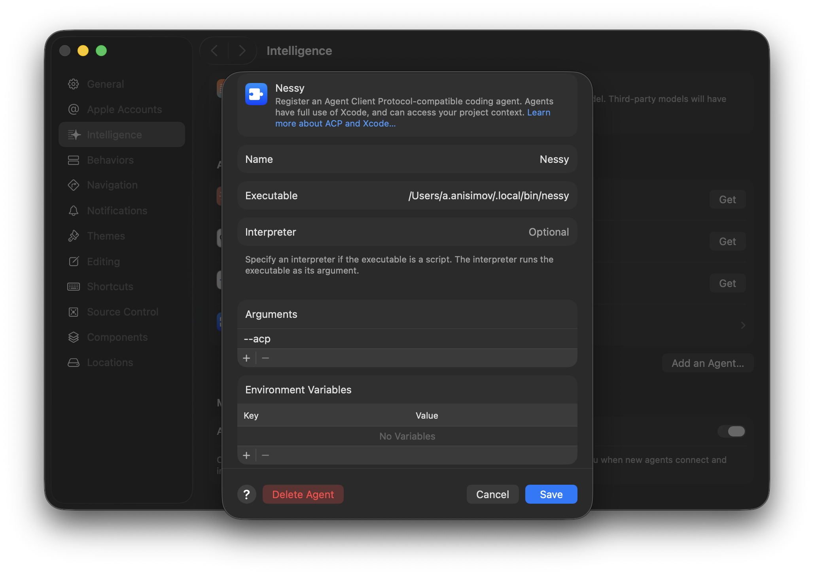
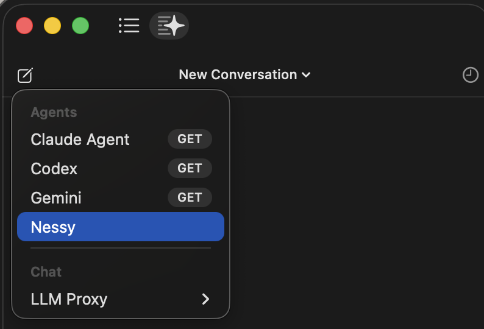

# Xcode

> Xcode [предоставляет](https://www.apple.com/newsroom/2026/02/xcode-26-point-3-unlocks-the-power-of-agentic-coding/) нативную поддержку ИИ-помощников для написания кода через Agent Client Protocol (ACP). Эта интеграция позволяет использовать Nessy CLI непосредственно в Xcode с предложениями кода в реальном времени.

### Функции

- **Нативный агентный опыт**: Интегрированный чат с агентом непосредственно в Xcode
- **Управление контекстом**: Упоминание файлов через @ для добавления их в контекст разговора
- **История разговоров**: Доступ к прошлым разговорам в IDE

### Требования

- Xcode 26.6 и новее

### Установка

1. Установите Nessy CLI если не устанавливали ранее:

   ```bash
   /usr/bin/curl -fsSL https://s3-msk.tinkoff.ru/nestor-companion/installation/v2/install-nessy.sh | bash
   ```

2. Авторизуйтесь в Nessy CLI, если не делали это ранее. Выполните команду и следуйте инструкциям:

   ```bash
   nessy
   ```

3. Откройте Xcode, перейдите в настройки: **Settings**(cmd+,) → **Intelligence** → **Agents** → **Add an Agent**

4. Заполните поля как на скриншоте ниже:



Описание полей:
| Параметр | Значение |
|---------------------------|-------------------------------------------------------------------------|
| **Name** | `Nessy`, но можете назвать как хотите |
| **Executable** | Путь до бинарника Nessy. Можно узнать с помощью команды `which nessy` |
| **Interpreter** | Оставляем пустым |
| **Arguments** | Обязательно добавляем аргумент `--acp`. Без него работать не будет |
| **Environment Variables** | Оставляем пустым |

5. Агент Nessy теперь должен быть доступен в панели Coding Assistant



## Устранение неполадок

### Агент не отвечает

- Убедитесь, что в конфигурации агента добавлен аргумент `--acp` (пункт 4).
- Убедитесь, что CLI работает, запустив `nessy` в терминале.
