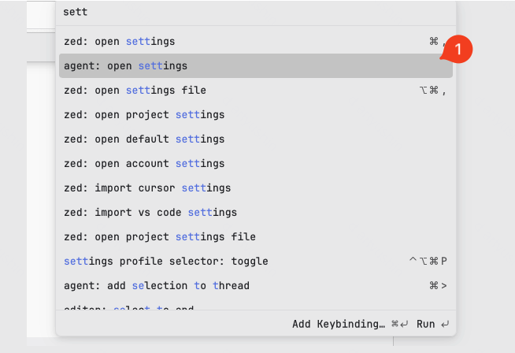
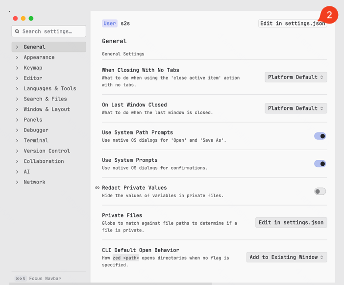
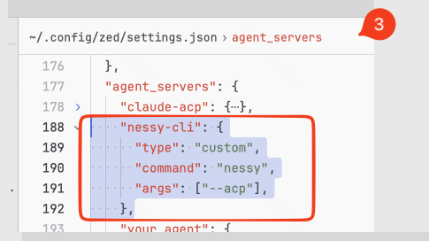

# Zed IDE

:::warning
В данный момент Zed находится в Gray List. Для использования этой IDE необходимо согласование с ИБ.
:::

Nessy-cli можно подключить в Zed IDE через ACP. Для этого необходимо:

### Возможности

- Нативная панель агента и полная поддержка ACP
- Добавление файлов в контекст через @упоминания
- История разговоров внутри Zed

### Требования

- Актуальная версия Zed
- Установленный Nessy CLI

### Ручная установка

- открыть `setting.json` с общими настройками Zed IDE
- [найти](https://zed.dev/docs/reference/all-settings) (или добавить) секцию `"agent_servers"`
- добавить туда конфигурацияю Nessy-cli:

```json
"nessy-cli": {
  "type": "custom",
  "command": "nessy",
  "args": ["--acp"],
},
```

В картинках

Шаг 1



Шаг 2



Шаг 3



## Устранение неполадок

### Агент не отображается

Проверьте `nessy --version`, корректность JSON и перезапустите Zed.

### Nessy CLI не отвечает

Проверьте сеть и запустите `nessy` отдельно в терминале.
