import Tabs from '@theme/Tabs';
import TabItem from '@theme/TabItem';

# Быстрый старт

> 👏 Добро пожаловать в Nessy CLI!

Это руководство по быстрому старту поможет вам начать использовать помощь ИИ в написании кода, анализа документов всего за несколько минут. К концу вы поймёте, как использовать Nessy CLI для распространённых задач.

:::tip

Инструкция создана совместно с командой Апгрейда в рамках подготовки [образовательных спринтов по ИИ для руководителей](https://my.tbank.ru/pages-my-tinkoff/tdc/sprint-ai) — чтобы сделать знакомство с инструментом максимально понятным и удобным для пользователей с нуля.

:::

## Руководство по быстрому старту

Для начала работы выполните следующие шаги:

- [**Шаг 0. Подготовка окружения (папка, терминал)**](#шаг-0-настройка-dp-и-spirit-cli) — создайте рабочую папку, откройте терминал. Убедитесь, что Visual Studio Code установлен через Центр программного обеспечения (Windows) или Self-Service (macOS).
- [**Шаг 1. Установка Nessy CLI**](#шаг-1-установка-nessy-cli) — установите Nessy CLI через Self-Service (macOS) или PowerShell (Windows).
- [**Шаг 2. Первый запуск и аутентификация**](#шаг-2-начните-свой-первый-сеанс) — запустите `nessy`, пройдите аутентификацию и установите дефолтный пакет MCP-плагинов.
- [**Шаг 3. Проверка подключения инструментов**](#шаг-3-проверить-как-подключились-инструменты) — убедитесь, что все MCP-серверы подключены и при необходимости пройдите аутентификацию.

---

## Перед началом

Убедитесь, что у вас есть:

<Tabs queryString="os">
<TabItem value="macos" label="macOS" default>

- Рабочая папка на компьютере для работы с проектом
  - Откройте терминал в папке: 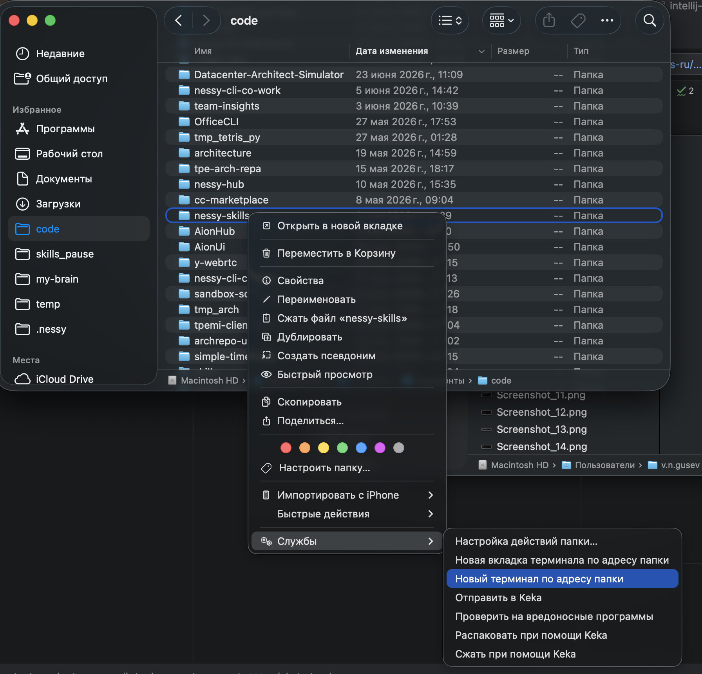
- Открытый **терминал**
  - 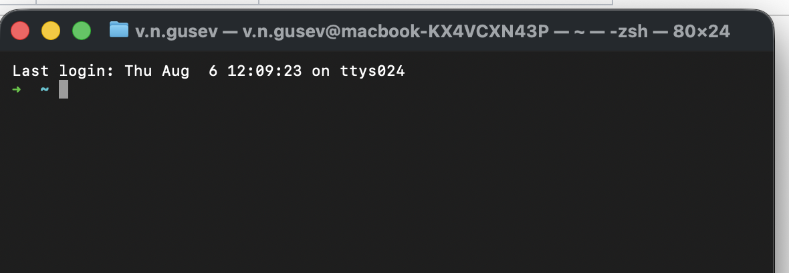

</TabItem>
<TabItem value="windows" label="Windows">

- Рабочая папка на компьютере для работы с проектом
  - Откройте терминал в папке: 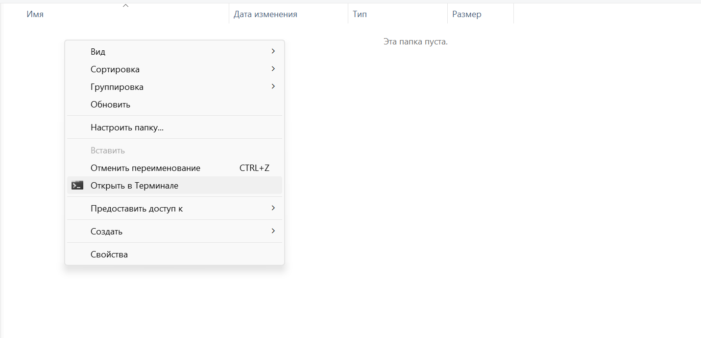
- Открытый **терминал** или командная строка
  - 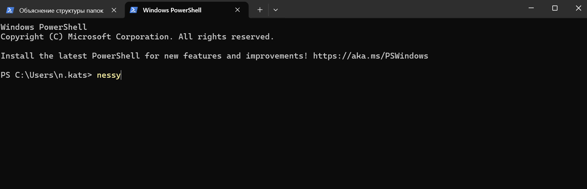

</TabItem>
<TabItem value="linux" label="Linux">

- Рабочая папка на компьютере для работы с проектом
  - Откройте терминал в папке
- Открытый **терминал**
  - 

</TabItem>
</Tabs>

## Шаг 1: Установка Nessy CLI

Для _установки/обновления_ Nessy CLI следуйте инструкции:

:::tip

Выберите свою операционную систему и перейдите в соответствующую вкладку.

:::

<Tabs queryString="os">
<TabItem value="macos" label="macOS" default>
:::note

Выберите один из доступных вариантов

- Self Service
- установка из терминала

:::

<Tabs queryString="install_mac">
<TabItem value="selfservice" label="Self Service" default>

1. Откройте на вашем компьютере приложение **Self Service**. Оно уже установлено.
2. Введите в поиске `Nessy CLI`.
3. Нажмите **Install** под названием **Nessy CLI**.

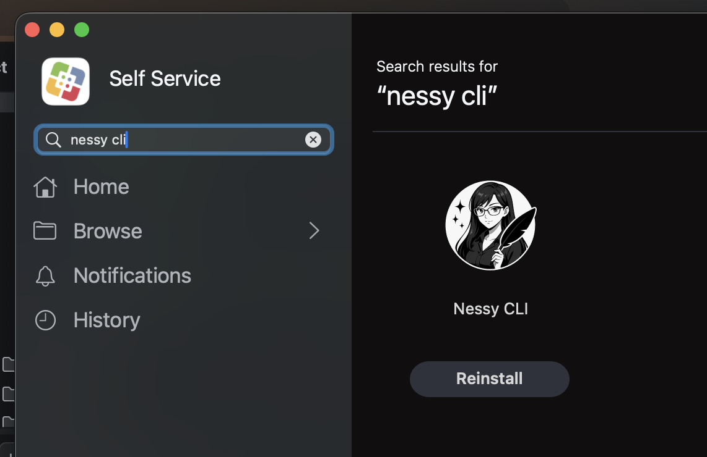

</TabItem>
<TabItem value="install_terminal_mac" label="установка из терминала">

```bash
/usr/bin/curl -fsSL https://s3-msk.tinkoff.ru/nestor-companion/installation/v2/install-nessy.sh | bash
```

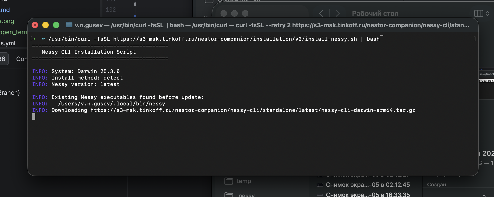

При успешной установке вы увидите предложение запустить Nessy CLI


</TabItem>
</Tabs>
</TabItem>
<TabItem value="windows" label="Windows">
**Windows PowerShell**

```powershell
irm https://s3-msk.tinkoff.ru/nestor-companion/installation/v2/install-nessy.ps1 | iex
```

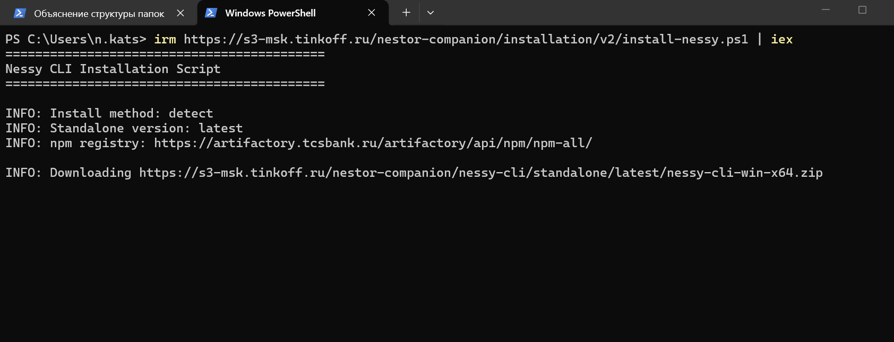

При успешной установке вы увидите предложение запустить Nessy CLI

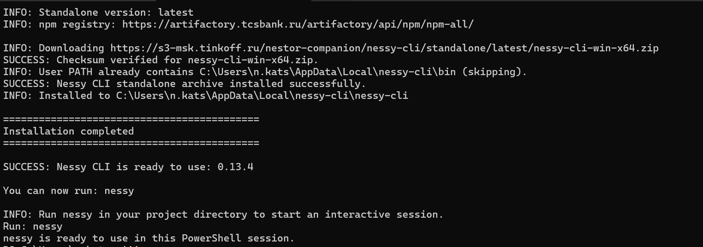

</TabItem>
<TabItem value="linux" label="Linux">
**Linux**

```bash
CURL=/usr/bin/curl
[ -x "$CURL" ] || CURL=/bin/curl
"$CURL" -fsSL https://s3-msk.tinkoff.ru/nestor-companion/installation/v2/install-nessy.sh | bash
```

</TabItem>
</Tabs>

:::note
Рекомендуется перезапустить терминал после установки, чтобы переменные окружения вступили в силу.
:::

## Шаг 2: Начните свой первый сеанс

Откройте терминал в любой директории и запустите Nessy CLI смотри [«Перед началом»](#перед-началом):

:::note

если у вас не получилось перейти к папке в терминале как показано в `перед началом`
вы можете в открытом терминале перейти к папке используя команду

```bash
cd /path/to/your/project
```

:::

:::tip

Первый запуск может занять некоторое время, зависит от скорости вашей сети

:::

```bash
# запуск nessy
nessy
```

При первом запуске агент предложит

- Войти в систему.

  Выберите **DP Authentication** и нажмите **Enter**. Так агент зайдет под вшей корпаративной учетной записи.

  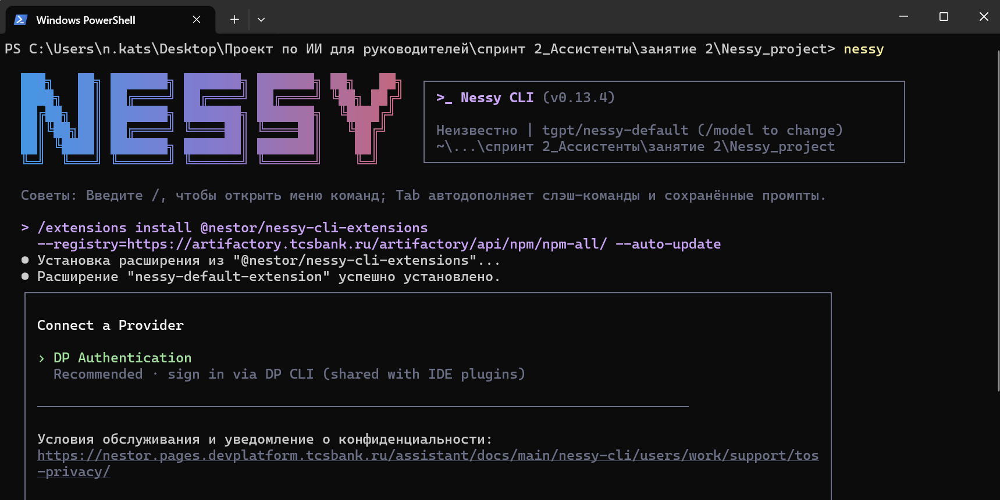
  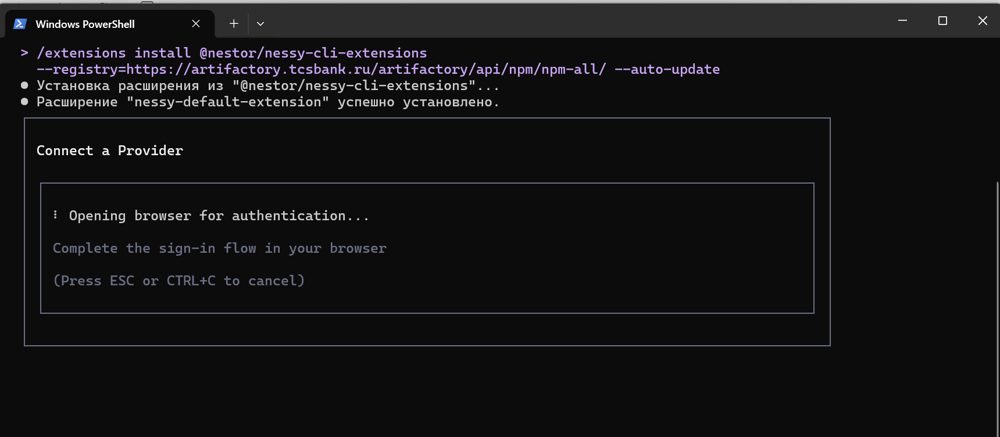

  :::note

  Откроется страница в браузере ее можно будет смело закрыть после сообщений Success Authentification

  :::

  :::tip

  Если вам нужно снова войти в систему или переключить учетные записи, используйте команду `/auth` внутри Nessy CLI.

  :::

- Установить дефолтный пакет предустановленных mcp
  По умолчанию при штатной установки пакет будет установлен автоматически и не требует
  дополнительных действий. После успешной установки и аутентификации для проверки введите в Nessy CLI `/extensions list`

  вы увидите установленный пакет `nessy-default-extension`

  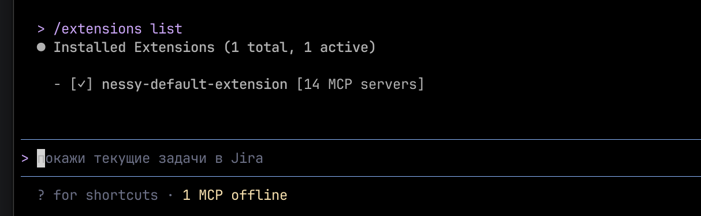

  :::note

  Если при первом запуске у вас спросит разрешение на установку то следуйте двум шагам:
  - Шаг 1 предлогает поставить, соглашаемся нажав **Enter**

  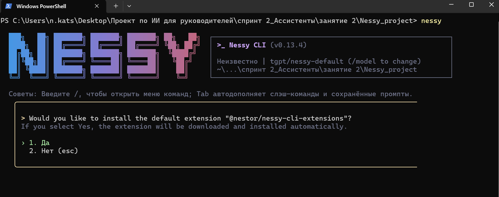
  - Шаг 2 показывает состав расширения, соглашаемся нажав **Enter**

  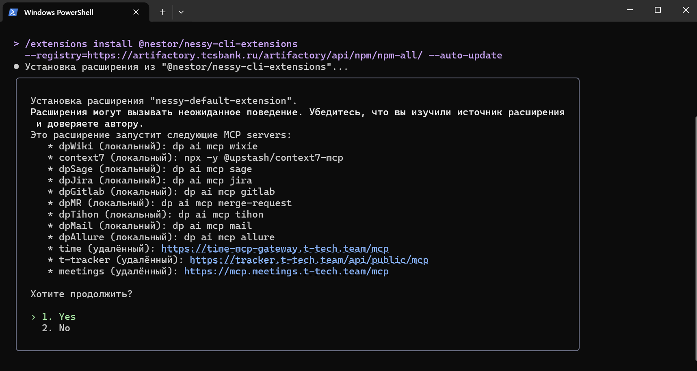

  :::

  :::note

  Если по каким-то причинам этот шаг пропущен то можно установить позже командой

  ```bash
  nessy extensions install @nestor/nessy-cli-extensions --registry=https://artifactory.tcsbank.ru/artifactory/api/npm/npm-all --auto-update
  ```

  :::

После всех действий вы при первом запуске вы увидите один из вариантов оба являются положительными

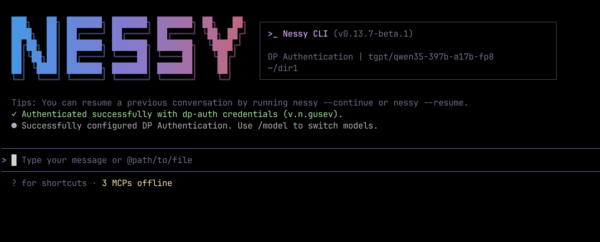

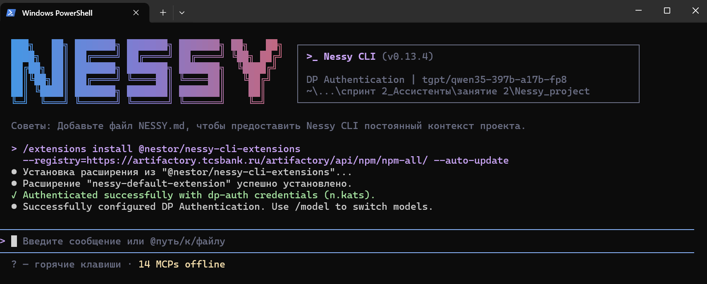

Вы увидите приветственное окно Nessy CLI с информацией о вашем сеансе, недавних разговорах и последних обновлениях. Введите `/help`, чтобы получить список доступных команд.

:::warning

Не пропускайте предупреждение о том что вы запустили Nessy CLI в пользовательской папке

Запускайте в заранее созданной проектной паке, см. [«Перед началом»](#перед-началом)

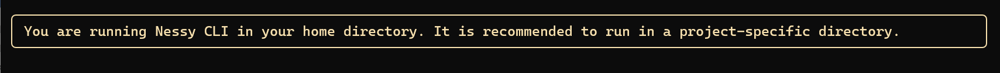

:::

## Шаг 3: Проверить как подключились инструменты

В Nessy CLI вводим команду `/mcp`

Откроется список доступных mcp и их состояние
все MCP кроме одного `context7` должны иметь состояние connected

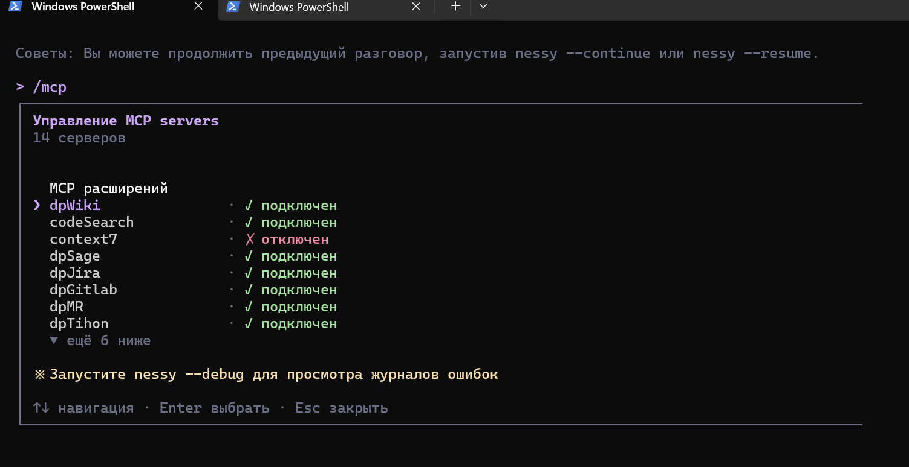

:::note

Если все disconnected/отключен подождите немного, статус должен смениться автоматически. В зависимости от скорости подключения сети могут медленно загружаться mcp инструменты.

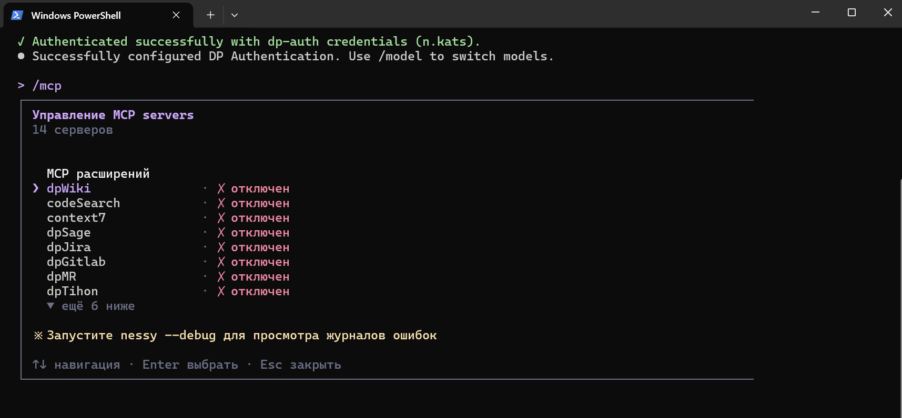

Если ожидание затянулось, передвигаяс стрелками на клавиатуре зайдите в каждый нажав _Enter_ вы попадете в диалог в котором есть пункт `reconnect/переподключить` нажмите _Enter_ если все удачно статус смениться на `подключен/connected`

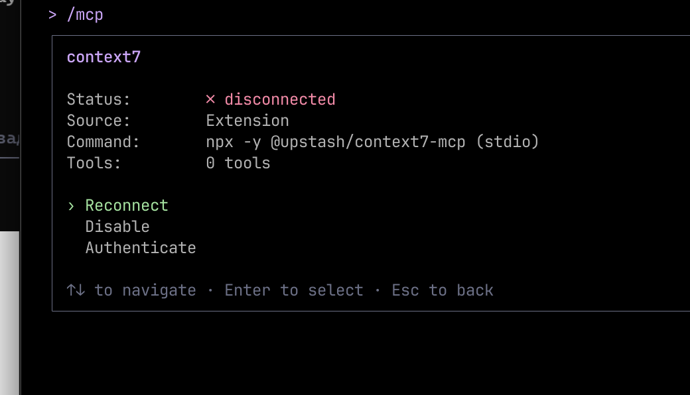

Eсли переподключение и перезагрузка Nessy CLI не помогает, обратитесь в поддержку в канал time [~nestor-ask](https://time.tbank.ru/tinkoff/channels/nestor-ask).

:::

Отдельно нужно остановить внимание на отдельных MCP в которые нужно зайти и выполнить аутентификацию

Если видите рядом с MCP `needs authentication` требуется зайти в этот MCP и нажать аутентификация

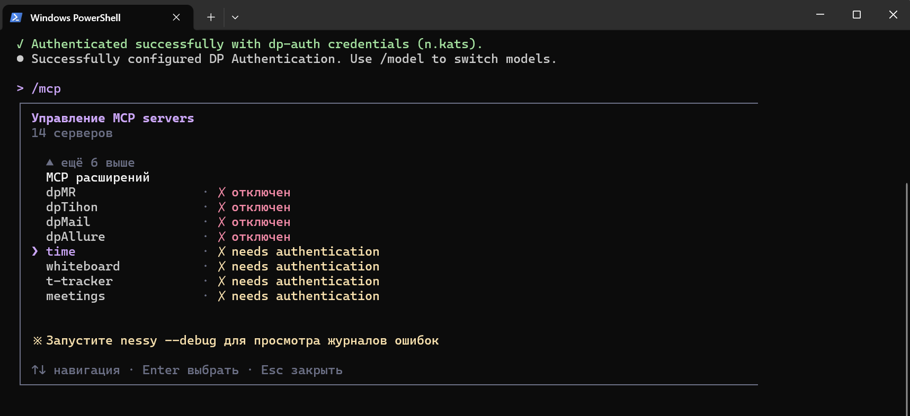

:::tip

Часть MCP будет скрыто так как нужно пролистать вниз
для перемещения курсора используйте стрелки на клавиатуре так как это терминал и мышь в нем не работает

:::

Заходим в каждый такой MCP **Enter**


Нажимаем аутентификация

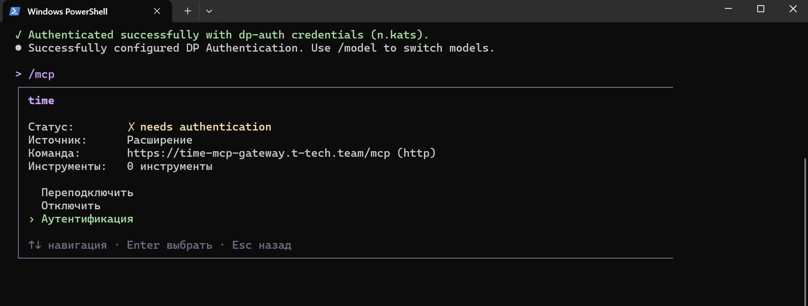

## Чат с Nessy CLI

### Задайте первый вопрос

Nessy CLI проанализирует ваши файлы и предоставит краткое изложение. Вы также можете задать более конкретные вопросы:

```
объясни структуру папок
```

Вы также можете спросить Nessy CLI о его собственных возможностях:

```
что может делать Nessy CLI?
```

:::note

Nessy CLI читает ваши файлы по мере необходимости — вам не нужно вручную добавлять контекст. Nessy CLI также имеет доступ к собственной документации и может отвечать на вопросы о своих функциях и возможностях.

:::

### Внесите первое изменение кода

Теперь давайте заставим Nessy CLI выполнить реальное программирование. Попробуйте простую задачу:

```
добавь функцию hello world в основной файл
```

Nessy CLI выполнит следующие действия:

1. Найдёт соответствующий файл
2. Покажет вам предложенные изменения
3. Запросит ваше одобрение
4. Внесёт изменение

:::note

Nessy CLI всегда запрашивает разрешение перед изменением файлов. Вы можете одобрять отдельные изменения или включить режим «Принять все» для сессии.

:::

### Используйте Git с Nessy CLI

Операции Git с Nessy CLI становятся разговорными:

```
какие файлы я изменил?
```

```
закоммить мои изменения с описательным сообщением
```

Вы также можете запрашивать более сложные операции Git:

```
создай новую ветку под названием feature/quickstart
```

```
покажи мне последние 5 коммитов
```

```
помоги мне решить конфликты слияния
```

### Исправление ошибки или добавление функции

Nessy CLI отлично справляется с отладкой и реализацией новых возможностей.

Опишите, что вы хотите, на естественном языке:

```
добавить проверку ввода в форму регистрации пользователя
```

Или исправьте существующие проблемы:

```
есть ошибка, из-за которой пользователи могут отправлять пустые формы — исправьте это
```

Nessy CLI выполнит следующее:

- Найдёт соответствующий код
- Поймёт контекст
- Реализует решение
- Запустит тесты, если они доступны

### Попробуйте другие распространенные рабочие процессы

Существует множество способов работы с Nessy CLI:

**Рефакторинг кода**

```
рефакторить модуль аутентификации для использования async/await вместо коллбэков
```

**Написание тестов**

```
написать модульные тесты для функций калькулятора
```

**Обновление документации**

```
обновить README с инструкциями по установке
```

**Ревью кода**

```
проверить мои изменения и предложить улучшения
```

:::tip

**Помните**: Nessy CLI — ваш ИИ-напарник по программированию или работе данными. Говорите с ним, как с полезным коллегой — описывайте, чего хотите достичь, и он поможет вам в этом.

:::

## Основные команды

Вот наиболее важные команды для ежедневного использования:

| Команда               | Что делает                                         | Пример                               |
| --------------------- | -------------------------------------------------- | ------------------------------------ |
| `nessy`               | запустить Nessy CLI                                | `nessy`                              |
| `/auth`               | Изменить метод аутентификации (в сессии)           | `/auth`                              |
| `/doctor`             | Проверить текущую аутентификацию и окружение       | `/doctor`                            |
| `/help`               | Отобразить справку по доступным командам           | `/help` или `/?`                     |
| `/compress`           | Заменить историю чата сводкой для экономии токенов | `/compress`                          |
| `/clear`              | Очистить содержимое экрана терминала               | `/clear` (горячая клавиша: `Ctrl+L`) |
| `/theme`              | Изменить визуальную тему Nessy CLI                 | `/theme`                             |
| `/language`           | Просмотреть или изменить настройки языка           | `/language`                          |
| → `ui [language]`     | Установить язык интерфейса                         | `/language ui zh-CN`                 |
| → `output [language]` | Установить язык вывода LLM                         | `/language output Chinese`           |
| `/quit`               | Немедленно выйти из Nessy CLI                      | `/quit` или `/exit`                  |

:::tip

**Быстрый выход**: Вы также можете ввести `exit` или `quit` (без префикса `/`) для немедленного выхода из Nessy CLI.

:::

Смотрите [справочник по CLI](./work/features/commands.md) для полного списка команд.

## Советы для начинающих

**Будьте конкретны в своих запросах**

- Вместо: «исправь баг»
- Попробуйте: «исправь баг при входе, из-за которого пользователи видят пустой экран после ввода неправильных учетных данных»

**Используйте пошаговые инструкции**

- Разбейте сложные задачи на шаги:

```
1. создай новую таблицу базы данных для профилей пользователей
2. создай конечную точку API для получения и обновления профилей пользователей
3. создай веб-страницу, которая позволяет пользователям просматривать и редактировать свою информацию
```

**Позвольте Nessy CLI сначала исследовать**

- Перед внесением изменений позвольте Nessy CLI понять ваш код:

```
проанализируй схему базы данных
```

```
создай панель мониторинга, показывающую продукты, которые чаще всего возвращаются нашими британскими клиентами
```

**Экономьте время с помощью горячих клавиш**

- Нажмите `?` для просмотра всех доступных горячих клавиш
- Используйте Tab для автодополнения команд
- Нажмите ↑ для истории команд
- Введите `/` для просмотра всех slash-команд

## Получение помощи

- **В Nessy CLI**: Введите `/help` или спросите «как я могу...»
- **Документация**: Вы здесь! Просматривайте другие руководства
- **Сообщество**: Присоединяйтесь к нашему [обсуждению в канале TiMe Nessy CLI Discussion](https://time.tbank.ru/tinkoff/channels/nessy-cli-discussion) для советов, поддержки и интересных оповещений.
- **Помощь**: Если у вас что-то не получилось обратитесь в канал [~nestor-ask](https://time.tbank.ru/tinkoff/channels/nestor-ask).
