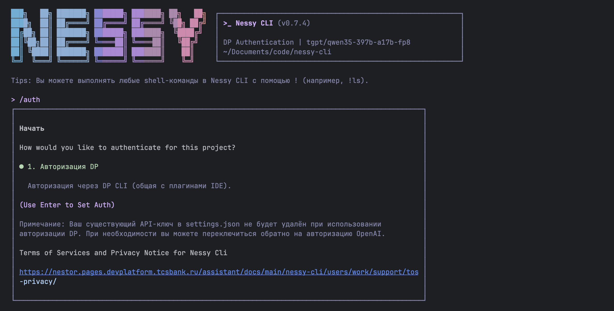
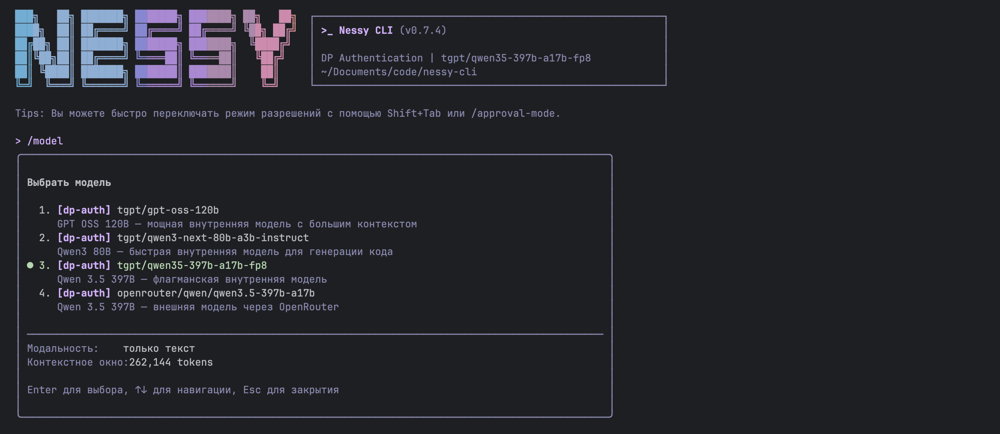

# Аутентификация

Nessy CLI использует аутентификацию через корпоративную учётную запись (DP Auth).

## 👍 DP Authentification

- **Как это работает**: при первом запуске Nessy CLI открывает страницу входа в браузере. После завершения учётные данные кэшируются локально, поэтому вам обычно не нужно входить снова.
- **Преимущества**: нет управления API-ключами, автоматическое обновление учётных данных.

Запустите CLI и следуйте потоку браузера:

```bash
nessy
```



:::note
В неинтерактивных или headless окружениях (например, CI, SSH, контейнеры), вы можете столкнуться с трудностями при прохождении потока входа DP браузера.
В этих случаях используйте переменные окружения для автоматизации аутентификации.
:::

## Модели

Модели для DP Auth доступны автоматически без дополнительной настройки.


