# Темы

Nessy CLI поддерживает множество тем для настройки цветовой схемы и внешнего вида. Вы можете изменить тему в соответствии с вашими предпочтениями через команду `/theme` или настройку конфигурации `"theme":`.

## Доступные темы

Nessy CLI поставляется с набором предопределённых тем, которые вы можете выбрать с помощью команды `/theme` в CLI:

- **Тёмные темы:**
  - `ANSI`
  - `Atom One`
  - `Ayu`
  - `Default`
  - `Dracula`
  - `GitHub`
- **Светлые темы:**
  - `ANSI Light`
  - `Ayu Light`
  - `Default Light`
  - `GitHub Light`
  - `Google Code`
  - `Xcode`

### Изменение тем

1.  Введите `/theme` в Nessy CLI.
2.  Появится диалог или подсказка выбора, перечисляющая доступные темы.
3.  Используя клавиши со стрелками, выберите тему. Некоторые интерфейсы могут предлагать предварительный просмотр или подсветку при выборе.
4.  Подтвердите ваш выбор для применения темы.

**Примечание:** Если тема определена в вашем файле `settings.json` (либо по имени, либо по пути к файлу), вы должны удалить настройку `"theme"` из файла перед тем, как вы сможете изменить тему с помощью команды `/theme`.

### Сохранение тем

Выбранные темы сохраняются в [конфигурации](../configuration/settings.md) Nessy CLI, поэтому ваше предпочтение запоминается между сессиями.

---

## Пользовательские цветовые темы

Nessy CLI позволяет вам создавать ваши собственные цветовые темы, указывая их в вашем файле `settings.json`. Это даёт вам полный контроль над цветовой палитрой, используемой в CLI.

### Как определить пользовательскую тему

Добавьте блок `customThemes` в ваш пользовательский, проектный или системный файл `settings.json`. Каждая пользовательская тема определяется как объект с уникальным именем и набором цветовых ключей. Например:

```json
{
  "ui": {
    "customThemes": {
      "MyCustomTheme": {
        "name": "MyCustomTheme",
        "type": "custom",
        "Background": "#181818",
        ...
      }
    }
  }
}
```

**Цветовые ключи:**

- `Background`
- `Foreground`
- `LightBlue`
- `AccentBlue`
- `AccentPurple`
- `AccentCyan`
- `AccentGreen`
- `AccentYellow`
- `AccentRed`
- `Comment`
- `Gray`
- `DiffAdded` (опционально, для добавленных строк в diff)
- `DiffRemoved` (опционально, для удалённых строк в diff)
- `DiffModified` (опционально, для модифицированных строк в diff)

**Обязательные свойства:**

- `name` (должно совпадать с ключом в объекте `customThemes` и быть строкой)
- `type` (должно быть строкой `"custom"`)
- `Background`
- `Foreground`
- `LightBlue`
- `AccentBlue`
- `AccentPurple`
- `AccentCyan`
- `AccentGreen`
- `AccentYellow`
- `AccentRed`
- `Comment`
- `Gray`

Вы можете использовать либо hex-коды (например, `#FF0000`), **либо** стандартные имена цветов CSS (например, `coral`, `teal`, `blue`) для любого цветового значения. Смотрите [имена цветов CSS](https://developer.mozilla.org/en-US/docs/Web/CSS/color_value#color_keywords) для полного списка поддерживаемых имён.

Вы можете определить несколько пользовательских тем, добавив больше записей в объект `customThemes`.

### Загрузка тем из файла

В дополнение к определению пользовательских тем в `settings.json`, вы также можете загружать тему напрямую из JSON файла, указав путь к файлу темы в вашем `settings.json`. Это полезно для распространения тем или хранения их отдельно от основной конфигурации.

Для загрузки темы из файла установите свойство `theme` в вашем `settings.json` в путь к вашему файлу темы:

```json
{
  "ui": {
    "theme": "/path/to/your/theme.json"
  }
}
```

Файл темы должен быть валидным JSON файлом, который следует той же структуре, что и пользовательская тема, определённая в `settings.json`.

**Пример `my-theme.json`:**

```json
{
  "name": "My File Theme",
  "type": "custom",
  "Background": "#282A36",
  "Foreground": "#F8F8F2",
  "LightBlue": "#82AAFF",
  "AccentBlue": "#61AFEF",
  "AccentPurple": "#BD93F9",
  "AccentCyan": "#8BE9FD",
  "AccentGreen": "#50FA7B",
  "AccentYellow": "#F1FA8C",
  "AccentRed": "#FF5555",
  "Comment": "#6272A4",
  "Gray": "#ABB2BF",
  "DiffAdded": "#A6E3A1",
  "DiffRemoved": "#F38BA8",
  "DiffModified": "#89B4FA",
  "GradientColors": ["#4796E4", "#847ACE", "#C3677F"]
}
```

**Примечание по безопасности:** Для вашей безопасности Gemini CLI загружает только файлы тем, которые находятся в пределах вашей домашней директории. Если вы попытаетесь загрузить тему извне вашей домашней директории, будет отображено предупреждение, и тема не будет загружена. Это предотвращает загрузку потенциально вредоносных файлов тем из ненадёжных источников.

### Пример пользовательской темы


### Использование вашей пользовательской темы

- Выберите вашу пользовательскую тему используя команду `/theme` в Nessy CLI. Ваша пользовательская тема появится в диалоге выбора темы.
- Или установите её как тему по умолчанию, добавив `"theme": "MyCustomTheme"` в объект `ui` в вашем `settings.json`.
- Пользовательские темы могут быть установлены на уровне пользователя, проекта или системы и следуют той же [очередности конфигурации](../configuration/settings.md), что и другие настройки.

## Предпросмотр тем

| Тёмная тема  |      Предпросмотр       | Светлая тема  |       Предпросмотр       |
| :----------: | :---------------------: | :-----------: | :----------------------: |
|     ANSI     |  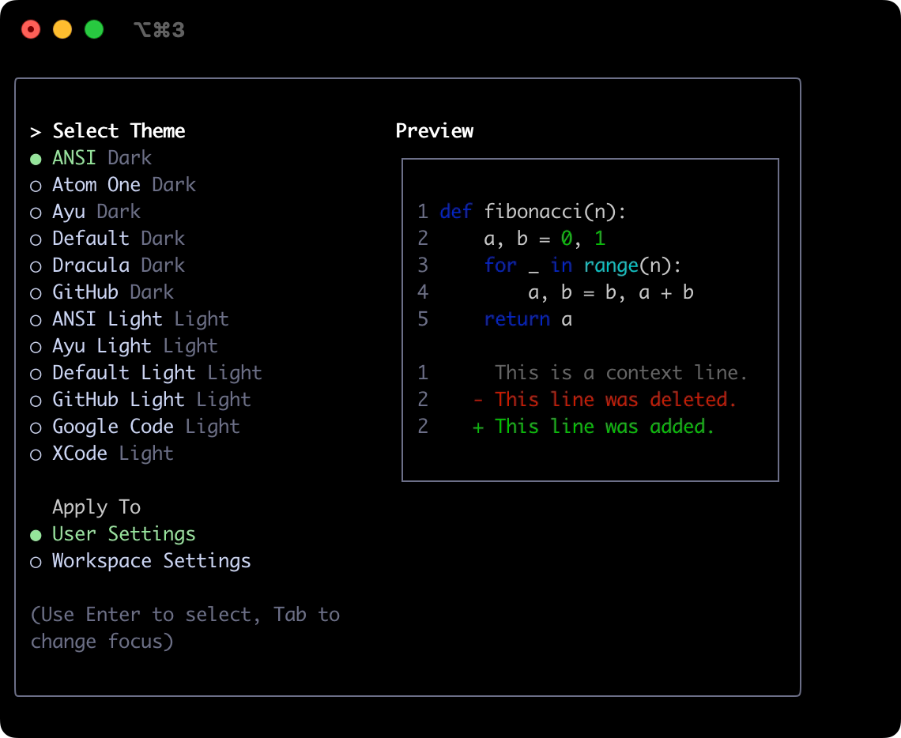   |  ANSI Light   |  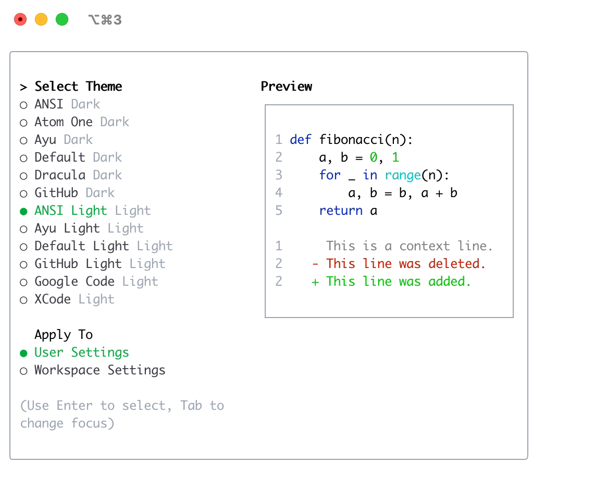   |
| Atom OneDark | 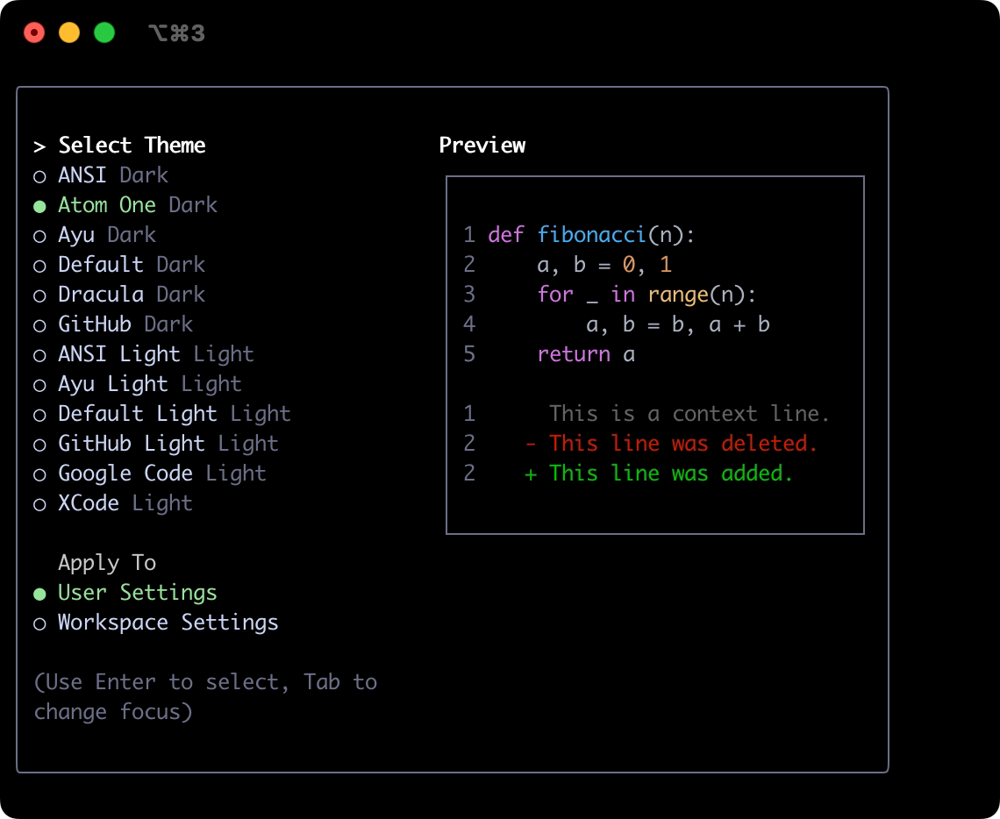 |   Ayu Light   |   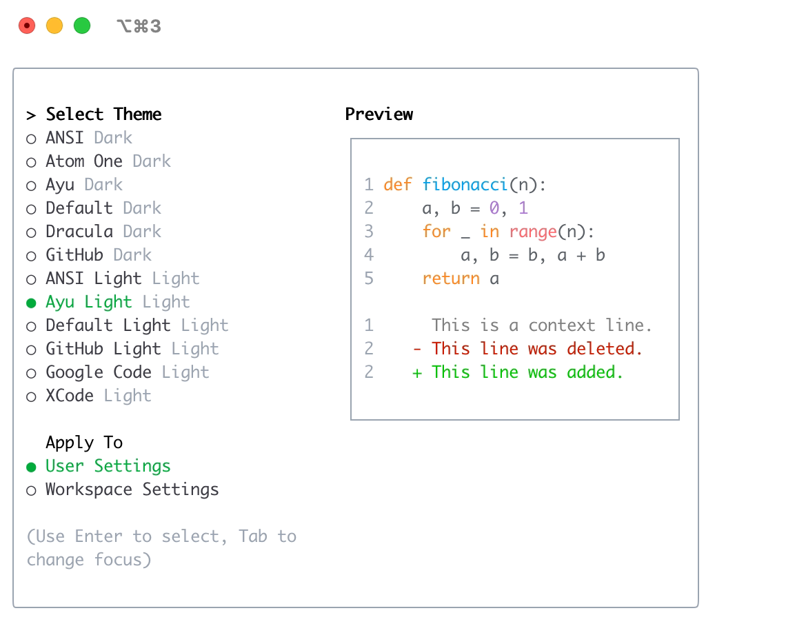   |
|     Ayu      |     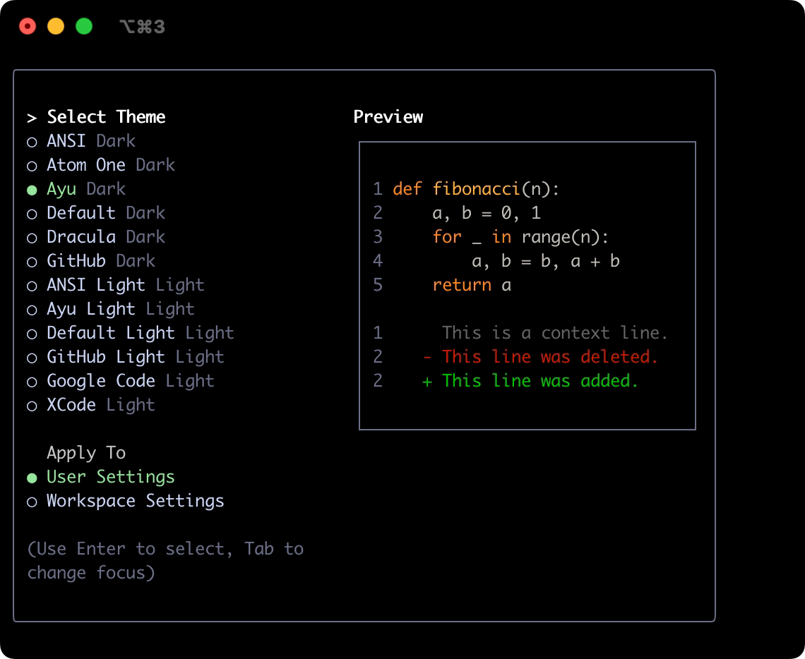      | Default Light | 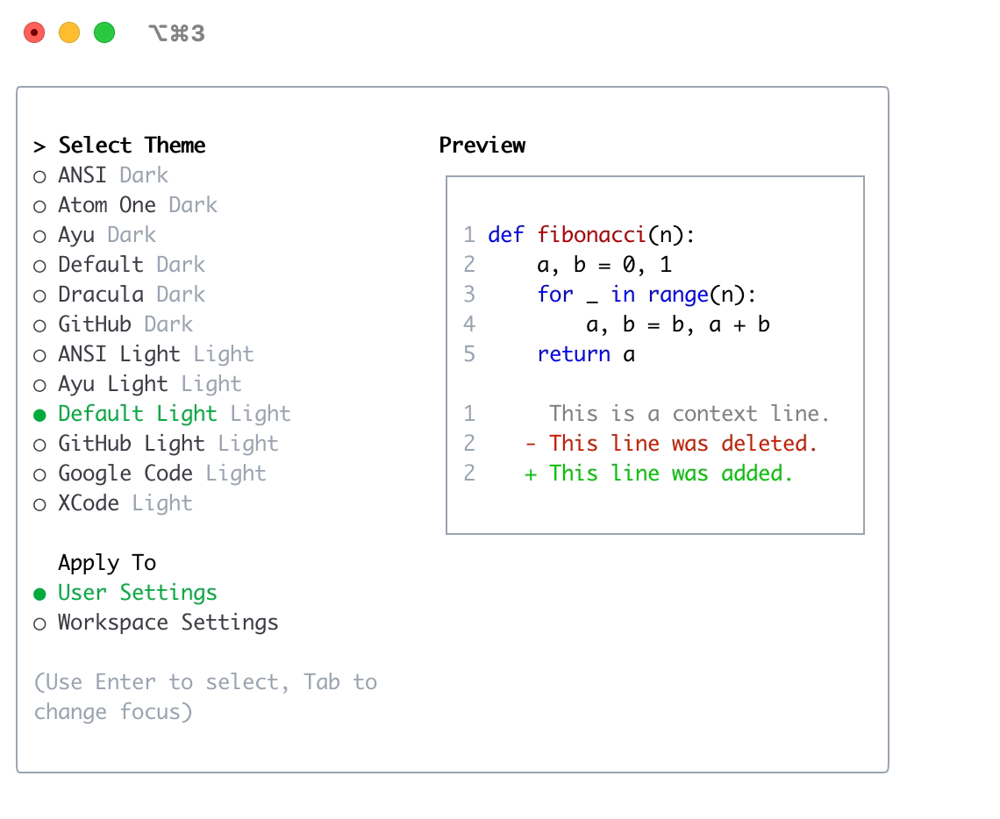 |
|   Default    |   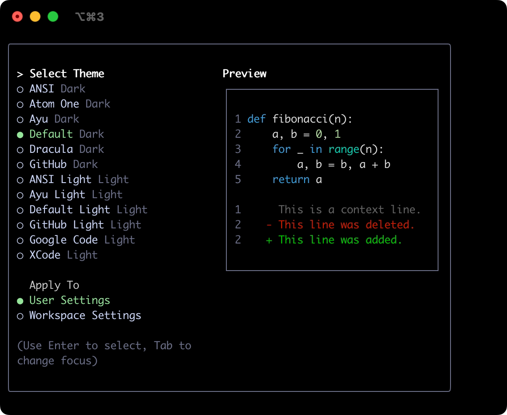    | GitHub Light  | 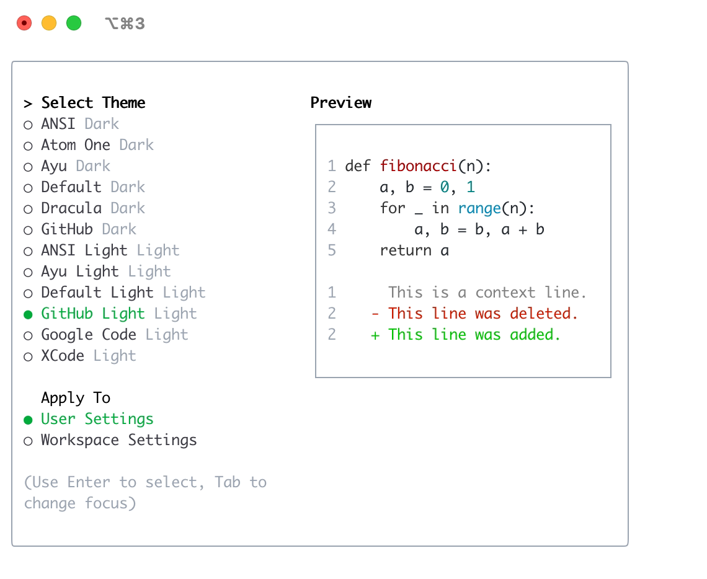  |
|   Dracula    |   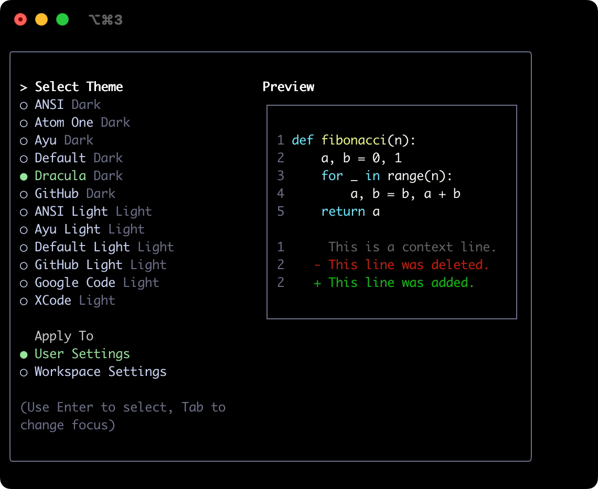    |  Google Code  |  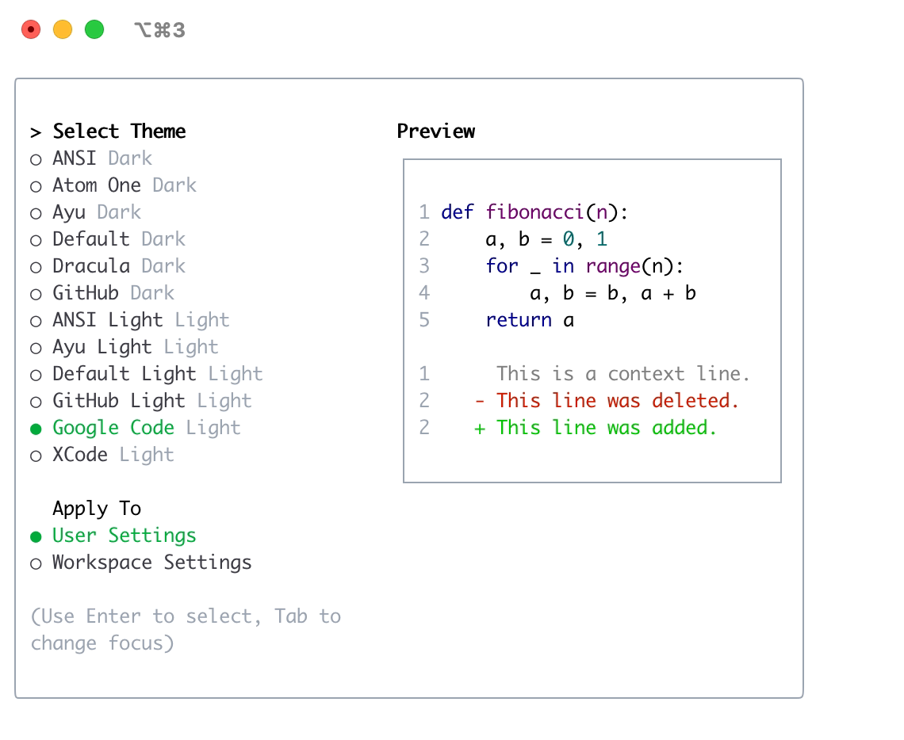  |
|    GitHub    |    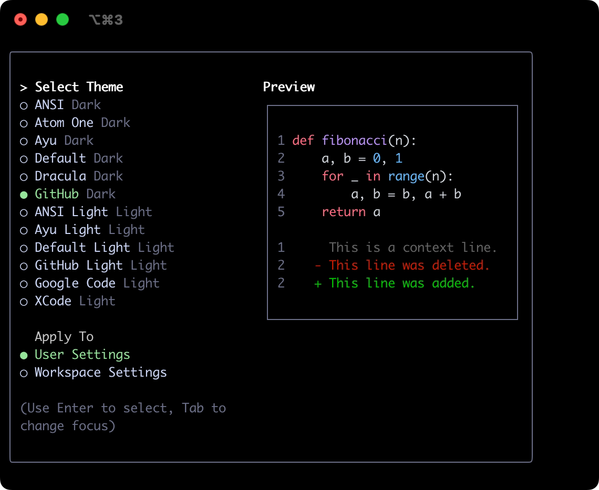    |     Xcode     |     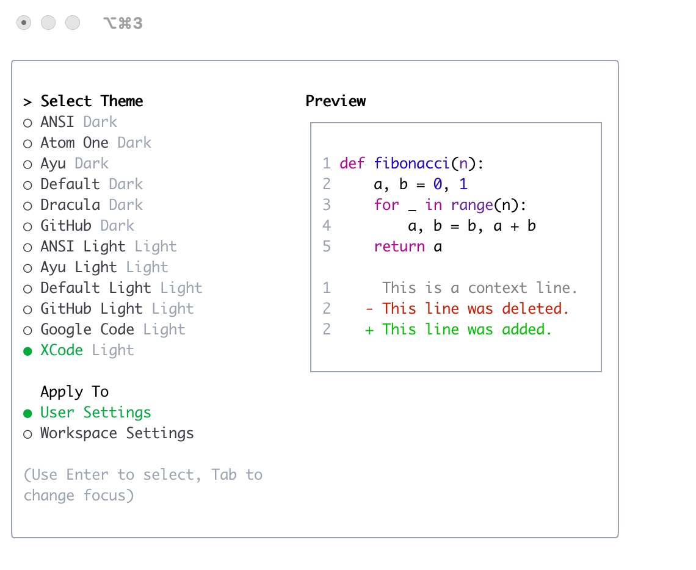     |
