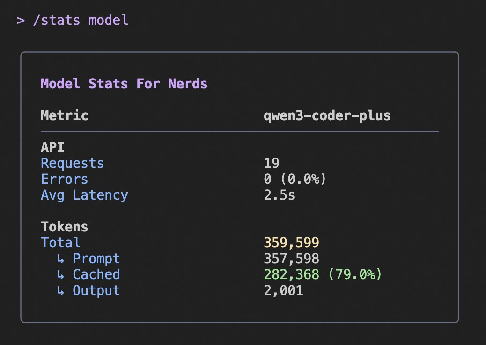

# Кэширование токенов и оптимизация стоимости

Nessy CLI автоматически оптимизирует стоимость API через кэширование токенов при использовании аутентификации по API-ключу. Эта функция хранит часто используемый контент, такой как системные инструкции и история разговора, для уменьшения количества токенов, обрабатываемых в последующих запросах.

## Как это вам помогает

- **Снижение стоимости**: Меньше токенов означает меньшие затраты на API
- **Более быстрые ответы**: Кэшированный контент извлекается быстрее
- **Автоматическая оптимизация**: Не требуется конфигурация — работает за кулисами

## Кэширование токенов доступно для

- Пользователей API-ключей (API-ключ Nessy, OpenAI-совместимые провайдеры)

## Мониторинг вашей экономии

Используйте команду `/stats`, чтобы увидеть вашу экономию кэшированных токенов:

- Когда активно, отображение статистики показывает, сколько токенов было обслужено из кэша
- Вы увидите как абсолютное число, так и процент кэшированных токенов
- Пример: "10 500 (90,4%) входных токенов были обслужены из кэша, снижая стоимость."

Эта информация отображается только когда используются кэшированные токены, что происходит при аутентификации по API-ключу, но не при OAuth-аутентификации.

## Пример отображения статистики

Приведённое выше изображение показывает пример вывода команды `/stats`, выделяя информацию об экономии кэшированных токенов.
