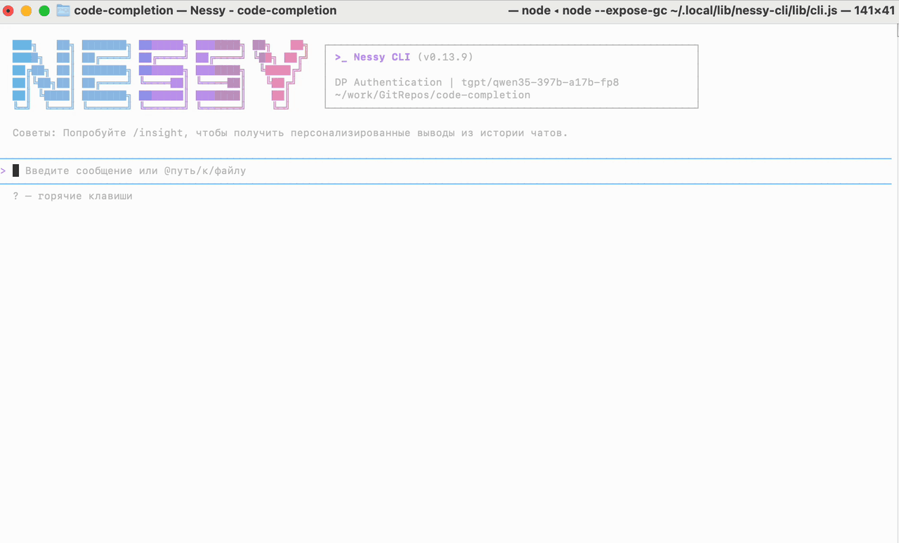
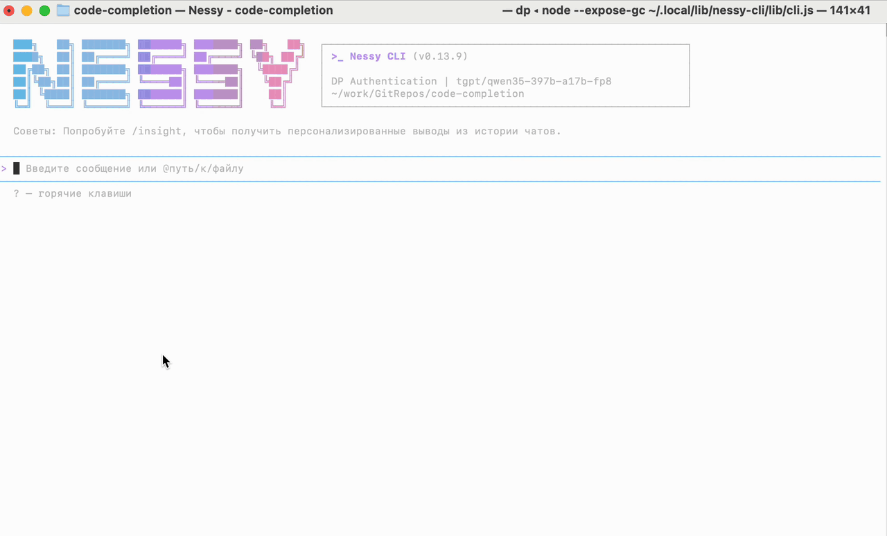
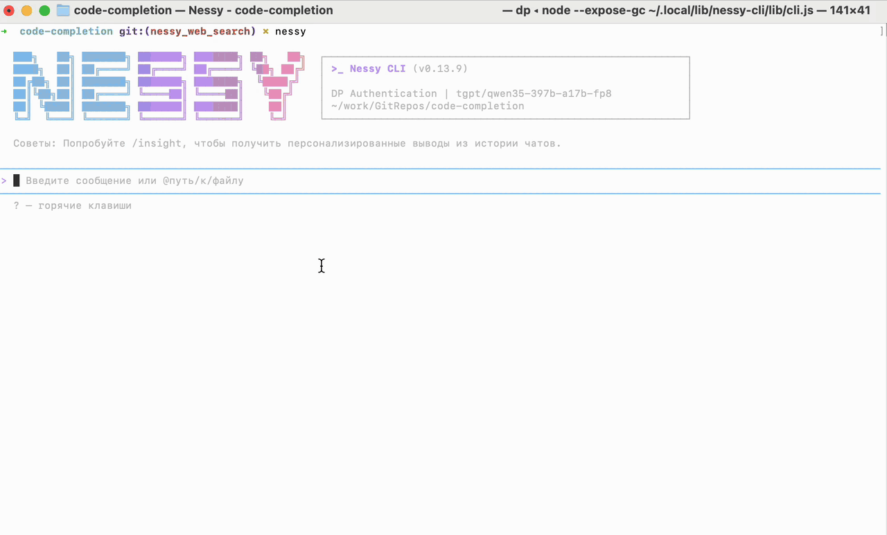

# Веб-поиск

Веб-поиск позволяет Nessy находить актуальную информацию в открытом интернете во время работы с проектом. Он полезен, когда ответа нет в репозитории или встроенных знаниях модели либо информация могла измениться.

Типичные сценарии:

- поиск актуальной документации внешней библиотеки или API;
- проверка release notes, руководств по миграции и недавних breaking changes;
- поиск публичных issue, примеров и сведений о совместимости;
- проверка текущих версий, статусов и поведения внешних сервисов;
- получение ответа со ссылками на публичные источники.

## Доступность

В стандартной поставке Nessy CLI (`nessy-default-extension`) сервер Nestor предоставляет веб-поиск как управляемый удалённый MCP-инструмент. Nestor проксирует запросы в Yandex Search, поэтому пользователю не нужно получать API-ключ поискового провайдера или добавлять ключ в `settings.json`.

Стандартный `web_search` отображается, если:

- управляемый MCP-сервер Nestor подключён;
- пользователь успешно авторизован.

Откройте диалог управления MCP командой `/mcp`. Сервер Nestor должен быть подключён, а в списке его инструментов должен присутствовать `web_search`.

## Авторизация

При первом подключении откройте диалог управления MCP командой `/mcp`. Напротив сервера Nestor будет указано, что он требует аутентификации. Откройте сервер и выберите пункт **Аутентификация**. Nessy откроет браузер для входа в систему. После успешного входа статус Nestor изменится на **✓ подключён**.

Если Nessy повторно запросит аутентификацию, выполните те же действия через `/mcp`.

## Как пользоваться веб-поиском

Задайте обычный вопрос. Nessy самостоятельно решает, нужен ли веб-поиск, и вызывает его в рамках задачи. Можно попросить выполнить поиск явно.

Примеры:

```text
Найди актуальное руководство по миграции на Go 1.25 и перечисли изменения, важные для этого проекта.
```

```text
Найди последнюю стабильную версию этой зависимости и проверь release notes на breaking changes.
```

```text
Найди официальную документацию по этой ошибке, объясни вероятную причину и приложи источники.
```

```text
Поищи этот stack trace в публичных issue и сравни предложенные решения с нашим кодом, не передавая внутренние детали.
```

### Примеры использования

Поиск актуального релиза Kubernetes и краткого обзора изменений:


Поиск последних релизов PostgreSQL и исправленных уязвимостей:



Использование внешней документации при анализе кода:



Поиск рекомендаций и первичных источников во время ревью:



Если URL нужной страницы уже известен, используйте [`web_fetch`](../../../developers/work/tools/web-fetch.md): он загружает конкретную страницу. `web_search` предназначен для поиска подходящих публичных страниц и ответа по результатам поиска.

## Источники

Веб-поиск возвращает ответ и ссылки на публичные страницы, использованные поисковым провайдером. Nessy передаёт модели и текст ответа, и источники. Когда важна проверяемость, явно попросите Nessy привести ссылки или сравнить источники.

Наличие ссылки не гарантирует правильность каждого утверждения в сгенерированном ответе. Для важных технических, юридических, связанных с безопасностью или эксплуатацией решений откройте первоисточник и проверьте информацию.

## Ограничения

- **Только открытый интернет:** веб-поиск не заменяет поиск по репозиторию, внутренней документации или корпоративным источникам.
- **Нет гарантии полноты:** поисковая выдача может пропустить релевантную страницу или отдать предпочтение одной трактовке.
- **Актуальность может различаться:** недавно опубликованная или обновлённая страница может ещё не попасть в индекс.
- **Ответ может содержать ошибки:** воспринимайте его как обобщение результатов поиска, а не как авторитетный источник.
- **Ограниченный размер ответа:** Nestor ограничивает результат для контроля задержки и расхода токенов. Длинные страницы или части выдачи могут быть сокращены либо пропущены.
- **Зависимость от сервисов:** доступность и задержка зависят от Nestor, поискового провайдера, сети, квот и rate limits.
- **Не предназначен для чтения произвольной страницы:** для известного URL используйте `web_fetch`.

## Безопасность данных

Поисковый запрос покидает локальную машину и обрабатывается Nestor и настроенным поисковым провайдером. Не передавайте в `web_search`:

- исходный код и внутренние детали реализации;
- внутренние URL, имена репозиториев и содержимое документов;
- токены, пароли, секреты и значения конфигурации;
- персональные данные;
- приватные логи, stack traces и сведения об инцидентах;
- системный промпт и историю диалога.

Оставляйте в запросе только минимальный публичный контекст. Например, ищите публичный код ошибки или название API библиотеки вместо отправки полного внутреннего лога.

## Устранение неполадок

### Инструмент `web_search` недоступен

Откройте `/mcp` и проверьте сервер Nestor:

- если требуется авторизация, запустите OAuth flow из карточки сервера;
- если сервер отключён, переподключите его или перезапустите Nessy.

### Авторизация открывается повторно

Убедитесь, что браузер может вернуться на настроенный локальный OAuth callback и Nessy может записывать данные в хранилище OAuth-токенов MCP. После удаления сохранённого токена браузерная авторизация запускается заново.

### В ответе нет полезного источника

Уточните запрос и явно попросите использовать официальные или первичные источники. Полнота зависит от данных, проиндексированных и возвращённых поисковым провайдером.

Подробнее о подключении и OAuth смотрите в разделе [MCP](./mcp.md). Серверная реализация описана в [технической документации управляемого Web Search Nestor](../../../developers/work/tools/nestor-web-search.md).
